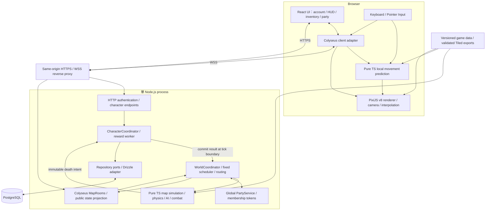

# 系統架構與實作契約

架構以 Task 0（2026-11-23）為基線，於 2026-11-25 補充商店交易與 PostgreSQL 契約檢查。規則見 [GAME_DESIGN](GAME_DESIGN.md)，產品驗收見 [PRD](PRD.md)，實作進度見 [ROADMAP](ROADMAP.md)，取捨見 [ADRs](decisions/001-pixijs-over-phaser.md)。

## 1. 架構總覽



Public room state、owner-only reliable messages、HTTP account session 為三條明確資料邊界。所有 gameplay authority 位於 server；client prediction 只改善本地 movement 手感。MVP-A 可用 local adapter 執行同一 simulation 與 command service，換成 memory repository；M3 先接通真實兩 client WebSocket，M7–M8 才達到完整持久化與 release candidate。

## 2. Stack 與 package boundaries

採 React、TypeScript、Vite、PixiJS v8、pure TS simulation、custom platformer physics、Tiled、Colyseus／WebSocket、Node.js、PostgreSQL、Drizzle、pnpm workspace、Vitest、ESLint、Prettier、GitHub Actions、Docker。沒有 Redis、Kubernetes、microservices 或 generic ECS。

以下是 **M0 起要建立的預定 tree**，Task 0 不建立這些 source directories：

```text
apps/
  client/src/                 # React UI / input / Pixi / prediction / network
  server/src/
    application/             # command handlers / coordinators / auth / rewards
    runtime/                 # MapRooms / scheduler / registry / PartyService
    adapters/                # HTTP / Colyseus integration / composition root
packages/
  domain/src/                # IDs / character & item models / immutable intents / ports
  game-data/src/             # balance / item & monster definitions / validation
  physics/src/               # collision / integration / spatial queries
  simulation/src/            # map model / movement / AI / combat / pure reward policies
  protocol/src/              # versioned message DTOs / runtime input validation
  network-colyseus/src/      # Schema / wire codec / framework adapters
  persistence/src/           # in-memory & Drizzle repositories / migrations
content/
  maps/                      # Tiled source / JSON exports / manifest
  assets/                    # original or licensed resources / license manifest
tools/                       # map validation / headless scenario & load harness
docs/
```

| Package／area | 可依賴 | 禁止／責任界線 |
| --- | --- | --- |
| `domain` | TypeScript 標準型別 | 無 framework、I/O 或 balance policy；提供 repository port 與 plain models |
| `game-data` | domain、physics | 版本化 definitions、Tiled 匯入與出生幾何驗證，不讀 DB、不依賴 UI |
| `physics` | domain | 純 math／geometry，無 DOM、wall clock 或 network |
| `simulation` | domain、game-data、physics | 不依賴 React／Pixi／Colyseus／Drizzle／Node I/O；無 database transaction |
| `protocol` | domain 的必要 wire-safe types | 不包含 DB entities 或 credentials；client input 必須 runtime validate |
| `network-colyseus` | domain、protocol、Colyseus | Schema 是投影；不可持有核心 combat／reward 規則 |
| `persistence` | domain、game-data 的 validation、Drizzle／PG | 實作 ports，不能依賴 apps、simulation runtime 或 renderer |
| `apps/server` | 上述 server 所需 packages | 唯一 authority composition root；管理 locks、sessions 與 side effects |
| `apps/client` | domain、game-data、physics、simulation、protocol、network adapter | 不 import persistence 或 server；shared pure policies 不代表 client 可決定結果 |

M2.4 的 [視覺資產管線](ASSETS.md) 在 Vite 建置端驗證本機圖集、引用及授權紀錄，瀏覽器取得只含渲染所需資料的 manifest。Pixi 依穩定 ID 延遲載入圖集，地圖切換時釋放前一張圖的資源。Sprite 尺寸與動畫只屬於 client presentation。

Repository ports 在 domain 的 application boundary 定義，例如 `CharacterRepository`、`RewardRepository`、`InventoryRepository`、`SessionRepository`；memory／PG adapter 共用契約。Domain reward intent 不使用 Colyseus Schema。初期不額外建立通用 event bus、CQRS framework、service container 或 ECS；使用明確函式、entity maps 與小型 services。

M0.2 建立 `domain`、`physics`、`simulation`、`protocol` 與 `network-colyseus` 的 workspace 公開入口。Domain 提供 plain models 和 repository ports，physics 提供世界座標與 AABB 契約，protocol 提供 `InputFrame` 與公開 room header 的 wire DTO，network adapter 將 map instance 與 tick 投影為 room header。M0.4 建立 [game-data 的 schema、fixture 與載入契約](GAME_DATA.md)。Colyseus Schema 與 room 接線由 M3.1 建立，repository 實作按 M5–M7 的任務交付。

## 3. Ownership matrix

| 狀態／行為                                | 唯一權威與生命週期                                                                                                          | Client 工作                                            |
| ----------------------------------------- | --------------------------------------------------------------------------------------------------------------------------- | ------------------------------------------------------ |
| Player movement／collision／HP／MP        | MapSimulation；session active 期間由所在 room 持有                                                                          | 同 physics 做本機 movement prediction，接受 correction |
| Monster AI／HP／spawn／death              | MapSimulation 單一 writer；room-local，不持久化                                                                             | 插值顯示，不執行權威 AI                                |
| Combat validation／damage contribution    | Server combat step；encounter-local ledger                                                                                  | 送 attack input，播放已確認結果                        |
| Party membership／leader／invite          | Process-global PartyService，獨立於 map                                                                                     | UI／command；map transition 不重建 party               |
| Eligibility／group pool／EXP／loot roll   | Server reward snapshot＋pure policy＋reward worker                                                                          | 只顯示 owner 的結果                                    |
| Level／AP／base attributes／currency      | M5.1 成長由 WorldCoordinator 持有。後續 economy 由 CharacterCoordinator 排序，MVP-B commit 後的 PostgreSQL 為 durable truth | 用 private snapshot 顯示，送意圖                       |
| Bag／equipment／pickup／consume／purchase | CharacterCoordinator＋InventoryRepository transaction                                                                       | 不能樂觀修改已確認 inventory 或餘額                    |
| Persistent character record               | PostgreSQL；只有 repository adapter 寫入                                                                                    | HTTP selection 或 owner-only snapshot                  |
| Camera／animation／touch／HUD             | Client                                                                                                                      | 不影響 collision 或 economy                            |

每角色有一個 process-wide CharacterActor，map room 只持有其當前 simulation body；不能在 room 轉移時複製 aggregate。Persistent version 與 runtime movement version 分開，不能用一份過期 character snapshot overwrite 新 wallet／inventory。

## 4. Simulation 與 fixed timestep

Simulation API 概念上為 `step(state, commands, dt, context) -> {state, events}`；state 是明確 Player／Monster／Map／Attack models，context 注入 tick、RNG 及讀取用 definitions。不得自行呼叫 `Date.now()`、`Math.random()`、DB 或 framework callback。Loot expiry／session／transaction deadline 使用 application wall clock，與 simulation tick 分離。

`step` 接受呼叫端注入的下一個 tick、RNG 與 ID source。M1.2 透過 context 注入 map 的角色控制器與當 tick 的 action 事件。`createFixedTickDriver` 接受 monotonic clock（毫秒）與同步 tick callback，固定傳入 `dt = 1 / 30` 秒。每次 `advance()` 回報已執行步數與尚未執行的完整 ticks，保留積欠時間供後續呼叫補跑。

Server 以單一 fixed scheduler 每 1/30 秒推進所有 rooms，rooms 按 stable ID 排序；accumulator 使用 monotonic clock。單次 callback 最多補5 ticks；落後時不放大 dt、不跳過 collision 直接快轉；記錄 lag 並暫停新 admission，持續超載則降容量或 drain。不能同時使用 Colyseus fixed loop 與另一個 accumulator 造成雙重 step；M0.1 選定 adapter API，M3.1 驗證「每 tick 一次」。

每個 world tick 順序：

1. 套用已提交的 command results、session／transfer 狀態；PartyService 處理先前收到的 membership commands。
2. 各 map consume 有效 input，進行 player physics／action windup。
3. Monster target selection／movement／action windup。
4. Player active attacks 按 `(acceptedTick, characterId, inputSeq)` 更新 HP 並記錄 EffectiveDamage。首次 HP=0 同步建立 death claim 與 reward snapshot，立即停止該怪物戰鬥。
5. 依 monster ID 結算仍合格的 monster active attacks，每次重新驗證角色、生命、距離、遮擋與保護，透過既有生命週期進入 Hurt 或 Death。
6. 產生 public projection 及本人 checkpoint。後續里程碑接入 private deltas、visual events 與 reward intents。

Death snapshot 當下符合條件者之後同 tick 被 monster 打死，仍保留該次 reward；這是先 player hits 再 monster hits 的既定規則。Party changes 不插入 tick 中間，避免 rooms 之間讀到半更新 roster。

Client 以同樣30Hz跑 local physics，render 以 `requestAnimationFrame` 自由更新。State 量化與 collision epsilon 初值1/1024 world unit；重播 fixtures 比較 discrete states 與可接受誤差。沒有 full-world lockstep 或跨 client deterministic combat requirement。

### 4.1 M1.1 平台碰撞契約

`@viesma/physics` 的 `createPhysicsStepper` 預先驗證、複製並排序靜態 AABB，回傳可接入 `createFixedTickDriver` 的純單步函式。Physics 與 simulation 共用同一個 `fixedDeltaSeconds`。呼叫端傳入帶符號的水平速度與單 tick 跳躍請求，接收新 AABB、速度、`grounded` 與 `inVoid`。

- AABB 的 `origin` 是左上角，+x 向右、+y 向下。寬高以 world units 表示，速度以 units/s 表示。輸入的 AABB 及 void 深度採 1/1024 unit 格線，寬高至少一格。每軸目標座標先捨入到最近一格，正好半格時往正座標方向取整。座標與一次步進後的 AABB 邊緣皆須在 ±1,048,576 units 內，速度絕對值上限為 1,048,576 units/s。
- 每 tick 先採用水平速度，並於起點有支撐且未往上移動時接受跳躍速度，再加重力並套用下降終端速度。先 X 後 Y，垂直掃掠用解算後的 X。兩軸各找路徑上最近的阻擋面，可跨越任意數量的格線；撞擊只將該軸速度歸零。掃掠的路徑是水平再垂直兩段，斜向角落依此順序解算。
- 垂直於掃掠軸的投影須有正交疊，剛好碰到邊緣或角點可通過。格線的一格是最小有效交疊，接觸面使用格線上的精確座標。Solid 四面皆阻擋，one-way 僅在下落且 tick 起點腳底位於平台頂面或更高時阻擋。踩在平台上時腳底接觸頂面，且水平投影仍須交疊。走出邊緣當 tick 失去支撐；有起始支撐的跳躍仍可於同 tick 離開邊緣。
- 世界左、右與上方邊界為阻擋面；底部保持開放。腳底到達 `bounds` 底緣加 void 深度時回傳 `inVoid`。Simulation 在跨越當 tick 結算墜落死亡。起點已穿入 solid 或超出世界左、右、上邊界時拒絕步進，初始位置須由呼叫端提供。
- 每個 body 每 tick 最多進行數次線性 collider 掃描。碰撞結果以最近阻擋面決定，幾何順序固定，同面接觸不依賴原始陣列順序。支援的地形為符合格線精度的靜態矩形與水平單向平台。

### 4.2 M1.2 角色與指令契約

- `createPlayerController(world, balance)` 以 map 靜態碰撞幾何與版控平衡資料建立控制器。`createPlayer(characterId, position, grounded, facing?)` 接受 authority 提供的 spawn 位置與支撐狀態，預設朝右。`SimulationPlayer` 保存左上角 `position`、物理速度與接觸旗標、movement intent、facing、locomotion 與 action。`getPlayerPresentationState` 依 [GAME_DESIGN §2.1](GAME_DESIGN.md#21-狀態機) 投影七種狀態，Attack 的朝向取自 `action.facing`。
- `step` 接受 `{ kind: 'input', characterId, lifeStartedTick, seq, moveX, jumpPressed }`。`lifeStartedTick` 標記角色的當前生命，初始為 0，每次重生換成重生 tick。`seq` 是生命內的非負安全整數，`moveX` 為 -1／0／1，`jumpPressed` 只代表該幀新按下。`normalizeMovementInput` 將邏輯按鍵轉成後兩個欄位，左右同按為中立，跳躍只在由放開轉為按下時產生 edge。
- Simulation 檢查指令的欄位、目標與序列。指令若包含額外欄位、格式錯誤、角色未知或 `seq` 小於或等於該角色已處理的序列，整筆忽略。每角色每 tick 最多採用一幀。同批送達多幀時採用最高有效新序列，該序列的相同重複幀視為一幀，內容衝突時該角色整個 tick 沿用無新輸入規則。輸入缺席時僅保留水平意圖，連續第 6 tick 起回到中立。Edge 每幀只檢查一次。角色以 `characterId` 字串順序更新。
- `context.playerActionEvents` 為 authority 提供的 `attackStarted`、`attackEnded` 表現 fixture。事件按角色與種類合併，並須屬於當前生命。Attack 結束訊號先處理，無有效 action 時才可接受開始訊號。觸發 Attack 時鎖定當 tick 的 facing，空中仍持續物理。有效受傷會取消 Attack 並進入 6 ticks Hurt，期間丟棄待跳與新 jump edge。
- 每個進行移動的角色每 tick 只呼叫一次 physics。Coyote jump 以控制器已驗證的一次性 `allowCoyoteJump` 授權，physics 負責 impulse、gravity 與碰撞。房間／連線 epoch、身份綁定、佇列和傳輸驗證由 server adapter 處理，transport DTO 沿用 §5.1。

### 4.3 M1.5 HP／MP 與重生契約

- `SimulationPlayer.vitals` 由 simulation 持有。初始值來自 [Game Data](GAME_DATA.md) 的 Beginner 平衡，HP 50／50、MP 30／30。數值保持在 0 至各自上限。測試效果可扣除或恢復 MP，正式技能費用與物品使用依後續任務驗證。
- `context.playerVitalEffects` 是本地 authority 的測試入口，接受當 tick、當前生命的 `damage`、`heal`、`spendMp`、`restoreMp`。數量須為正的安全整數。`order` 是 authority 在該 tick 為同角色指派的非負安全整數，依序套用。相同角色、生命、tick、order 的同內容只處理一次，內容衝突時捨棄該位置。其他 tick 或生命的效果與未知角色一律忽略。
- Fixture 的效果先於移動與動作。有效傷害立即鎖定 30 tick 傷害免疫，受傷當 tick 起計。HP 歸零即停止後續效果及當 tick 操作。若物理回傳 `inVoid`，同 tick 直接死亡，包含仍受免疫或重生保護的角色。死亡清除水平意圖、jump buffer、coyote、速度與 Attack。Dead body 只等待重生，直到時限前保持原樣。
- 單圖 harness 可用 `createSafeHubSpawn` 驗證 fixture 生成點，檢查安全區、角色淨空與支撐面。單圖 `step` 接受 map ID 相符的已驗證位置。七圖測試場由本地世界控制器使用匯入器驗證的 Village 生成點。
- 死亡 tick 為 D 時，D + 90 恢復同一角色 body、補滿 HP／MP，以靜止 grounded Idle 進入新生命。該 tick 清除一切動作和移動序列，下一 tick 才接受新生命的輸入。重生保護自該 tick 起 90 ticks，接受 Attack 時立即解除。生命標記只用於 runtime，未來由 adapter 綁定已驗證的輸入和 action，不由 wire payload 任意指定。
- `playerDied`／`playerRespawned` 各在轉移時發出一次，按角色 ID 排序。兩者共用由死亡來源的 map instance、character ID、死亡 tick 組成的 `deathId`。重生依 fixed tick 與可用目的地推進。Animation 只讀取投影。

### 4.4 M2.2 本地地圖與傳送

- Server 啟動和 client 測試場都用 `loadGrayboxGameData` 驗證七圖 graybox，並由同一份 Tiled 內容產生正規化地圖。Simulation 按當前 map ID 選擇角色控制器及對應的碰撞資料，渲染讀取同一份正規化幾何。
- M1.4 將 ↑、W 和觸控 ↑ 的按住來源合併，每次從放開到按下只鎖存一個 `portalPressed`。本地世界在 M1.2 移動幀增加 `portalPressed` 和 `mapEpoch`，沿用角色、生命、`seq`、同批去重及衝突檢查。舊 mapEpoch 或生命的命令無效。傳送保留實體 Up 的按住狀態，直到所有來源放開才可再次產生邊緣。
- 每 tick 查當前角色在步進前的 portal 交疊，使用正常步進處理生命、動作與移動。步進前後都符合接地及動作狀態，且載入了目的圖和目的 spawn，才在同一個結果切換 map ID、map instance、角色位置與朝向。成功只發出一次 `playerTransferred`，並增加 `mapEpoch`。失敗沿用本 tick 的來源步進結果。Portal 啟動使用輸入邊緣，無額外計時限制。
- Village 阻擋傷害效果，並以連續地板封住可達的 void。戰鬥圖的傳送抵達保護由抵達 tick 起算 90 ticks，和生命起點分開。死亡滿 90 ticks 後，控制器以相同角色和 `deathId` 返回 `village/spawn_respawn`，重設移動序列、生命標記和 HP／MP，並增加 `mapEpoch`。
- Client 在 mapEpoch 變動時將前一個渲染快照設為新位置。渲染器在既有 PixiJS Application 更新地形，直接對目的地 bounds 計算相機，再繼續正常插值。整個過程沿用同一個 30 Hz tick driver。

### 4.5 M2.5 Guide 互動

- 發行用世界載入器將 Guide 設定連結至 Village 的正規化 `Npc` 點。距離以角色腳底中心與該點的平方距離比較。開啟時檢查同一地圖與步進前後的生命、動作、接地和距離。
- `LocalMapInputCommand` 可附 Guide 開關請求，沿用角色、生命、mapEpoch、序號及同批衝突檢查。E／觸控「互動」以按下邊緣切換，面板關閉請求另帶開啟 tick 以識別該次對話。成功傳送與重生先於開啟，並清除舊圖對話。死亡及超出範圍也各只發出一次關閉事件。
- 對話 context 由本地 simulation 持有。React 使用唯讀投影顯示對話與操作提示，Pixi 依 Tiled 點繪製 Guide。場景取得焦點時才接收遊戲按鍵，面板控制項取得焦點時鍵盤輸入不進入遊戲。對話期間可在場景繼續移動。此處的請求屬本地輸入，線上指令接入由後續任務處理。

### 4.6 M3.1 M1 開發房

- 本機 server 註冊 `map`（M1）及 `village` 房型。開發角色初次進入 M1。Colyseus 管理 WebSocket、一次性 transport seat、逾時及空房銷毀。傳送與重連另由 WorldCoordinator 驗證角色所有權及 application seat。
- 每個 server 建立一個 WorldCoordinator。第一間房註冊時啟動單一 monotonic `createFixedTickDriver`，依 map instance ID 順序同步步進各房。新房以當前 world tick 為起點。房間各自擁有 state、actor registry 與待處理輸入。補跑以每次喚醒最多 5 ticks 為限，維持 `dt = 1 / 30`，剩餘時間留到下次喚醒。補跑尚有欠步時記錄告警並暫停新連線入房，追上後恢復。最後一房離開 coordinator 時停止 scheduler。
- 初次 Join 在 tick 邊界以 `m1/spawn_from_village` 建立 body。主動離房立即撤銷輸入並釋放角色席位，下一 tick 移除 body。異常斷線進入 §6 的重連保留期。房間銷毀會清空房間狀態並解除 scheduler 註冊。
- 線上 `InputFrame` 驗證 exact fields、版本、連線／地圖 epoch、序號和型別。每角色以 40/s、burst 80 限流，WebSocket payload 上限為 4 KiB。M4.2 將 §5.1 佇列出隊的 `attackPressed` 與角色、生命及輸入序號綁定，交給 simulation 安排攻擊。含 damage、HP、attack ID、hit result 或 target 位置的輸入幀整筆拒絕。
- `@viesma/protocol` 定義 wire DTO。Server 把 domain state 投影成角色 ID、左上角座標、朝向、狀態與 HP／MaxHP，再由 `@viesma/network-colyseus` 的 Schema 送出。公開房間欄位包含 map ID、map instance ID、內容 hash 與 server tick。Colyseus 每 100 ms 評估一次最新快照。只有本人收到自己的角色 ID 與連線／地圖 epoch。
- Browser 以同一份地圖資料計算版本資訊並檢查入房版本。線上模式提供匿名開發角色、即時移動、M1 ↔ Village 傳送及重連。本地模式提供七圖走訪。

## 5. Input protocol 與同步

### 5.1 Client → server

| Message                                   | Payload 核心欄位                                                                                                                   | 處理契約                                                                                 |
| ----------------------------------------- | ---------------------------------------------------------------------------------------------------------------------------------- | ---------------------------------------------------------------------------------------- |
| `InputFrame`                              | `protocolVersion, connectionEpoch, mapEpoch, seq, moveX, jumpPressed, attackPressed`                                               | 30Hz；moveX 僅 -1／0／1，jump／attack 為單次 edge；不接收 damage／EXP／absolute position |
| `InteractPortal`／`InteractNpc`           | `requestId, mapEpoch, objectId`                                                                                                    | Portal 由 Up 按下邊緣發起，server 驗證來源交疊後解析目的地。NPC 由互動按鍵發起。         |
| `PickupLoot`                              | `requestId, sessionEpoch, mapEpoch, lootId`                                                                                        | 重新驗證 owner、距離、expiry、容量                                                       |
| `AllocateAP`                              | `protocolVersion, requestId, connectionEpoch, mapEpoch, expectedCharacterVersion, deltas`                                          | 由目前 socket 綁定辨識本人，驗證角色狀態、版本與整數增量                                 |
| `EquipItem`／`UnequipItem`／`ConsumeItem` | `requestId, sessionEpoch, itemInstanceId/slot, expectedCharacterVersion`                                                           | version stale 回傳最新 snapshot，不能套用 client bag                                     |
| `PurchaseItem`（M5.6）                    | `protocolVersion, requestId, sessionEpoch, connectionEpoch, mapEpoch, npcId, itemDefinitionId, quantity, expectedCharacterVersion` | 以 socket 與 session 辨識本人，依權威位置及店點驗證互動，查 server 商品目錄計價          |
| `PartyCommand`                            | `requestId, type, targetId/inviteId, expectedPartyRevision`                                                                        | PartyService 序列處理；不信任 client roster                                              |

入房先驗證版本與連線資格。M3.4 的 `InteractPortal` 使用表列的三個欄位，由已驗證的實際 socket 綁定角色及連線世代。每綁定使用單調遞增的安全整數 `requestId`，同時最多一個待處理請求。後續經濟與隊伍 mutation envelope 帶 `protocolVersion` 和 `connectionEpoch`，並驗證 schema、大小、數值與速率。

Input seq 在 connection epoch 內單調遞增。Server 拒絕舊 epoch、已見的序號及超出「連線經過時間換算的 30 Hz ticks 加 80」的過遠序號。每角色使用同一個六幀 FIFO，每 tick 最多套用一幀。滿隊時淘汰最舊的純移動幀或衝突幀，保留有效 jump／attack 邊緣的原始序號、方向及順序。若六幀都是有效邊緣，新幀拒收並結案。最新待處理幀收到異內容的同序號重送時標為衝突，後續不套用。已淘汰或拒收的序號不能靠重送復活。

佇列以伺服器 monotonic clock 記錄首次收件時間，重送不刷新時間。接收與步進前，排隊超過 200 ms 的整幀會結案，正好 200 ms 仍可用。同次 scheduler 補跑使用同一份喚醒時間。TTL 只量測伺服器端排隊時間，網路傳輸時間未計入。已由控制器接受的 jump buffer 仍按 simulation tick 推進。連續 6 ticks 未套用新幀時，控制器將水平意圖轉為中立。Death 結案並清除剩餘輸入，停止接受該生命的新幀。離房撤銷連線資格，SDK reconnect buffer 不參與輸入發送。

初始限流：input 40 messages/s、burst80；gameplay mutations 每角色10/s、burst20；party invite cooldown 見 GAME_DESIGN；單 payload 最大4 KiB。另設 account／IP 的 login／register limits，具體由 M7.2 設定。Rate reject 不執行 mutation；惡意重複或無效 payload 可斷線並記錄。

### 5.2 Server → client

- **Public Schema，10 Hz**。房間包含 `serverTick`、`mapId`、`mapInstanceId` 與 `mapContentHash`。角色投影含位置、朝向、狀態、HP／MaxHP、`mapEpoch` 和 `lifeStartedTick`。`mapEpoch` 屬於個別角色。怪物投影含 `monsterId`、archetype、位置錨點、朝向、`patrol` 表現值與 HP／MaxHP。以房間 tick 為共用時間軸。Server 建立獨立的 plain DTO，Colyseus 以 ID 更新或移除 Schema 項目。連線 epoch 與本人 checkpoint 仍走 owner channel。
- **Self movement checkpoint，10 Hz owner-only**。`MovementCheckpoint` 在同 tick 的 public patch 之後由 server 專門發給本人，帶版本、角色、map instance、connection／map epoch、生命開始 tick 及 server tick。`ackInputSeq` 是累積結案邊界，初值為 `null`，在權威步進完成後才更新。它涵蓋已套用、衝突、過期、淘汰或滿隊拒收的幀，以及較新序號關閉的缺口。ACK 不跨過最早未決幀，佇列清空後涵蓋已結案的尾端。控制器自己的 `lastProcessedInputSeq` 和 `lastInputTick` 則記錄實際套用的輸入。完整狀態包含 position、velocity、grounded／void、水平意圖、jump buffer／coyote、facing、locomotion、action 及最近受擊 tick。HP／MaxHP 沿用公開投影。
- **Reliable visual messages**：attack／damage／death／respawn event，含 eventId 與 tick；純顯示事件可在 reconnect 丟棄，不重播舊 damage numbers。EventId 做短期去重。
- **Owner-only messages**：character／bag／equipment snapshot、loot snapshot／delta、request result、reward receipt。`privateRevision` 不連續時重新要求完整 snapshot；重新入房／重連一定重建完整 owner view。
- **購買結果（M5.6）**。只有本人收到帶 requestId 的 pending／拒絕／已提交結果。成功後用同一角色版本回報餘額與 bag 更新，換圖或重連由完整 owner view 恢復。
- **M5.1（protocol 5）**。`OwnerProgression` 綁定 `characterId`、`connectionEpoch` 與 `mapEpoch`，在入房／重連及角色版本變更時傳送全量進度，可附 AP 請求的結案碼。較舊版本的快照不得覆寫已確認資料。
- **Party-only messages**：PartyService 對所有 connected members 發送 revisioned full snapshot，包含同／跨 map 的 member 摘要。不同 party 收不到 invite／roster 私有資料。

Personal loot／inventory **不放 public room Schema**；預設用 server 指定 client 的 reliable messages，靠完整 private snapshot 修復斷線，而不是只在畫面過濾。將來若用 StateView 也須有 payload isolation tests；不是目前必需依賴。

### 5.3 Prediction、reconciliation 與 interpolation

- **預測**。本人輸入由既有鍵盤／觸控 adapter 取樣，以獨立於 rAF 的固定 30 Hz driver 推進。Client 使用和 server 相同的 `createPlayerController`、Tiled 碰撞幾何及平衡資料。預測只保有移動控制器狀態，送往 server 的只有方向、按下邊緣和序號／epoch。瀏覽器的 HUD 從 server 投影取得 HP，從本地預測取得本人的動作和朝向。
- **歷史與重播**。本地歷史最多 120 幀，保留 `InputFrame` 完整意圖、序號、地圖／連線 epoch 與本地 tick。Checkpoint 必須屬於本人的 room、角色及連線，server tick 須較新，epoch、生命及 ack 邊界須單調。相同 ack 可出現在更新的 tick，代表 authority 已步進而未結案更多輸入。缺少 ack 欄位的 payload 會被拒絕，`null` 則表示尚未結案。接收時剪除已結案的前綴，從完整 authoritative controller 恢復，在後續固定 ticks 按序重播未確認幀。重播沿用原本的 jump edge，保留 Attack 欄位但沒有戰鬥效果。已送出的輸入不因重播而再次發送。
- **畫面校正**。重播結果立即成為新的預測碰撞狀態。小於或等於 64 world units 且整段 AABB 路徑無 solid 的誤差，可在 100 ms 內衰減畫面 offset。大誤差、受阻的路徑，或衰減期間失去淨空時，畫面立即使用校正後的位置。Camera 跟隨本人最終的畫面位置。
- **重設**。新連線、Death、生命或地圖 epoch 變更清除歷史與畫面 offset。傳送或同圖瞬移可用新地圖 epoch 讓畫面立即定位。切到背景／回前景會暫停預測並從較新的 checkpoint 恢復。歷史達上限後再次取樣會清空並回到最後的權威位置，等較新的 checkpoint 才繼續。斷線或卸載會銷毀該連線的時鐘、歷史與畫面狀態，重新入房使用新的連線 epoch 及序號。

M3.3 使用公開 `serverTick` 建立遠端角色／怪物的 client presentation buffer。10 Hz 每 100 ms 一個 patch，畫面延遲 100 ms（3 ticks），讓一般短暫的到達抖動有一個 patch 的緩衝。用最近最多 8 筆到達樣本中最小的到達時鐘偏移估計 server tick，畫面時鐘只往前。每個 entity 最多保留 8 筆座標。權威 HP 和成員清單隨最新 patch 更新，座標的視覺插值不回寫權威資料。

- 重複或逆序 tick 丟棄。有一筆快照時停在該位置。兩筆快照間距最多 6 ticks 可插值（涵蓋漏一個一般 patch）。間距更大、身分／房間／地圖／生命世代變更，或位移超過角色移動上限時，從最新位置開始。離房及怪物移除依最新清單立即釋放各自的 buffer 與 sprite。
- 缺少後續快照時，遠端活角色可依最後兩筆有效快照的速度，最多外推 100 ms，再停在外推終點直到更新。死亡角色與怪物停在最後權威位置。外推只用於畫面，沒有碰撞或輸入重播。Server 不回溯舊 client attack time，高 latency 的近戰命中體驗留待後續實測。
- **瀏覽器診斷**。`?multiplayerDiagnostics=1` 啟用 canvas 診斷屬性，包含重播筆數、校正模式與距離、歷史溢出、snapshot tick、遠端取樣、公開怪物投影及 sprite 清理。預設關閉，跳過診斷序列化與 DOM 讀寫。本人 ACK 留在 owner checkpoint，Chromium 測試由隔離的伺服器 fixture 驗證實際送出的 ACK。

Server 公告 `protocolVersion`、`balanceVersion` 與 `mapContentHash`。所有入房、傳送及重連均檢查三個值。`schemaVersion` 由各端載入資料時檢查。M3.4 將 client 和 server 一同升至 v4，新增本人 join 憑證及傳送訊息。v3 client 須重新載入。InputFrame 與 MovementCheckpoint 保留欄位與累積 ACK 語意。本人預測與權威步進共用 TypeScript 控制器。

## 6. Map authoring、room 與 transfer

七圖 graybox 的 Tiled JSON 同時作為編輯來源與發行匯出。呼叫端提供已解碼的 JSON 與外部 tileset，game-data 載入時驗證每張供應的地圖、manifest 引用和出生幾何，回傳不可變的 tile layers 及 M1.1 相容碰撞資料。完整 graybox 載入另外要求七圖都存在，使 12 個方向的傳送門都有實際目的地。Simulation 使用已驗證的資料，renderer 可使用獨立的 tile layers。Canonical manifest 納入正規化的地圖內容，asset license reference 由 M2.4 驗證。 [Tiled 地圖製作指南](TILED_MAPS.md) · [GAME_DATA](GAME_DATA.md)

每個 MapRuntime 持有一份 map simulation，包含該房的共享怪物集合。`maxClients=20` 加上 application seat registry 的 reservation 檢查。Connection seat 與 character seat 分開計數，短暫 socket handover 不能多出第21個 character。Room key 為 `(nodeBootId, mapId, instanceSequence)`；map instance 不持久化，personal loot 另有可 rebind durable records。

M3.4 由 WorldCoordinator 獨占角色路由，以穩定的 `characterId` 識別角色，以具體 socket 綁定及 `connectionEpoch` 驗證私有通道。MapRuntime 擁有角色席位、輸入佇列與唯一的 simulation body。預留的目的席位在交接前沒有 body 或輸入權限。同一角色每個 world tick 至多步進一次，只有當前綁定可收到 owner-only checkpoint。舊連線的輸入、離房與逾時回呼均需核對當前綁定。提交前失敗回來源，提交後從目的地恢復。

1. ↑／W／觸控 ↑ 合併為單次按下邊緣。WorldCoordinator 在步進前驗證當前 socket、`mapEpoch`、request ID、存活、接地、動作及權威 AABB 交疊。目的 room 和 spawn 取自既有的 Village ↔ M1 portal。保留來源席位並清除移動輸入，待交接的 body 停在來源。
2. 對同地圖選擇最早有空席的 room，無 room 時建立一間，已存在的目的房皆滿時回報失敗。Active、reconnect 與 incoming reservation 共用每房 20 個角色席位。Colyseus 另限制 20 個 transport 席位。整段交接最多 10 秒，保留目的席位後發 owner-only `TransferOffer`。一次性 ticket 綁定角色、來源綁定、目的 room 及下一個 `mapEpoch`。Client 用 ticket 和自己的 reconnect 憑證向目的 room 入房。
3. 目的 socket 通過驗證後暫候，直到下一個可入房的 world tick。WorldCoordinator 先驗證雙方席位並準備離開與到達狀態。準備成功後，在房間步進前依序移除來源席位與 body、安裝目的席位與 body、更新路由與世代並銷毀 ticket。傳送保留身分、生命與 HP／MP，重置移動、速度、朝向與生成保護。路由生效後才對目的 socket 發 `MapRoomJoined` 並關閉舊連線。目的通知失敗時保留目的角色席位供重連。Client 等待匹配的公開狀態和本人 checkpoint 後顯示目的房。
4. 提交前銷毀或拒絕目的連線、收到 `CancelTransfer`、滿房或逾時時，釋放預留席位並恢復來源的中立狀態與輸入資格。本人用 `TransferFailure` 的 request ID 和錯誤碼對應請求。舊 ticket 與舊 socket 回呼不能改變新綁定。`WORLD_TICK_BACKLOG` 暫停新入房與交接提交，過期仍照 monotonic 時間處理。
5. 異常斷線立即撤銷輸入、清空待處理輸入及方向／跳躍意圖，保留唯一 body 及席位 30 秒。提交前以來源恢復，提交後以目的地恢復。已知交接結果遺失時，client 依序嘗試 offer 的目的 room 與原 room，只有角色權威位置可接受。逾時後才收到目的入房確認時，client 以斷線方式關閉該連線，讓已提交角色保留重連資格。主動離房釋放角色，保留期屆滿也釋放角色及席位。斷線中 Death 保留於目前 room，重連後在重生延遲屆滿時接上 Village handoff。

匿名角色的 reconnect 憑證由 server 產生，只能用於該角色的保留席位，活躍綁定存在時拒絕重連。成功重連輪替憑證及 `connectionEpoch`。在新連線收到有效輸入前，保留本次出示的憑證供入房確認遺失時重試。有效傳送請求或 ticket claim 也可完成確認。憑證僅在本人訊息、matchmaking POST body 及兩端記憶體中傳遞。公開投影、URL、診斷及應用日誌省略憑證。

Browser 在交接期間暫停輸入，切換成功後由目的 room 及 checkpoint 重建 prediction、序號、校正與遠端插值，清理 peer／monster sprite 及傷害數字並以目的圖重算 camera，沿用單一 canvas。實體 Up 的按住來源保留至放開。離開舊 room 後解除 listener，新狀態由新的房間與角色世代驗證。M7 接入正式帳號驗證、play lease 與 durable recovery。

M4.4 已確認的 Death 優先於 portal 選擇。既有 portal 票券與預留席位一併撤銷，返村票券綁定死亡 tick，claim 與提交都核對來源生命。死亡滿 90 ticks 時可以發出返村 offer。現有 Village 滿房時，死亡回復可共用一次新 Village 建立作業，完成後各自預留目的席位。建立或預留失敗時，角色保持 Death 並由原路由重試。目的連線提交後建立同一角色的新生命，補滿 HP／MP，並從抵達 tick 起計 90 ticks 生成保護。Village 持續停用戰鬥。

## 7. Shared monster 與 reward pipeline

M4.1 將怪物的唯一權威狀態放在 `SimulationState.map.monsters`。MapRuntime 建房時將已驗證的出生配置轉為純 simulation 定義，注入 ID、RNG 與 solid 掃掠函式。每個 room 從 spawn ID 的字典序分配 ID，在固定 tick 依 monster ID 順序更新及投影。角色先完成當 tick 的移動與生命週期，再供怪物選擇目標。交接凍結的角色暫不參與該 tick，重連 grace 仍保有 body 的角色照常參與。

M1 啟用已驗證的 10 個出生點，Village 維持安全區，Bat 以現有 M2 地圖資料與測試用幾何驗證。房間仍存活時空房繼續步進，晚加入和重連讀取當前投影。M4.4 退役 M3.3 的半血／移除指令；測試以出生配置、輸入與 reward port 注入條件。銷毀房間時清除實體及傷害訊息緩衝。

Return 到出生點後重置 HP、攻擊與 aggro 狀態，記錄重置 tick 並分配新 encounter ID，保留原 monster ID 與 generation。M4.4 的 Protocol v4 公開快照包含怪物 HP、generation 與表現狀態（`patrol`、`attack`、`rewardPending`、`dead`、`respawnWait`、`spawning`），以及角色的重生保護狀態。AI 目標、encounter ID、帳本及獎勵資格留在伺服器。

同房快照以 server tick 遞增套用。角色及怪物動作、死亡和新生世代由快照呈現。另以 `CombatDamage` 傳送伺服器有效傷害，附 map instance、事件序號、結算 tick、目標位置及生命／世代。每房保留最近 12 ticks、至多 128 筆供下一次公開 patch 後傳送。新綁定的第一份快照建立事件起點，重連和換圖重設事件接收與渲染狀態。晚到、重複或不符目前生命／世代的事件不再顯示。M4.4 的 client 與 server 須一併部署以讀取新增的 v4 Schema 欄位，既有 `InputFrame` 與 checkpoint 仍沿用 v4 欄位和累積 ACK。

M4.2 在角色控制器與怪物 FSM 步進後，以同一份 map state 先結算玩家命中，再依 monster ID 結算怪物命中。Swing ID、接受 tick、輸入序號及鎖定朝向留在角色動作。凡在 Return 重置 tick 或之前接受的 swing 都不能命中新 encounter。HP 歸零的怪物保留原 ID 及 encounter，進入停止戰鬥的狀態。這一階段的傷害結果留在 `step` events，兩端仍使用公開 HP 和既有本人動作 checkpoint。按住、衝突或已過期輸入不會在 cooldown 結束時補發攻擊。

M4.3 將 first-hit lock、角色累計傷害、最近傷害 tick 與已使用的 attack IDs 留在 monster encounter。Return 到出生點時銷毀帳本。死亡時帳本轉成唯讀快照，包含當前 `balanceVersion`、各組傷害及 [GAME_DESIGN §6.3](GAME_DESIGN.md#63-death-time-eligibility) 的合格角色。MapRuntime 從當前 seat 提供 connected 狀態、以交接前的凍結排除 transfer 角色，並可注入權威 party membership 查詢。佇列接受的意圖由 world reward worker 持有，完成回呼只提供結果，由下一次固定 tick 接受 receipt。記憶體 port 按 deathId 重用 receipt，提交失敗或確認遺失時保留原意圖重試；房間釋放後已接受的工作仍可完成。未完成意圖達 256 時停止接受新 swings，已接受的 swings 依固定 tick 結算。記憶體 receipt 僅記錄完成，角色 version 集合為空。

M4.4 同一固定 tick 驗證 receipt 的 deathId、monsterId、generation 與 encounterId。確認 tick C 進入 Dead，C + 30 進入 RespawnWait，C + 330 於原 spawn 以新 monsterId、遞增 generation 與新 encounterId 進入 Spawning，下一 tick 進入 Patrol。前一世代接受的 swing 不會命中新世代。房間銷毀只釋放對 receipt 的保留，原工作仍由 world worker 完成。

M5.1 的匿名角色由 WorldCoordinator 持有一份記憶體成長 aggregate，入房時建立，換圖與保留席位期間的重連沿用同一份。Reward worker 收下凍結意圖時保留單人授予目標。記憶體 port receipt 通過身分驗證後，在固定 tick 內先套用單人 EXP 並更新版本，再完成 encounter receipt。AP 在同一世界 tick 內、交接判定後與戰鬥步進前處理，使用當下的版本和角色狀態。請求 ID 在目前連線 epoch 內遞增，最近一次結案可重送，同 ID 變更內容須拒絕。完整的 EXP 與 ground grants 交易及故障驗證屬 M5.5。

M5.2 的 server-only 記憶體 adapter 接受凍結的 `EncounterRewardIntent`，以死亡地圖與 spawn ID 從同版本的已驗證資料取得怪物階級及掉落表。每個 owner／entry 的 roll 以 server secret、deathId、ownerCharacterId、tableEntryId 和 stream counter 派生。Pending grant 保留物品定義 ID／數量或貨幣金額、balanceVersion、來源地圖／instance 與死亡座標。Death settlement 成功寫入記憶體時，以 UTC wall clock 設定原始到期時間，按 deathId 取得原 receipt。Grant ID 以 deathId、ownerCharacterId 和 tableEntryId 編碼。M5.4 負責最終安全座標、delivery instance、可見性及拾取。M5.5 將此結算契約接入現行 reward worker，並把到期時間錨定在 EXP 與 ground grants 的同一次原子提交。

後續完整獎勵依下列契約交付。

1. Combat applyHit 檢查 monster lifecycle／attackId，寫入 EffectiveDamage 與 first-hit group lock。
2. 首個 HP≤0 transition 設 `RewardPending`，以 `(mapInstanceId, spawnId, monsterId, encounterId)` 編碼唯一的 `deathId`（mapInstanceId 已含 nodeBootId，monsterId 識別 generation），凍結 death-time eligibility／group damage／balanceVersion。
3. Pure reward policy 按 GAME_DESIGN 先分一份 B，再套 party bonus；loot 使用 server-secret deterministic RNG，產生不可變 RewardIntent。
4. Reward worker 透過 CharacterCoordinator 按 characterId 取得所有 recipient 的 mutation locks；用 **同一 DB transaction** 插入 death record、各 recipient grant、level／EXP／AP 更新、所有 personal ground-loot rolls。
5. 重複 deathId：讀取原 receipt／rolled data，不重新分配、不再加 EXP。Unique `(deathId, characterId)` 提供第二道保護；只插入新 grant 的 recipients 才能加進度。
6. Commit 成功後，在下一個 tick boundary apply versioned progression results，再送 owner `RewardConfirmed`／loot snapshot，monster 才進 Dead／respawn timer。Level-up 只 clamp HP／MP，不復活。

Room tick **不 await DB**；worker 並行執行獨立角色的操作，涉及相同角色的 AP／pickup／equip／reward 必須序列化；multi-character locks 一律排序，且整批取得後才進 transaction。RewardPending monster 不再命中或重複 emit；global pending intent cap 初值256，超出時停止新 combat admission，不丟棄已接受 intent。

Reward worker 持有已接受 intent 的生命週期，不依賴 room 是否還存在。空房 disposal 不取消結算；commit 後只更新仍存在的 actor／room projection，已消失 room 不重建 corpse／respawn。離線 owner 下次以 DB aggregate／ground grants 恢復結果。

DB 暫不可用時 bounded retry 同一 intent，保留結算中狀態，economy circuit breaker 拒絕新 mutation／新 combat；movement 與 reconnect UI 仍可更新。不能用 memory 成功覆蓋 durable failure。Process crash 前未 commit 的 death 可能不保留，且未曾回覆收益成功；**已 commit 但回覆遺失**由 death／grant／loot records 恢復，不能依 room events 再發一次。

## 8. Persistence model 與 transaction boundaries

M5.3 後的 [PostgreSQL 契約 spike](ROADMAP.md#postgresql-契約-spikem53-後) 使用可拋棄的真資料庫試驗既有 InventoryRepository 及 transaction 語意。正式 schema、Drizzle migrations 與 adapters 自 M7.1 交付。M7.1 依賴 M6.4 定義的 frozen death snapshot、多人 grants／receipts 及 personal ground grants，以便驗證正式資料約束與 parity。

### 8.1 初始 logical schema

| Table | 關鍵資料／constraints |
| --- | --- |
| `accounts` | UUID、unique normalized handle、password hash、createdAt；不存原密碼 |
| `auth_sessions` | hashed opaque token、accountId、expiresAt、revokedAt；cookie 不含角色數值 |
| `characters` | owner account、unique normalized name、level、expWithinLevel、四 base stats、unspentAP、currency、version；CHECK 非負與合法 level／AP |
| `play_sessions` | active account／character unique lease、sessionEpoch、bootId、connectionEpoch、status；startup 失效舊 boot lease |
| `inventory_items` | itemInstanceId、characterId、definitionId、quantity、metadata、location；location 為 bag slot 或 equipment slot，partial UNIQUE 各 owner／slot；quantity bounds |
| `monster_deaths` | deathId PK、balanceVersion、immutable contribution／eligibility snapshot、rolled reward result、committedAt |
| `reward_grants` | UNIQUE(deathId,characterId)、group pool、EXP amount、resulting version；audit／replay receipt |
| `personal_loot` | lootId PK、owner、deathId、entryOrdinal、rolled content、mapId、position、deliveryInstanceId、state、expiresAt；UNIQUE(deathId,owner,entryOrdinal) |
| `command_receipts` | UNIQUE(characterId,sessionEpoch,requestId)、type、canonical payload hash、result、version；同 key 不同 payload 拒絕 |

Equipment 不另存一份 item copy；一筆 inventory_item 的 location 在 bag 與 equipment 之間移轉。Derived stats 由 definitions＋base stats 計算，不接受 client 或 cache 為真。房內 HP／MP、monster、party、inputs 不作 durable combat snapshot；每次新 play session 於 Village 重建滿 HP／MP。

### 8.2 一致性與各 transaction

預設 PostgreSQL `READ COMMITTED`＋明確 row locks／unique constraints；不以 isolation name 代替業務驗證。先按 characterId 鎖 `characters` rows，再按 ID 鎖 item／loot rows；同類 row 都使用 stable order。Lock timeout／deadlock 有 bounded retry；連線遺失造成 commit 結果不明時，重新讀 idempotency receipt，不能把 exception 當確定 rollback。

Request 處理先驗證 session／connection 與 payload hash，再查相同 idempotency key：已完成就回原結果、處理中就回 pending，不重新排 mutation。Canonical hash 包含 command type 與原始 domain payload／preconditions，不包含會在合法重連時改變的 transport connectionEpoch。只有新 request 才檢查當前 mapEpoch、character version、alive／距離等前提；否則合法 retry 會因第一次執行已改變 version 而被誤判。Closed sessionEpoch 的舊 request 不重執行，client 用新 session snapshot 查目前狀態。

| Command | Transaction 內容 | 對 runtime 的套用 |
| --- | --- | --- |
| Reward | death／grants＋所有 eligible 的 EXP／level／AP＋rolled ground grants 原子提交 | commit 後更新 persistent version，套用現 actor 的 MaxHP／MP clamp |
| Pickup | lock owner／loot／bag；validate expiry、GROUND、packing／currency cap；改 item 或 purse＋標 PICKED＋receipt | commit 後移除 owner ground view／更新 bag；重送讀原結果 |
| Equip／unequip | lock character／items；validate current version、type／level、target capacity；變更 locations＋receipt | commit 後 derived stats 重算與 clamp |
| AP | lock character；驗證整數、remaining AP、invariant；更新四屬性＋AP＋receipt | commit 後 derived stats 重算與 clamp |
| Consume | lock character／item；admission 驗證 alive、未滿並保留 cooldown；扣量＋記錄一次性 heal effect receipt | commit 後下一 tick apply effect；若已死亡則 effect 已處理但不恢復、不退款；失敗 rollback 釋放保留 |
| Purchase（M5.6 memory／M7.4 PG） | 經 CharacterCoordinator 序列化，鎖 character／相關 bag rows，重驗 version、ownership、餘額及完整容量；用 server 固定價原子扣 purse、入包及寫 command receipt | commit 後於 tick 邊界套用已確認版本與本人更新。重送或 COMMIT 結果不明時查 receipt，換圖／重連沿用同一份 aggregate |
| Create character | lock account 保護3角色上限；insert character＋starter bag／equipment 原子建立 | 完成才可 selection |
| Loot expire／rebind | lock loot；確認 GROUND、server wall time、原 instance 是否不存在、owner active instance | 只更新可見性；expiry 不延長，不 reroll |

Gameplay actor facts（alive、map、距離、cooldown）在 command acceptance 的 authority turn 線性化，DB rows 的 owner／quantity／version／expiry 在 transaction 中再次驗證。已接受且成功 commit 的經濟 command 不因後續移動／斷線撤銷；新的 command 在 Death／transfer 中拒絕。Consume 在 accepted 時保留 shared potion cooldown 與 pending request，避免多次同時使用；DB rollback 解除保留。若角色在 commit 前已死亡，該藥水仍已消耗但不產生 heal／復活；UI 顯示該確定結果。Effect 只在原 session 的當前 body apply 一次；新 session／重啟以 Village 滿血重建，不 replay 舊 heal。

購買接收沿用同一 authority turn，以 server 的 Village `npc_guide`、腳底位置、alive、互動狀態及目前綁定驗證新請求。商品 ID 與數量經 runtime validation；server 計算安全整數總價，payload 含 client 價格等額外欄位即拒絕。以既有 inventory packing 規則預算容量，餘額不足或放不下完整數量時，保留原 purse 與 bag。同一 receipt key 的相同請求回已結案結果，異內容拒絕。M7.4 以真 PG 驗證扣款、入包與 receipt 在同一 transaction 中提交或 rollback，以及 COMMIT 回覆遺失後的 receipt lookup。

這個規則避免跨 DB 與即時 HP 做無法保證的分散式 atomic write；「atomic inventory」指 debit、receipt、item locations 一致，不承諾 network latency 期間的 heal 會回溯救回已死角色。可用 transaction 延遲測試固定此順序。

Persistent aggregate 寫入都經 CharacterCoordinator；不得另設每5秒把整份 character cache overwrite DB 的 autosave。Movement／HP 不存檔，所以沒有 snapshot 覆蓋新 reward 的 race。Disconnect 先停止新 command、排空已接受 mutations，才釋放 character lease；若 process crash，DB committed rows 為準。

### 8.3 Recovery 與冪等

- Idempotency scope 綁定 character、sessionEpoch、requestId，retry 必須相同 payload；stale epoch 即使 receipt 被清理也不能執行。
- Reward death/grant 與 loot source keys 長期保留或以仍具唯一性的 archive 保存；command receipts 只可在 epoch 已關閉且超過30天後清理，不刪 active epoch receipts。
- Crash recovery 不重播整個 combat room。重新 login 載入 committed character，查詢未過期 personal_loot；原 instance 不存在時依 GAME_DESIGN rebind。
- Loot pickup 與 expire 同鎖一列，先成功者決定 PICKED／EXPIRED；即使 client 重送、重連或 expiry worker 與 pickup 同時執行，也不能雙重處理。
- 每個 grant／mutation 帶 correlation IDs；不宣稱 exactly-once message delivery，以 at-least-once retry＋idempotent commit 達到一次有效結果。

## 9. Authentication 與 session lifecycle

初始採本地 username＋password，handle 為 lowercase ASCII 3–24 characters（letters／digits／underscore），password 12–128 Unicode characters，使用維護中的 Argon2id implementation，參數由 M7.2 在部署硬體測量。不得自己設計 crypto。Character display name NFKC normalize、2–12 Unicode code points、限制 letters／numbers／underscore，normalized lowercase key 唯一；server 做同一套檢查。

HTTP session 使用256-bit random opaque token，DB 僅存 hash；same-origin Secure／HttpOnly／SameSite=Lax cookie。預設24小時 expiry，logout revoke；登入／登出／register／character mutation 驗證 Origin 與 CSRF token。TLS termination 在 reverse proxy，僅可信 proxy header 可使用。登入錯誤不揭露帳號是否存在，限制 IP／account 頻率。

角色選取後以 authenticated HTTP 取得60秒、一次性的 WebSocket join ticket，綁定 account、character、protocolVersion、sessionEpoch。MapRoom auth consume ticket 並核對 active HTTP session／lease／Origin；不可只憑 client characterId 入房。Query string／log 不暴露 cookie 或 ticket。

Lifecycle：`AUTHENTICATED → CHARACTER_SELECTED → JOINING → ACTIVE → RECONNECTING → ACTIVE/CLOSED`。每 account 最多一個 active play lease；同帳號另一 tab／裝置選角時回 `SESSION_IN_USE`，不自動踢舊連線。重連使用同 lease＋重新驗證 session 的 reconnect token，並輪替 connectionEpoch；舊 socket／buffered commands 失效。

Grace window 30秒，body 與 seat 保留，輸入 neutral、仍可被 monster 選為 target 並受傷，不能新取得 reward eligibility。斷線中死亡且 timer 完成時保留來源 room 的 Death body／respawn-ready flag；重連成功後再做 Village handoff，避免 reconnect token 指向已移走的 body。成功 reconnect 發 full public／private／party snapshots、清 prediction history；token 僅存在 memory／sessionStorage，重連後更新。Grace 過期則移除 body、PartyService 依規則移除 member、完成 pending mutations 後 release lease。新 play session 回 Village，不能使用舊 map／connection epoch。Process restart invalidate 舊 boot lease 與 reconnect tokens，但保留 auth session；需要 fresh join ticket。

HTTP session revoke／expiry 會結束其 play lease；pending accepted economy commands依 receipt 完成，不因撤銷回滾已提交內容。跨 room transfer 不是新 play session，沿用同 sessionEpoch、增加 mapEpoch，且只有一份 CharacterActor。

## 10. Mobile 與 rendering

React 管 account／inventory／party／AP／dialogue／shop／HUD；Pixi 管 world、camera、sprite animation、damage numbers 與 ground loot。React 不每 tick setState 全世界；透過 selective subscriptions 更新 HUD，render adapter 從 snapshot／view model 讀取。

Camera follow local visual transform，clamp 至 map bounds；tile chunks／sprite viewport culling、atlas batching、effect pool 降低 GC。Logical view 參考1280×720，依可見區採 scale／letterbox；低寬度時 UI panels reflow。DPR cap2、WebGL baseline，WebGPU 可選但不要求。Simulation world 不跟著 canvas resize 改變。

Pointer input 轉為與 keyboard 相同的 InputFrame；多指方向／jump／attack 可同時按。使用 pointer capture，處理 cancel／blur／visibility；遊戲控制區停用 browser pan，DOM panels 保留正常捲動。Portrait／background 停止新 input、neutralize，server 不暫停，回前景先 resync 而非快轉幾千個 local ticks。Touch targets ≥2.75rem，safe-area 避開瀏海與 gesture edge。

### 10.1 M1.3 平台測試場

- **生命週期**。React 的 `Playground` 持有 DOM 容器和 HUD。每個容器依序完成 Pixi v8 WebGL 初始化，React StrictMode 的 effect 重跑與快速切換共用同一條初始化順序。卸載會取消 animation frame、解除 resize observer、移除 canvas，並銷毀 stage、繪圖 context 與 WebGL renderer。初始化期間卸載，會在初始化完成後直接釋放資源。瀏覽器無法建立 WebGL 時，React 顯示支援訊息。[PixiJS Application](https://pixijs.com/8.x/guides/components/application)
- **資料流**。測試場以 rAF 的 monotonic 時間戳呼叫既有 `createFixedTickDriver`，本地世界控制器每步以固定 1/30 秒使用同一套角色模擬。每幀依剩餘 tick 比例，在前後兩個快照間線性插值位置，累積欠步時顯示最新已完成 tick。狀態、朝向與 HP／MP 隨取樣的 tick 切換，Attack 使用 simulation 鎖定的朝向。傳送和重生直接切換至新位置。Pixi 只讀獨立的視覺投影，React HUD 只在畫面所需欄位變更時更新。
- **鏡頭與縮放**。鏡頭追蹤插值後的角色碰撞盒中心，以 1280 × 720 logical view 等比縮放。各軸獨立限制鏡頭位置。地圖比可見區小時，在該軸置中並留邊。Viewport 或 DPR 變動只更新 canvas backing resolution 和 world container 的渲染轉換。DPR 上限為 2。
- **替代素材與腳本**。地板、平台和傳送區直接繪自正規化地圖，邊界框和格線供目視判讀。M2.4 以原創 sprite atlas 呈現 Beginner，保留原有幾何圖形供缺圖時使用。腳本透過同一條指令及生命週期路徑展示七種狀態、去程傳送與死亡返村。 [視覺資產管線](ASSETS.md)

### 10.2 M1.4 平台測試場輸入

- **事件與取樣**。Client 的 DOM adapter 以鍵盤 `code` 和 `pointerId` 記錄各自按住的控制。30 Hz tick 才讀取方向與待處理的動作。相同控制的來源先合併，左右同按為中立。一個動作從全放開變為有來源按下時鎖存 edge，正常放開仍保留 tick 之間的短按。每 tick 同種動作最多消費一次。
- **指令**。互動模式每 tick 送出一筆 `LocalMapInputCommand`，含中立幀、當前生命及地圖標記，`seq` 為當次場景 tick（第一筆為 1）。Simulation 負責指令驗證、移動、傳送及 Guide 互動。Attack edge 接到測試場既有的 15-tick 動作 fixture，Up 與互動各自產生獨立請求。HUD 顯示輔助按鍵輸入。死亡及重生都清除鍵盤、觸控擷取和待送動作。輸入取樣可由後續 transport adapter 使用。
- **輸入生命週期**。場景聚焦才攔截綁定的鍵，跳過 IME 組字及 Ctrl、Alt、Meta 快捷鍵，忽略重複按下。觸控按鈕各自擷取指標，正常放開、取消或擷取遺失只釋放對應來源。取消或擷取遺失也清除該來源尚未取樣的 edge。場景／視窗失焦、visibility 變更、離開頁面、直橫向切換及卸載會清除所有來源與待處理 edge，並釋放擷取。回復時重新按下才受理。
- **畫面與模式**。粗略指標裝置以橫向觸控操作，按鈕至少 2.75rem 並預留 safe-area。切成直向時顯示提示並停用輸入。背景期間略過互動場景的經過時間，回前景延續既有 tick。場景模式切換會重新載入場景。兩種模式共用既有 renderer、camera 和插值流程。操作方式見 [README](../README.md#平台測試場操作)。

## 11. Testing 與 deployment

測試分層：pure unit／property tests（physics、combat、group allocation、AP、packing）、headless multi-actor scenarios（party／simultaneous hits）、network contract／two-browser integration、真 PG transaction／fault tests、mobile 實機與20人 load。RNG／clock 可注入；針對算法 invariants 與外部行為寫測試，避免只複製實作。Vitest 是基線；browser automation／load driver 選型由 M0.3／M3.5 決定，不引入與 task 無關的框架。

GitHub Actions 的 `verify` 使用 `ubuntu-latest`，由 `.node-version` 取得 Node.js 24.22.3、由 `package.json` 取得 pnpm 11.19.0。執行 frozen install、typecheck、lint（含 dependency boundaries）、format check、Vitest、production build、Playwright Chromium smoke 與 Compose PostgreSQL 18.7 readiness。PG health smoke 以 TCP 執行 `SELECT 1`，正式 migration、race／rollback 測試由 M7 交付。 [操作指令](../README.md#驗證) · [CI 紀錄](evidence/CI-STABILIZATION.md)

Deployment 為單 host／單 region：reverse proxy（TLS＋static Vite output）→單 Node.js process（HTTP＋Colyseus）→PostgreSQL（persistent volume 或 managed）。Docker Compose 用於 local／staging 與小規模部署；不使用 Node cluster／多 replicas。Initial node cap140 unique characters／14 rooms，admission 同時計入 reconnect／incoming reservations；同一 transfer character 在 node 計一次、來源／目的 room 各占一個 seat。由 M8.3 benchmark 下修或確認，不能用理論值當 capacity guarantee。

Migration 以受控一次性 job 在 deploy 前執行；測試 restore／forward-compatible migration、備份與 rollback，不讓各 room 自動跑 schema migration。Daily backup retention7天初值，演練 PRD 的 RPO≤24h／RTO≤2h；同 host disk loss 與 DB corruption 的恢復靠備份，不聲稱 app transaction 可取代備份。

Health 分 liveness／readiness；DB outage、draining 或 tick backlog 可使 readiness false。Graceful shutdown 先停 admission／invite／新 combat，通知倒數，排空 pending durable commands（目標30秒），保留已提交 rows，關閉 connections；超時沒有回覆成功的 intent 依 recovery 規則處理。Party／monsters 不跨 restart 保存。

Observability 包含 process tick p95／p99、room occupancy、reserved seats、input queue、reconciliation distance、DB／reward latency、duplicate／reject／retry counters、pending intents 與 startup recovery。Structured logs 帶 requestId／deathId／characterId（權限控管），不記 password／session／join ticket／loot RNG seed。M8.4 建立實際 runbook／dashboard 與 alert thresholds。

開發房 coordinator 提供目前積欠 ticks、程序累計額外補跑 ticks，以及最近一次積欠從偵測到恢復的毫秒數。首次積欠與恢復各記錄一次。補跑仍以每次喚醒最多 5 ticks 為限，積欠期間繼續拒絕入房並回傳 `WORLD_TICK_BACKLOG`。

## 12. 決策與官方參考

M0.1 已查核並固定 Node.js、pnpm、Colyseus server／SDK／schema、Drizzle／PG driver 與 PixiJS 等工具版本。Task 0 查閱下列官方文件，實際 API 以目前 [版本矩陣](../README.md#版本矩陣) 為準。

- [Colyseus Rooms](https://docs.colyseus.io/room)：room capacity、patch interval 與 loop adapters。Measured variable timestep 不等於本案的 fixed simulation。
- [Colyseus State Synchronization](https://docs.colyseus.io/state) 與 [State View](https://docs.colyseus.io/state/view)：server Schema projection／per-client visibility；本案先以 targeted private messages 避免 personal loot 外洩。
- [Colyseus Reconnection](https://docs.colyseus.io/room/reconnection)：grace／token／full state recovery 的 adapter 能力；application 仍需 session／epoch validation。
- [PixiJS v8 Application](https://pixijs.com/8.x/guides/components/application) 與 [Render Loop](https://pixijs.com/8.x/guides/concepts/render-loop)：render lifecycle 與 ticker；不把 ticker 當 gameplay authority。
- [Tiled JSON format](https://doc.mapeditor.org/en/stable/reference/json-map-format/)：Tile／Object Layers、GID 與 properties；只支援本案列明的子集。
- [Drizzle Transactions](https://orm.drizzle.team/docs/transactions) 與 [PostgreSQL Explicit Locking](https://www.postgresql.org/docs/current/explicit-locking.html)：transaction／row lock 能力；業務 idempotency、鎖順序與 receipt 由本案實作。

正式 hosting 與備份部署由 M8.4 決定，實機矩陣與單節點容量由 M8.2／M8.3 驗收。若量測顯示需要更改既定架構，先記錄證據並另立 ADR。
