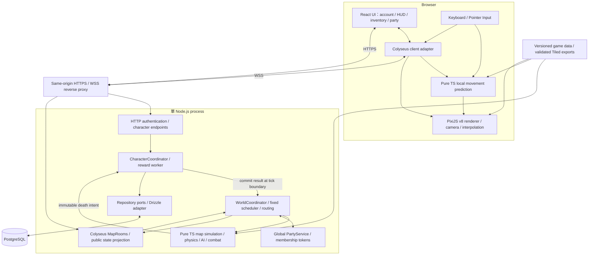

# 系統架構與實作契約

版本：Task 0 / 2026-11-23。本文定義可逐步交付的單節點架構，不代表已建立程式或安裝依賴。規則見 [GAME_DESIGN](GAME_DESIGN.md)，產品驗收見 [PRD](PRD.md)，取捨見 [ADRs](decisions/001-pixijs-over-phaser.md)。

## 1. 架構總覽



Public room state、owner-only reliable messages、HTTP account session 為三條明確資料邊界。所有 gameplay authority 位於 server；client prediction 只改善本地 movement 手感。MVP-A 可用 local adapter 執行同一 simulation 與 command service，換成 memory repository；M3 先接通真實兩 client WebSocket，M7–M8 才達到完整持久化與 release candidate。

## 2. Stack 與 package boundaries

採 React、TypeScript、Vite、PixiJS v8、pure TS simulation、custom platformer physics、Tiled、Colyseus／WebSocket、Node.js、PostgreSQL、Drizzle、pnpm workspace、Vitest、ESLint、Prettier、GitHub Actions、Docker。沒有 Redis、Kubernetes、microservices 或 generic ECS。

以下是 **M0 起要建立的預定 tree**，Task 0 不建立這些 source directories：

```text
apps/
  client/src/                 # React UI / input / Pixi / prediction / network
  server/src/
    application/             # command handlers / coordinators / auth / rewards
    runtime/                 # MapRooms / scheduler / registry / PartyService
    adapters/                # HTTP / Colyseus integration / composition root
packages/
  domain/src/                # IDs / character & item models / immutable intents / ports
  game-data/src/             # balance / item & monster definitions / validation
  physics/src/               # collision / integration / spatial queries
  simulation/src/            # map model / movement / AI / combat / pure reward policies
  protocol/src/              # versioned message DTOs / runtime input validation
  network-colyseus/src/      # Schema / wire codec / framework adapters
  persistence/src/           # in-memory & Drizzle repositories / migrations
content/
  maps/                      # Tiled source / JSON exports / manifest
  assets/                    # original or licensed resources / license manifest
tools/                       # map validation / headless scenario & load harness
docs/
```

| Package／area | 可依賴 | 禁止／責任界線 |
| --- | --- | --- |
| `domain` | TypeScript 標準型別 | 無 framework、I/O 或 balance policy；提供 repository port 與 plain models |
| `game-data` | domain | 版本化 definitions、validation，不讀 DB、不依賴 UI |
| `physics` | domain | 純 math／geometry，無 DOM、wall clock 或 network |
| `simulation` | domain、game-data、physics | 不依賴 React／Pixi／Colyseus／Drizzle／Node I/O；無 database transaction |
| `protocol` | domain 的必要 wire-safe types | 不包含 DB entities 或 credentials；client input 必須 runtime validate |
| `network-colyseus` | domain、protocol、Colyseus | Schema 是投影；不可持有核心 combat／reward 規則 |
| `persistence` | domain、game-data 的 validation、Drizzle／PG | 實作 ports，不能依賴 apps、simulation runtime 或 renderer |
| `apps/server` | 上述 server 所需 packages | 唯一 authority composition root；管理 locks、sessions 與 side effects |
| `apps/client` | domain、game-data、physics、simulation、protocol、network adapter | 不 import persistence 或 server；shared pure policies 不代表 client 可決定結果 |

Repository ports 在 domain 的 application boundary 定義，例如 `CharacterRepository`、`RewardRepository`、`InventoryRepository`、`SessionRepository`；memory／PG adapter 共用契約。Domain reward intent 不使用 Colyseus Schema。初期不額外建立通用 event bus、CQRS framework、service container 或 ECS；使用明確函式、entity maps 與小型 services。

M0.2 建立 `domain`、`physics`、`simulation`、`protocol` 與 `network-colyseus` 的 workspace 公開入口。Domain 提供 plain models 和 repository ports，physics 提供世界座標與 AABB 契約，protocol 提供 `InputFrame` 與公開 room header 的 wire DTO，network adapter 將 map instance 與 tick 投影為 room header。Game-data 由 M0.4 建立，Colyseus Schema 與 room 接線由 M3.1 建立，repository 實作按 M5–M7 的任務交付。

## 3. Ownership matrix

| 狀態／行為 | 唯一權威與生命週期 | Client 工作 |
| --- | --- | --- |
| Player movement／collision／HP／MP | MapSimulation；session active 期間由所在 room 持有 | 同 physics 做本機 movement prediction，接受 correction |
| Monster AI／HP／spawn／death | MapSimulation 單一 writer；room-local，不持久化 | 插值顯示，不執行權威 AI |
| Combat validation／damage contribution | Server combat step；encounter-local ledger | 送 attack input，播放已確認結果 |
| Party membership／leader／invite | Process-global PartyService，獨立於 map | UI／command；map transition 不重建 party |
| Eligibility／group pool／EXP／loot roll | Server reward snapshot＋pure policy＋reward worker | 只顯示 owner 的結果 |
| Level／AP／base attributes／currency | CharacterCoordinator；MVP-B commit 後的 PostgreSQL 為 durable truth | 用 private snapshot 顯示，送意圖 |
| Bag／equipment／pickup／consume | CharacterCoordinator＋InventoryRepository transaction | 不能樂觀修改已確認 inventory |
| Persistent character record | PostgreSQL；只有 repository adapter 寫入 | HTTP selection 或 owner-only snapshot |
| Camera／animation／touch／HUD | Client | 不影響 collision 或 economy |

每角色有一個 process-wide CharacterActor，map room 只持有其當前 simulation body；不能在 room 轉移時複製 aggregate。Persistent version 與 runtime movement version 分開，不能用一份過期 character snapshot overwrite 新 wallet／inventory。

## 4. Simulation 與 fixed timestep

Simulation API 概念上為 `step(state, commands, dt, context) -> {state, events}`；state 是明確 Player／Monster／Map／Attack models，context 注入 tick、RNG 及讀取用 definitions。不得自行呼叫 `Date.now()`、`Math.random()`、DB 或 framework callback。Loot expiry／session／transaction deadline 使用 application wall clock，與 simulation tick 分離。

M0.2 的 `step` 接受呼叫端注入的下一個 tick、RNG 與 ID source。此階段只推進 tick 並回傳空事件，command 與 definitions 隨後續任務加入。`createFixedTickDriver` 接受 monotonic clock（毫秒）與同步 tick callback，固定傳入 `dt = 1 / 30` 秒。每次 `advance()` 回報已執行步數與尚未執行的完整 ticks，保留積欠時間供後續呼叫補跑。

Server 以單一 fixed scheduler 每 1/30 秒推進所有 rooms，rooms 按 stable ID 排序；accumulator 使用 monotonic clock。單次 callback 最多補5 ticks；落後時不放大 dt、不跳過 collision 直接快轉；記錄 lag 並暫停新 admission，持續超載則降容量或 drain。不能同時使用 Colyseus fixed loop 與另一個 accumulator 造成雙重 step；M0.1 選定 adapter API，M3.1 驗證「每 tick 一次」。

每個 world tick 順序：

1. 套用已提交的 command results、session／transfer 狀態；PartyService 處理先前收到的 membership commands。
2. 各 map consume 有效 input，進行 player physics／action windup。
3. Monster target selection／movement／action windup。
4. Player active attacks 按 `(acceptedTick, characterId, inputSeq)`，每次命中更新 HP 與 contribution；首次 HP=0 立即 claim death 並 freeze reward snapshot。
5. 仍存活 monsters 的 active attacks；處理 player Death、respawn timer、monster lifecycle。
6. 產生 public projection／private deltas／visual events，將 immutable reward intents 交給 worker。

Death snapshot 當下符合條件者之後同 tick 被 monster 打死，仍保留該次 reward；這是先 player hits 再 monster hits 的既定規則。Party changes 不插入 tick 中間，避免 rooms 之間讀到半更新 roster。

Client 以同樣30Hz跑 local physics，render 以 `requestAnimationFrame` 自由更新。State 量化與 collision epsilon 初值1/1024 world unit；重播 fixtures 比較 discrete states 與可接受誤差。沒有 full-world lockstep 或跨 client deterministic combat requirement。

## 5. Input protocol 與同步

### 5.1 Client → server

| Message | Payload 核心欄位 | 處理契約 |
| --- | --- | --- |
| `InputFrame` | `protocolVersion, connectionEpoch, mapEpoch, seq, moveX, jumpPressed, attackPressed` | 30Hz；moveX 僅 -1／0／1，jump／attack 為單次 edge；不接收 damage／EXP／absolute position |
| `InteractPortal`／`InteractNpc` | `requestId, mapEpoch, objectId` | 從 server object definition 解析目的地／dialogue |
| `PickupLoot` | `requestId, sessionEpoch, mapEpoch, lootId` | 重新驗證 owner、距離、expiry、容量 |
| `AllocateAP` | `requestId, sessionEpoch, deltas` | 非負 integers，總額與 invariant 驗證 |
| `EquipItem`／`UnequipItem`／`ConsumeItem` | `requestId, sessionEpoch, itemInstanceId/slot, expectedCharacterVersion` | version stale 回傳最新 snapshot，不能套用 client bag |
| `PartyCommand` | `requestId, type, targetId/inviteId, expectedPartyRevision` | PartyService 序列處理；不信任 client roster |

Connection 在入房時綁定 account／character，不允許 payload 冒用其他 owner。非 input messages 亦帶 protocolVersion，mutation envelope 帶目前 connectionEpoch；所有欄位做 schema、大小、數值有限性與 rate validation。

Input seq 在 connection epoch 內單調遞增；duplicate／stale epoch 不 consume。Server 每個 tick 每 player 最多 consume 1 frame，不因多送 input 加速世界。Queue 最多6 frames；溢出丟棄舊 frames 到最新一筆並明確 ack 被丟棄序列，jump／attack edge 不補放。連續6 ticks 無新 frame，movement 強制 neutral。Client 不透過 WebSocket SDK reconnect buffer 補送離線 input。

初始限流：input 40 messages/s、burst80；gameplay mutations 每角色10/s、burst20；party invite cooldown 見 GAME_DESIGN；單 payload 最大4 KiB。另設 account／IP 的 login／register limits，具體由 M7.2 設定。Rate reject 不執行 mutation；惡意重複或無效 payload 可斷線並記錄。

### 5.2 Server → client

- **Public Schema，10Hz**：serverTick、mapInstanceId、mapContentHash、players 的 transform／public state／HP／MaxHP、monsters 的 IDs／transform／HP／MaxHP／action state。Schema 由 domain projection 建立，不能反向寫 domain；mapEpoch 為個別 character 的 handoff version，不是 room-wide counter。
- **Self movement checkpoint，10Hz owner-only**：帶 serverTick、該 player 的 mapEpoch／connectionEpoch、`lastProcessedInputSeq`、position、velocity、grounded、jump buffer／coyote、facing、action／hurt timing；不能只校正 x／y 卻漏掉 controller state。與同 tick 的 public projection 對齊。
- **Reliable visual messages**：attack／damage／death／respawn event，含 eventId 與 tick；純顯示事件可在 reconnect 丟棄，不重播舊 damage numbers。EventId 做短期去重。
- **Owner-only messages**：character／bag／equipment snapshot、loot snapshot／delta、request result、reward receipt。`privateRevision` 不連續時重新要求完整 snapshot；重新入房／重連一定重建完整 owner view。
- **Party-only messages**：PartyService 對所有 connected members 發送 revisioned full snapshot，包含同／跨 map 的 member 摘要。不同 party 收不到 invite／roster 私有資料。

Personal loot／inventory **不放 public room Schema**；預設用 server 指定 client 的 reliable messages，靠完整 private snapshot 修復斷線，而不是只在畫面過濾。將來若用 StateView 也須有 payload isolation tests；不是目前必需依賴。

### 5.3 Prediction、reconciliation 與 interpolation

Client 記錄至多120 frames（4秒）的 local input 與 predicted movement。收到 checkpoint 時丟掉已 ack／已丟棄 frames，從 authoritative controller state 重播未 ack input；小誤差只平滑 visual offset，simulation collider 立即以校正後結果運作。大於64 units、map／epoch 改變、Death、transfer 或 buffer overflow 時 hard reset，不把角色 tween 穿牆。

Remote players／monsters 以 serverTick 建立100ms buffer，依 snapshot 插值。最多 extrapolate100ms，超時停在最後狀態並提示連線；不拿 extrapolated 位置算 combat。Server 不回溯舊 client attack time，因此高 latency 的近戰命中體驗需在 M3／M8 實測。

Protocol version 或 mapContentHash 不同拒絕入房並要求 reload；固定 balanceVersion 由 server 公告。SDK 已提供的 prediction／fixed loop 能力僅作 adapter 選項，不能讓 framework 接管 domain models 或再跑一份 physics。

## 6. Map authoring、room 與 transfer

Tiled source 與 JSON export 皆進版控。MVP 支援 finite orthogonal、未壓縮 numeric tile arrays、external tileset resolution、GID flip flags、Tile Layers 與 Object Layers；其餘功能 validator 明確拒絕。Source 修改須重新匯出並驗證 hash。

Object classes：`SolidRect`、`OneWayPlatform`、`Portal`、`PlayerSpawn`、`MonsterSpawn`、`Npc`、`LootFallback`。Portal properties 為 `portalId, destinationMapId, destinationSpawnId, reversePortalId`；spawn 包含唯一 ID、position／facing。Validator 檢查 topology 完整12 directed edges、reverse、bounds、headroom、支撐、monster patrol／flight region、safe loot floor、Village 無怪與 asset license reference。

MapRoom 持有一份 shared monster simulation，`maxClients=20` 加上 application seat registry 的 reservation 檢查。Connection seat 與 character seat 分開計數，短暫 socket handover 不能多出第21個 character。Room key 為 `(nodeBootId, mapId, instanceSequence)`；map instance 不持久化，personal loot 另有可 rebind durable records。

Transfer state machine：

1. `ACTIVE → RESERVING`：validate source portal／actor，source seat 保留且停止 action，發 neutral；尚未在 destination 創建 body。
2. `RESERVING → HANDOFF`：destination seat reserve 成功，建立10秒一次性 transfer ticket，綁定 account、character、來源／目的 room、mapEpoch+1。`CharacterActor.currentMap` 只有 coordinator 可改。
3. Client 連 destination；server 驗證 ticket 後在一個 coordinator turn 移除來源 body，更新 actor location／epoch，再創建 destination body；不能同時存在兩份 combat body。
4. 成功確認後釋放 source reservation、關閉舊 room connection，發全量 public／private state。Pending reward 使用 death-time snapshot，與 transfer 不互相取消。
5. Timeout／join failure：若尚未 commit handoff，回來源有效 spawn 並恢復原 seat；若已 commit，從 destination reconnect。兩邊 room 都消失則登入後安全回 Village。ticket consume idempotent，過期不可另開 body。

PartyService 不隨 map connection dispose；server 以 characterId 找現在的 connection 路由 private／party events。保留 source 的接線與 ticket 消費由 M3.4 驗證，不能簡化成「先 leave 再盲目 join」。

## 7. Shared monster 與 reward pipeline

1. Combat applyHit 檢查 monster lifecycle／attackId，寫入 EffectiveDamage 與 first-hit group lock。
2. 首個 HP≤0 transition 設 `RewardPending`，建立 `deathId = nodeBootId + mapInstanceId + spawnId + generation + encounterId` 的唯一識別（實作可編碼成 UUID／opaque ID），凍結 death-time eligibility／group damage／balanceVersion。
3. Pure reward policy 按 GAME_DESIGN 先分一份 B，再套 party bonus；loot 使用 server-secret deterministic RNG，產生不可變 RewardIntent。
4. Reward worker 透過 CharacterCoordinator 按 characterId 取得所有 recipient 的 mutation locks；用 **同一 DB transaction** 插入 death record、各 recipient grant、level／EXP／AP 更新、所有 personal ground-loot rolls。
5. 重複 deathId：讀取原 receipt／rolled data，不重新分配、不再加 EXP。Unique `(deathId, characterId)` 提供第二道保護；只插入新 grant 的 recipients 才能加進度。
6. Commit 成功後，在下一個 tick boundary apply versioned progression results，再送 owner `RewardConfirmed`／loot snapshot，monster 才進 Dead／respawn timer。Level-up 只 clamp HP／MP，不復活。

Room tick **不 await DB**；worker 並行執行獨立角色的操作，涉及相同角色的 AP／pickup／equip／reward 必須序列化；multi-character locks 一律排序，且整批取得後才進 transaction。RewardPending monster 不再命中或重複 emit；global pending intent cap 初值256，超出時停止新 combat admission，不丟棄已接受 intent。

Reward worker 持有已接受 intent 的生命週期，不依賴 room 是否還存在。空房 disposal 不取消結算；commit 後只更新仍存在的 actor／room projection，已消失 room 不重建 corpse／respawn。離線 owner 下次以 DB aggregate／ground grants 恢復結果。

DB 暫不可用時 bounded retry 同一 intent，保留結算中狀態，economy circuit breaker 拒絕新 mutation／新 combat；movement 與 reconnect UI 仍可更新。不能用 memory 成功覆蓋 durable failure。Process crash 前未 commit 的 death 可能不保留，且未曾回覆收益成功；**已 commit 但回覆遺失**由 death／grant／loot records 恢復，不能依 room events 再發一次。

## 8. Persistence model 與 transaction boundaries

### 8.1 初始 logical schema

| Table | 關鍵資料／constraints |
| --- | --- |
| `accounts` | UUID、unique normalized handle、password hash、createdAt；不存原密碼 |
| `auth_sessions` | hashed opaque token、accountId、expiresAt、revokedAt；cookie 不含角色數值 |
| `characters` | owner account、unique normalized name、level、expWithinLevel、四 base stats、unspentAP、currency、version；CHECK 非負與合法 level／AP |
| `play_sessions` | active account／character unique lease、sessionEpoch、bootId、connectionEpoch、status；startup 失效舊 boot lease |
| `inventory_items` | itemInstanceId、characterId、definitionId、quantity、metadata、location；location 為 bag slot 或 equipment slot，partial UNIQUE 各 owner／slot；quantity bounds |
| `monster_deaths` | deathId PK、balanceVersion、immutable contribution／eligibility snapshot、rolled reward result、committedAt |
| `reward_grants` | UNIQUE(deathId,characterId)、group pool、EXP amount、resulting version；audit／replay receipt |
| `personal_loot` | lootId PK、owner、deathId、entryOrdinal、rolled content、mapId、position、deliveryInstanceId、state、expiresAt；UNIQUE(deathId,owner,entryOrdinal) |
| `command_receipts` | UNIQUE(characterId,sessionEpoch,requestId)、type、canonical payload hash、result、version；同 key 不同 payload 拒絕 |

Equipment 不另存一份 item copy；一筆 inventory_item 的 location 在 bag 與 equipment 之間移轉。Derived stats 由 definitions＋base stats 計算，不接受 client 或 cache 為真。房內 HP／MP、monster、party、inputs 不作 durable combat snapshot；每次新 play session 於 Village 重建滿 HP／MP。

### 8.2 一致性與各 transaction

預設 PostgreSQL `READ COMMITTED`＋明確 row locks／unique constraints；不以 isolation name 代替業務驗證。先按 characterId 鎖 `characters` rows，再按 ID 鎖 item／loot rows；同類 row 都使用 stable order。Lock timeout／deadlock 有 bounded retry；連線遺失造成 commit 結果不明時，重新讀 idempotency receipt，不能把 exception 當確定 rollback。

Request 處理先驗證 session／connection 與 payload hash，再查相同 idempotency key：已完成就回原結果、處理中就回 pending，不重新排 mutation。Canonical hash 包含 command type 與原始 domain payload／preconditions，不包含會在合法重連時改變的 transport connectionEpoch。只有新 request 才檢查當前 mapEpoch、character version、alive／距離等前提；否則合法 retry 會因第一次執行已改變 version 而被誤判。Closed sessionEpoch 的舊 request 不重執行，client 用新 session snapshot 查目前狀態。

| Command | Transaction 內容 | 對 runtime 的套用 |
| --- | --- | --- |
| Reward | death／grants＋所有 eligible 的 EXP／level／AP＋rolled ground grants 原子提交 | commit 後更新 persistent version，套用現 actor 的 MaxHP／MP clamp |
| Pickup | lock owner／loot／bag；validate expiry、GROUND、packing／currency cap；改 item 或 purse＋標 PICKED＋receipt | commit 後移除 owner ground view／更新 bag；重送讀原結果 |
| Equip／unequip | lock character／items；validate current version、type／level、target capacity；變更 locations＋receipt | commit 後 derived stats 重算與 clamp |
| AP | lock character；驗證整數、remaining AP、invariant；更新四屬性＋AP＋receipt | commit 後 derived stats 重算與 clamp |
| Consume | lock character／item；admission 驗證 alive、未滿並保留 cooldown；扣量＋記錄一次性 heal effect receipt | commit 後下一 tick apply effect；若已死亡則 effect 已處理但不恢復、不退款；失敗 rollback 釋放保留 |
| Create character | lock account 保護3角色上限；insert character＋starter bag／equipment 原子建立 | 完成才可 selection |
| Loot expire／rebind | lock loot；確認 GROUND、server wall time、原 instance 是否不存在、owner active instance | 只更新可見性；expiry 不延長，不 reroll |

Gameplay actor facts（alive、map、距離、cooldown）在 command acceptance 的 authority turn 線性化，DB rows 的 owner／quantity／version／expiry 在 transaction 中再次驗證。已接受且成功 commit 的經濟 command 不因後續移動／斷線撤銷；新的 command 在 Death／transfer 中拒絕。Consume 在 accepted 時保留 shared potion cooldown 與 pending request，避免多次同時使用；DB rollback 解除保留。若角色在 commit 前已死亡，該藥水仍已消耗但不產生 heal／復活；UI 顯示該確定結果。Effect 只在原 session 的當前 body apply 一次；新 session／重啟以 Village 滿血重建，不 replay 舊 heal。

這個規則避免跨 DB 與即時 HP 做無法保證的分散式 atomic write；「atomic inventory」指 debit、receipt、item locations 一致，不承諾 network latency 期間的 heal 會回溯救回已死角色。可用 transaction 延遲測試固定此順序。

Persistent aggregate 寫入都經 CharacterCoordinator；不得另設每5秒把整份 character cache overwrite DB 的 autosave。Movement／HP 不存檔，所以沒有 snapshot 覆蓋新 reward 的 race。Disconnect 先停止新 command、排空已接受 mutations，才釋放 character lease；若 process crash，DB committed rows 為準。

### 8.3 Recovery 與冪等

- Idempotency scope 綁定 character、sessionEpoch、requestId，retry 必須相同 payload；stale epoch 即使 receipt 被清理也不能執行。
- Reward death/grant 與 loot source keys 長期保留或以仍具唯一性的 archive 保存；command receipts 只可在 epoch 已關閉且超過30天後清理，不刪 active epoch receipts。
- Crash recovery 不重播整個 combat room。重新 login 載入 committed character，查詢未過期 personal_loot；原 instance 不存在時依 GAME_DESIGN rebind。
- Loot pickup 與 expire 同鎖一列，先成功者決定 PICKED／EXPIRED；即使 client 重送、重連或 expiry worker 與 pickup 同時執行，也不能雙重處理。
- 每個 grant／mutation 帶 correlation IDs；不宣稱 exactly-once message delivery，以 at-least-once retry＋idempotent commit 達到一次有效結果。

## 9. Authentication 與 session lifecycle

初始採本地 username＋password，handle 為 lowercase ASCII 3–24 characters（letters／digits／underscore），password 12–128 Unicode characters，使用維護中的 Argon2id implementation，參數由 M7.2 在部署硬體測量。不得自己設計 crypto。Character display name NFKC normalize、2–12 Unicode code points、限制 letters／numbers／underscore，normalized lowercase key 唯一；server 做同一套檢查。

HTTP session 使用256-bit random opaque token，DB 僅存 hash；same-origin Secure／HttpOnly／SameSite=Lax cookie。預設24小時 expiry，logout revoke；登入／登出／register／character mutation 驗證 Origin 與 CSRF token。TLS termination 在 reverse proxy，僅可信 proxy header 可使用。登入錯誤不揭露帳號是否存在，限制 IP／account 頻率。

角色選取後以 authenticated HTTP 取得60秒、一次性的 WebSocket join ticket，綁定 account、character、protocolVersion、sessionEpoch。MapRoom auth consume ticket 並核對 active HTTP session／lease／Origin；不可只憑 client characterId 入房。Query string／log 不暴露 cookie 或 ticket。

Lifecycle：`AUTHENTICATED → CHARACTER_SELECTED → JOINING → ACTIVE → RECONNECTING → ACTIVE/CLOSED`。每 account 最多一個 active play lease；同帳號另一 tab／裝置選角時回 `SESSION_IN_USE`，不自動踢舊連線。重連使用同 lease＋重新驗證 session 的 reconnect token，並輪替 connectionEpoch；舊 socket／buffered commands 失效。

Grace window 30秒，body 與 seat 保留，輸入 neutral、仍可被 monster 選為 target 並受傷，不能新取得 reward eligibility。斷線中死亡且 timer 完成時保留來源 room 的 Death body／respawn-ready flag；重連成功後再做 Village handoff，避免 reconnect token 指向已移走的 body。成功 reconnect 發 full public／private／party snapshots、清 prediction history；token 僅存在 memory／sessionStorage，重連後更新。Grace 過期則移除 body、PartyService 依規則移除 member、完成 pending mutations 後 release lease。新 play session 回 Village，不能使用舊 map／connection epoch。Process restart invalidate 舊 boot lease 與 reconnect tokens，但保留 auth session；需要 fresh join ticket。

HTTP session revoke／expiry 會結束其 play lease；pending accepted economy commands依 receipt 完成，不因撤銷回滾已提交內容。跨 room transfer 不是新 play session，沿用同 sessionEpoch、增加 mapEpoch，且只有一份 CharacterActor。

## 10. Mobile 與 rendering

React 管 account／inventory／party／AP／dialogue／HUD；Pixi 管 world、camera、sprite animation、damage numbers 與 ground loot。React 不每 tick setState 全世界；透過 selective subscriptions 更新 HUD，render adapter 從 snapshot／view model 讀取。

Camera follow local visual transform，clamp 至 map bounds；tile chunks／sprite viewport culling、atlas batching、effect pool 降低 GC。Logical view 參考1280×720，依可見區採 scale／letterbox；低寬度時 UI panels reflow。DPR cap2、WebGL baseline，WebGPU 可選但不要求。Simulation world 不跟著 canvas resize 改變。

Pointer input 轉為與 keyboard 相同的 InputFrame；多指方向／jump／attack 可同時按。使用 pointer capture，處理 cancel／blur／visibility；遊戲控制區停用 browser pan，DOM panels 保留正常捲動。Portrait／background 停止新 input、neutralize，server 不暫停，回前景先 resync 而非快轉幾千個 local ticks。Touch targets ≥2.75rem，safe-area 避開瀏海與 gesture edge。

## 11. Testing 與 deployment

測試分層：pure unit／property tests（physics、combat、group allocation、AP、packing）、headless multi-actor scenarios（party／simultaneous hits）、network contract／two-browser integration、真 PG transaction／fault tests、mobile 實機與20人 load。RNG／clock 可注入；針對算法 invariants 與外部行為寫測試，避免只複製實作。Vitest 是基線；browser automation／load driver 選型由 M0.3／M3.5 決定，不引入與 task 無關的框架。

M0.3 的 GitHub Actions 跑 frozen pnpm install、typecheck、lint、format check、dependency boundaries、Vitest 單元測試與 production build。Vitest headless harness 注入 clock、RNG 與 ID，Playwright 使用 Chromium 檢查 production client 與 server shell。Docker Compose 提供 PostgreSQL 開發／測試服務，以 TCP 執行 `SELECT 1` 驗證 readiness。操作指令見 [README](../README.md#驗證)。後續由 M2 加入 Tiled／topology／license 檢查，由 M7 加入 migration 與 PostgreSQL race／rollback 測試。

Deployment 為單 host／單 region：reverse proxy（TLS＋static Vite output）→單 Node.js process（HTTP＋Colyseus）→PostgreSQL（persistent volume 或 managed）。Docker Compose 用於 local／staging 與小規模部署；不使用 Node cluster／多 replicas。Initial node cap140 unique characters／14 rooms，admission 同時計入 reconnect／incoming reservations；同一 transfer character 在 node 計一次、來源／目的 room 各占一個 seat。由 M8.3 benchmark 下修或確認，不能用理論值當 capacity guarantee。

Migration 以受控一次性 job 在 deploy 前執行；測試 restore／forward-compatible migration、備份與 rollback，不讓各 room 自動跑 schema migration。Daily backup retention7天初值，演練 PRD 的 RPO≤24h／RTO≤2h；同 host disk loss 與 DB corruption 的恢復靠備份，不聲稱 app transaction 可取代備份。

Health 分 liveness／readiness；DB outage、draining 或 tick backlog 可使 readiness false。Graceful shutdown 先停 admission／invite／新 combat，通知倒數，排空 pending durable commands（目標30秒），保留已提交 rows，關閉 connections；超時沒有回覆成功的 intent 依 recovery 規則處理。Party／monsters 不跨 restart 保存。

Observability 包含 process tick p95／p99、room occupancy、reserved seats、input queue、reconciliation distance、DB／reward latency、duplicate／reject／retry counters、pending intents 與 startup recovery。Structured logs 帶 requestId／deathId／characterId（權限控管），不記 password／session／join ticket／loot RNG seed。M8.4 建立實際 runbook／dashboard 與 alert thresholds。

## 12. 決策與官方參考

版本相容性（Node LTS、pnpm、Colyseus server／SDK／schema、Drizzle／PG driver、Pixi v8）由 M0.1 查核並固定；Task 0 只確立能力與邊界，不指定未驗證的 package patch versions。下列官方文件於2026-11-23查閱，API 名稱仍以選定版本為準：

- [Colyseus Rooms](https://docs.colyseus.io/room)：room capacity、patch interval 與 loop adapters。Measured variable timestep 不等於本案的 fixed simulation。
- [Colyseus State Synchronization](https://docs.colyseus.io/state) 與 [State View](https://docs.colyseus.io/state/view)：server Schema projection／per-client visibility；本案先以 targeted private messages 避免 personal loot 外洩。
- [Colyseus Reconnection](https://docs.colyseus.io/room/reconnection)：grace／token／full state recovery 的 adapter 能力；application 仍需 session／epoch validation。
- [PixiJS v8 Application](https://pixijs.com/8.x/guides/components/application) 與 [Render Loop](https://pixijs.com/8.x/guides/concepts/render-loop)：render lifecycle 與 ticker；不把 ticker 當 gameplay authority。
- [Tiled JSON format](https://doc.mapeditor.org/en/stable/reference/json-map-format/)：Tile／Object Layers、GID 與 properties；只支援本案列明的子集。
- [Drizzle Transactions](https://orm.drizzle.team/docs/transactions) 與 [PostgreSQL Explicit Locking](https://www.postgresql.org/docs/current/explicit-locking.html)：transaction／row lock 能力；業務 idempotency、鎖順序與 receipt 由本案實作。

未決事項均有 defaults：正式 hosting／PG 版本 M0.1／M8.4、load driver M3.5、asset pipeline M2.4、實機與容量 M8.2／M8.3。沒有待選的 core architecture；若量測證明不相容，需新增 ADR 說明證據後再改 stack。
