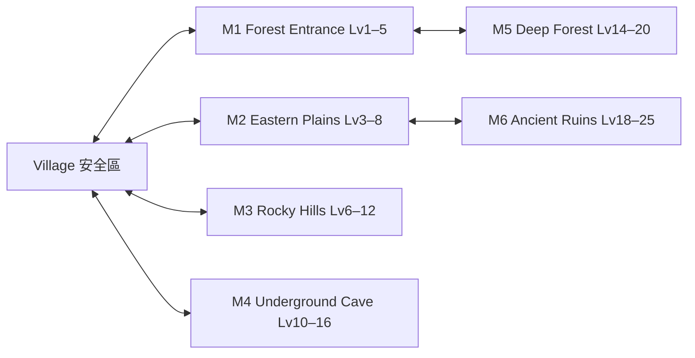

# 遊戲設計與初始平衡

版本：Task 0 / 2026-11-23。本文件是 MVP 遊戲規則的共同基線；所有數字均為待 playtest 的 configurable defaults，並非最終平衡。技術落實見 [ARCHITECTURE](ARCHITECTURE.md)，驗證任務見 [ROADMAP](ROADMAP.md)。MVP-A 使用相同規則搭配 in-memory authority，MVP-B 由 server 執行。

## 1. 世界與單位

World 使用 logical world unit，1 個 Tiled pixel 對應 1 world unit；初始 tile 為 32 × 32。原點左上，+x 向右、+y 向下。CSS `rem`、device pixel 與 world unit 各自獨立。地圖採 finite orthogonal、solid rectangles 與 one-way horizontal platforms；不做 slopes、ladders、ropes、moving platforms 或可破壞地形。

| Map ID | 名稱／建議等級 | 初始尺寸，tiles | 初始怪物配置；等級為 spawn data | 遊玩重點 |
| --- | --- | --- | --- | --- |
| `village` | Village／安全區 | 96 × 24 | 0 | Respawn、NPC、組隊與整理物品 |
| `m1` | Forest Entrance／1–5 | 128 × 32 | 6 Slime Lv2、4 Mushroom Lv4 | 低落差平台與初次戰鬥 |
| `m2` | Eastern Plains／3–8 | 160 × 24 | 4 Slime Lv4、4 Mushroom Lv6、2 Bat Lv7 | 寬地面與少量飛行怪 |
| `m3` | Rocky Hills／6–12 | 128 × 48 | 2 Slime Lv6、6 Mushroom Lv8、4 Bat Lv10 | 多層平台 |
| `m4` | Underground Cave／10–16 | 128 × 40 | 4 Mushroom Lv11、8 Bat Lv13 | 洞穴與狹窄平台 |
| `m5` | Deep Forest／14–20 | 160 × 48 | 4 Slime Lv15、4 Mushroom Lv17、4 Bat Lv19 | 多層合作戰鬥 |
| `m6` | Ancient Ruins／18–25 | 160 × 40 | 2 Slime Lv19、4 Mushroom Lv22、6 Bat Lv25 | 最高 MVP 區域 |

等級是建議值，portal 不設 level gate。各戰鬥圖最多 12 隻 active monsters，M1／M2 初始 10 隻。每個 map instance 最多 20 個 active／reconnect-reserved／incoming-reserved character seats；不同 instance 不共享 monsters、loot 或 EXP eligibility。Party 可跨 instance 存在。

### 1.1 Portal 與 spawn 契約

以下每列代表一對 portal，共 6 條雙向連線、12 個 directed portals。`spawn_*` 為對應 map 內唯一的 destination spawn object ID；另有 Village `spawn_respawn`。

| A map／portal → B map／spawn | B map／portal → A map／spawn |
| --- | --- |
| `village/p_to_m1` → `m1/spawn_from_village` | `m1/p_to_village` → `village/spawn_from_m1` |
| `m1/p_to_m5` → `m5/spawn_from_m1` | `m5/p_to_m1` → `m1/spawn_from_m5` |
| `village/p_to_m2` → `m2/spawn_from_village` | `m2/p_to_village` → `village/spawn_from_m2` |
| `m2/p_to_m6` → `m6/spawn_from_m2` | `m6/p_to_m2` → `m2/spawn_from_m6` |
| `village/p_to_m3` → `m3/spawn_from_village` | `m3/p_to_village` → `village/spawn_from_m3` |
| `village/p_to_m4` → `m4/spawn_from_village` | `m4/p_to_village` → `village/spawn_from_m4` |

Village 的傳送門由西向東依序通往 M3、M1、M2、M4。走訪 M5 需經 M1 的單向橋面，走訪 M6 需跑過 M2 的平地。 [七圖地形及來源](TILED_MAPS.md#七圖-graybox)

- 角色站在 portal 觸發區內時，按下 ↑／W 或橫向觸控 ↑ 才會啟動傳送。單純進入觸發區會留在原圖。鍵盤和觸控的 Up 合併為一個動作，須放開所有來源再按下，才會有下一次啟動邊緣。
- Authority 以角色 AABB 與來源 portal 的正面積交疊判定資格。角色須存活、接地，且未處於 Attack、Hurt 或傳送中。目的地和生成點由匯入資料決定。
- 成功傳送保留角色身分與 HP／MP，清除移動意圖、速度與動作，將角色放到指定朝向的目的地生成點，並增加 `mapEpoch`。生成點位於所有觸發區外。放開再按且符合資格時即可再次傳送。
- M2.2 本地傳送在一個 tick 更新角色和地圖，目的地驗證失敗時依原地圖繼續模擬。多人房間由 server 先保留 destination seat，再移出來源。 [架構契約](ARCHITECTURE.md#6-map-authoringroom-與-transfer)
- Spawn 須在 map bounds、有 solid／one-way 支撐、完整角色 headroom、非 hazard／portal trigger。實際座標由 M2.1 authoring 決定，validator 為 release 必要條件。
- 進入戰鬥圖／respawn 有 90 ticks protection；被保護者不能受傷，主動 attack 立即取消保護。Village 永遠不能受傷。
- 初次進圖優先 party leader 的同 map instance；滿則使用該 map 最早建立且有位子的 instance，皆滿則在 node limits 內建立。MVP 無手動 channel browser；若隊友分開，party UI 顯示 map／instance，之後經 portal 可重試靠攏。

## 2. 角色、移動與狀態

只有 `Beginner`。初始 level 1、EXP 0、STR／DEX／INT／LUK 各 4、unspent AP 0、currency 0；配有 Training Sword（Weapon，ATK +3）、5 HP Potion、3 MP Potion。藥水占 2 個 inventory slots，已裝備武器不占 inventory slot。

| 參數 | 初值 |
| --- | --- |
| Fixed simulation | 30 ticks/s，`dt = 1/30` 秒 |
| Player collision box | 24 × 48 world units，visual sprite 可較大 |
| Run speed／acceleration／ground deceleration | 220 units/s／1800 units/s²／2200 units/s² |
| Gravity／jump impulse／terminal fall speed | 1800 units/s²／600 units/s 向上／900 units/s |
| Jump buffer／coyote time | 各 3 ticks，約 100ms；同一跳躍只 consume 一次 edge |
| Air control | 水平 acceleration 同地面；無 double jump、無 drop-through |

Physics 固定順序為水平速度更新 → gravity → swept horizontal collision → swept vertical collision → grounded／action state。兩軸掃掠均使用 1/1024 world unit 格線上的目標座標，tick 結束時儲存量化後的位置。One-way 只在向下且前一 tick 腳底位於平台頂面或更高時碰撞。角色與怪物可彼此穿過。以固定資料順序及相同公式降低 prediction drift，連線時以 server correction 為準。角點、座標與速度上限見 [平台碰撞契約](ARCHITECTURE.md#41-m11-平台碰撞契約)。

### 2.1 狀態機

`Death > Hurt > Attack > Jump/Fall > Run/Idle` 是 presentation state 優先序；locomotion 與 action 在 model 中分開，避免空中 attack 失去 velocity。

- **Idle／Run**：grounded 且沒有高優先 action，依水平 velocity 選擇。
- **Jump／Fall**：airborne，依 vertical velocity 負／非負選擇。
- **Attack**：可在地面或空中觸發，保留移動；鎖定當次 facing；禁止重疊 attack。
- **Hurt**：受有效傷害後 6 ticks，取消尚未出手的攻擊；MVP 不做 knockback，Hurt 期間不能新 attack／jump。
- **Death**：HP ≤0，清除 input／attack／aggro target，不能移動、拾取、分 AP 或換裝；3 秒後自動 Village respawn。

### 2.2 移動輸入與跳躍時序

- 向左、向右各自將水平速度朝對應跑速推進，並更新朝向。地面放開輸入時減速至靜止，空中放開輸入時維持水平慣性。左右同按等同中立並保留朝向。Idle／Run 依碰撞後的速度決定，因此煞停前仍為 Run。邊緣失去支撐當 tick 進入 Fall，落地當 tick 依水平速度切到 Idle 或 Run。
- Jump edge 在按下當 tick 嘗試跳躍。若當下無支撐且已超過 coyote 視窗，仍可在接下來 3 ticks 的任一 tick 開始時有支撐便起跳。地面行走失去支撐後的下一 tick 是 coyote 視窗的第 1 tick，第 3 tick 仍可跳。主動起跳立即消耗 edge 與 coyote 視窗。按住跳躍不會自動再跳，放開不改變跳躍高度。可變跳高留待後續手感評估。
- 鍵盤與觸控共用同一組方向和動作。相同控制須放開所有來源，下一次按下才會觸發新的動作。兩種裝置的鍵位和測試場模式見 [README](../README.md#平台測試場操作)。

World void plane 在地圖底緣下方 64 units。角色腳底到達該 plane 時觸發墜落死亡。Village 應避免可達的 void，角色意外墜落時依同一規則重生。

## 3. 成長、EXP 與 attributes

初始 level cap 為 25。升級所需的「目前 level 內」EXP：

`RequiredEXP(L) = 50 × L × (L + 1)`，適用 L=1..24。以資料表匯出並驗證此公式，不在 client UI 另寫一份曲線。

| L → L+1 | EXP | L → L+1 | EXP | L → L+1 | EXP |
| --- | --- | --- | --- | --- | --- |
| 1→2 | 100 | 9→10 | 4500 | 17→18 | 15300 |
| 2→3 | 300 | 10→11 | 5500 | 18→19 | 17100 |
| 3→4 | 600 | 11→12 | 6600 | 19→20 | 19000 |
| 4→5 | 1000 | 12→13 | 7800 | 20→21 | 21000 |
| 5→6 | 1500 | 13→14 | 9100 | 21→22 | 23100 |
| 6→7 | 2100 | 14→15 | 10500 | 22→23 | 25300 |
| 7→8 | 2800 | 15→16 | 12000 | 23→24 | 27600 |
| 8→9 | 3600 | 16→17 | 13600 | 24→25 | 30000 |

單次 reward 可連升多級，每級給 5 AP；從 level 1 到 25 共 260000 EXP、120 AP。到 cap 時 `expWithinLevel = 0`，後續 EXP 不累積，不再取得 AP；仍可取得 loot。沒有 level difference EXP penalty，也沒有最後一擊 bonus。

AP invariant：`Σ(baseAttribute - 4) + unspentAP = 5 × (level - 1)`。所有 base attributes 是整數且至少 4；任何單項最高 124（由總 AP 上限自然推得）。Server 一次處理 `{STR, DEX, INT, LUK}` 非負整數增量，驗證總數 ≤ unspent AP；全數成功或全數拒絕。不能配置 equipment 加成，不提供 AP reset。

### 3.1 Derived stats

`S/D/I/K` 是 base attribute 加上 equipment attribute modifiers 後的 effective STR／DEX／INT／LUK；先套 attributes，再依公式，最後套 flat modifiers。所有 derived stat 的可用範圍由 game-data validator 限制。

| Derived stat | 初始公式 |
| --- | --- |
| `MaxHP` | `50 + 10 × (L-1) + 5 × (S-4) + equipmentHP` |
| `MaxMP` | `30 + 5 × (L-1) + 3 × (I-4) + equipmentMP` |
| `AttackPower` | `floor(8 + 2×S + D/2 + equipmentATK)` |
| `PhysicalDefense` | `floor(D/4) + equipmentDEF` |
| `MagicDefense` | `floor(I/2) + equipmentMDEF` |
| `CriticalChanceBps` | `clamp(500 + 25×(K-4) + equipmentCritBps, 0, 2500)` |
| `CriticalMultiplier` | 150%，以整數百分比計算 |

沒有武器時 base AttackPower 為 18；starter weapon 後為 21。INT 影響 MP 與對 Bat 的 magic defense；LUK 影響 critical，不另外影響 loot roll。MVP 不做 accuracy／miss、元素、buff、skills 或裝備隨機 affix。Basic attack 不耗 MP；MP 可由藥水恢復，保留未來技能空間，不提前加入技能系統。

Level-up／AP／換裝使 MaxHP／MaxMP 改變時，只 clamp 現有 HP／MP 到新上限，不自動補滿或復活。MVP 沒有自然 regen；respawn／新 play session 回 Village 時補滿。

## 4. Combat

### 4.1 Player basic attack

- Cooldown 18 ticks（600ms）；windup 4 ticks、active 1 tick、recovery 9 ticks，總 action 14 ticks。由 server 在取用有效輸入時接受，於 T + 4 結算、T + 14 結束，T + 18 才可再次接受新邊緣。攻擊控制器不保留未獲接受的邊緣。
- Active tick 使用 server 當時 player transform，前方 48 × 40 world-unit rectangle；以 player 中心為高度中心，沿 facing 從中心向前延伸。禁止穿過 solid wall 命中；用中心到 target 中心的 obstruction test。
- M4.2 的怪物命中點位於底部錨點上方 12 world units。命中點在矩形邊界上也算命中。遮擋測試使用兩個戰鬥中心之間的直線，穿入 solid 內部才阻擋，沿邊、擦角或穿過 one-way 不阻擋。
- 最多命中 3 個不同 monsters，候選依 `monsterId` 排序；同 `attackId + monsterId` 只命中一次。MVP 不做 lag compensation／回溯 client timestamp。
- `RawDamage = max(1, AttackPower - MonsterDefense)`；server RNG 抽 `0..9999` 與 `CriticalChanceBps` 比較，critical 時 `Damage = floor(RawDamage × 150/100)`，否則為 RawDamage。
- `EffectiveDamage = min(Damage, HPBeforeHit)` 才可計入 contribution；顯示數字可為 Damage，HP 與 credit 使用 EffectiveDamage。Zero／duplicate／blocked hit 沒有 contribution。
- 同 tick command 按 `(acceptedTick, characterId, inputSeq)` 決定順序；先結算 player active hits，再 monster active hits。同 tick 先死亡的 monster 不能再攻擊。
- 權威傷害結果包含 `attackId` 與 `encounterId`。M4.3 在同一次 HP 更新納入有效傷害及尾刀，HP 首次歸零時以 `deathId` 凍結各組傷害與合格角色。線上沿用公開 HP。視覺訊息與 EXP／loot 分配在後續階段接入。

### 4.2 Monster attack 與受傷

- 同一角色有 30 ticks global hurt invulnerability，避免多人怪物同 tick 多重傷害；不阻止其他角色受傷。
- Monster attack windup 9 ticks、active 1 tick、recovery 8 ticks、cooldown 30 ticks；在 active tick 重新檢查 alive、範圍、遮擋與 spawn protection。
- Physical damage 使用 `max(1, MonsterATK - PhysicalDefense)`；magic 使用 `max(1, MonsterATK - MagicDefense)`。Monster 無 critical。
- Player HP／MP、cooldown、invulnerability 皆由 authority 管理。Hit 不會消耗 MP。Consumable cooldown 30 ticks，HP／MP 共用；當數值已滿或角色死亡時拒絕，不消耗物品。

## 5. Monster archetypes 與生命週期

三種造型必須原創；「Slime／Mushroom／Bat」只是通用 archetype。

| Archetype | Lv1 HP／ATK／DEF／BaseEXP | Movement／attack | 初始特色 |
| --- | --- | --- | --- |
| Slime | 60／6／1／20 | Ground patrol 60 units/s，chase 100，reach 36，physical | 低速近戰 |
| Mushroom | 90／9／3／30 | Ground patrol 50，chase 90，reach 44，physical | 較高 HP／DEF；無跳躍 AI |
| Bat | 50／8／1／25 | Box-bounded flight，patrol 90，chase 130，reach 40，magic sonic strike | 無 gravity，仍受 solid wall 約束；無 projectile |

Spawn level `L` 套用：`MaxHP = round(BaseHP × (1 + 0.18×(L-1)))`、`ATK = BaseATK + 2×(L-1)`、`DEF = BaseDEF + floor((L-1)/2)`、`MonsterBaseEXP = BaseEXP × L`。結果在資料載入時計算驗證；round 的 .5 向上，均為正數。初始所有來源皆為整數。

生命週期：`Spawning → Patrol → Aggro/Chase → Attack → Chase`；失去合法 target → `Return → Patrol`；HP 歸零 → `RewardPending → Dead → RespawnWait → Spawning → Patrol`。

- Spawn point 含 `spawnId`、archetype、level、patrol segment／flight box、floor ID。Ground monster 不跨越平台邊緣、不跳躍；不能到達的目標可 chase 到邊界後 Return，不做通用 pathfinding。
- 每 6 ticks 更新 target；以最近 alive、無 protection 且仍保留 body 的 player 為目標，包含 reconnect grace 內的 disconnected body，距離相同按 `characterId`。Grace 到期移除 body 才不再是合法 target。Aggro radius 320、lose-target radius 480、spawn leash 512；失去 target 持續 90 ticks 後 Return。
- Return 不接受 damage、不產生 reward；到 spawn 補滿 HP、清除 contribution／group locks，開始新 `encounterId`。不可帶著過往 credit farm 下一次 encounter。
- HP 首次歸零以單一 state transition claim death，立即停止 combat；`RewardPending` 等 durable result（MVP-A 為 memory commit），期間不可再命中／respawn。
- 從固定 tick 接受成功 receipt 起顯示 corpse 30 ticks，接續 respawn wait 300 ticks。原出生點以全新 `monsterId`、遞增 generation 與新 `encounterId` 進入 Spawning，下一 tick 進入 Patrol。若結算失敗或尚未確認，保持 RewardPending。
- Room 空房且沒有 reconnect／incoming reservation 後可釋放；monster 狀態不持久化。重建 room 從新 spawn 開始，不重播未提交 death。

M4.1 使用怪物錨點與角色腳底中心的平方距離判斷範圍，邊界含等號。新目標須在 aggro 半徑內，已追蹤的目標可保留到 lose-target 半徑。新目標若從巡邏區任何位置都無法進入攻擊距離，或已在出生 leash 外，略過該目標。追蹤中的角色離開可達區時，怪物可走到限制位置後進入 Return。怪物在巡邏區內先沿 X 再沿 Y 掃掠，Ground 的 Y 固定在出生樓面，Bat 在出生高度往返巡邏，追逐時可改變高度。

Monster attack cooldown 從前搖開始計算。前搖鎖定角色及該次生命，目標離開房間或失去資格時解除該次鎖定。有效 tick 再確認同房、生命、reach、中心直線遮擋、安全區、出生保護及受傷免疫。M4.2 在怪物 HP 首次歸零時終止其 AI 與命中資格，保留怪物和 encounter ID 供 M4.3 接入 death claim。和 Return 重置同 tick 或更早接受的 swing 對新 encounter 無效。

## 6. Party

### 6.1 Membership

- 正式 party 2–4 人；沒有單人成員 party。未組隊者可發 invite，accept 時原子建立兩人 party；既有 party 只有 leader 可 invite、transfer leader 或 disband。MVP 無 kick。
- Invite 含 server ID、sender、target、預期 party revision、30 秒 expiry；同 target 僅保留最新 invite，sender 每 5 秒最多發一次。邀請不保留名額。
- Accept 在單一 PartyService queue 驗證雙方 online、未在別 party、revision／expiry、capacity 與 sender 仍為 leader；多人搶最後一位只有一個成功。Reject／expiry 不修改 membership。
- 每次加入產生 `membershipToken`，不可重用；leave／disband／disconnect timeout 使 token 無效。Leadership transfer 不改 membership token。
- Leader leave：人數仍 ≥2 時，依 join order、再 `characterId` 選新 leader；人數 <2 自動 disband，剩下者 solo。Leader 主動 transfer 只能選現有 connected member。
- 斷線 30 秒內保留 membership 與 room seat，但不具 death-time reward eligibility。Timeout 移除並執行 leader／disband 規則。Grace 內 leader 暫時無法操作，其他成員仍可 leave。
- PartyService 位於單 Node process，party 不屬於 map room；portal／room transition 不移除 membership。重啟後 party 全失效，character progress 保留。
- UI 提供 invite、accept／reject、member HP／level／map／instance／connection、leader transfer、leave／disband；不在 MVP 加 chat。

### 6.2 Contribution group lock

每隻 monster 每次 encounter 各自記錄：

`characterId → {effectiveDamage, lastDamageTick, lockedGroupKey, membershipTokenAtLock}`。

角色第一次造成正的 EffectiveDamage 時鎖定歸屬：有 party 為 `party:<partyId>`，否則為 `solo:<characterId>`。該 encounter 後續所有傷害仍算此 group，不能藉加入／換隊把 credit 移到另一組。Group ID 採 stable ASCII ID，tie-break 使用 bytewise lexicographic order，不依 locale。

Party credit 在 death 時只有「仍在同 party，且 membershipToken 相同」的人可領；leave 後重入也失去資格。Solo lock 即使後續加入 party，本 encounter 仍按 solo 計算。Disband 的 group 保留已造成傷害，但沒有 eligible members。以上預設寧可使切換隊伍的當次 credit 失效，也不允許轉移／重複獎勵。

### 6.3 Death-time eligibility

RewardPending transition 時，server 在同一 authority turn 擷取不可變的 reward snapshot，使用玩家命中階段的戰鬥中心與當時連線及組隊資料。角色須**全部符合**：

1. Alive、connected、不是 transfer 中，與 monster 在同一 `mapInstanceId`。
2. 角色中心距 monster death 中心的 Euclidean distance ≤640 units（比較 squared distance）。
3. 該 encounter 累計 EffectiveDamage ≥`max(1, ceil(MonsterMaxHP × 0.01))`。
4. 最近一次正傷害距 death ≤450 ticks（15 秒，含邊界）。
5. Group lock 合法；party 成員的 party／membershipToken 仍一致。

只有實際打出有效傷害的人 eligible；站在旁邊、走動、空揮、被打、在其他 instance 攻擊，均不算 meaningful participation。MVP 無 heal／support contribution。死亡 snapshot 後才掉線、離隊或換圖，不撤銷已確定的 reward；snapshot 後才加入亦不能補領。

### 6.4 Competing parties／solo 的 EXP 分配

定義 `B = MonsterBaseEXP`，`Dg = group g 的全部 EffectiveDamage`，`D = ΣDg`。包括後來遠離、idle、死亡、掉線或失去 membership 的 damage；overkill 不超額加入。正常 lethal death 有 `D > 0`；scripted removal／reset 或 D=0 不發 EXP／loot。

**第一階段：只分配一次怪物 BaseEXP。**

1. 對所有有 damage 的 groups 計算 `qg = B × Dg / D`。
2. `Poolg = floor(qg)`；剩餘 `R = B - ΣPoolg` 按 remainder `B×Dg mod D` 由大到小各補 1，tie 按 groupKey。以整數運算／安全範圍驗證避免 floating rounding。
3. 包含無 eligible member 的 group 也先取得 pool；該 pool 隨後作廢，不重新分配。因此離場不會讓其他 group 取得原本不屬於自己的份額。

不變量：`ΣPoolg = B`；所有 unrelated groups 合計在 bonus 前只分得一份 BaseEXP。

**第二階段：各組 eligibility、bonus 與均分。**

對 group g 取 eligible count `N`。N=0 不發 EXP；solo group 最多 N=1。Party N=1 沒有 bonus，N=2..4 使用：

`PartyBonus = 1 + 0.1 × (N - 1)`

`IndividualEXP = floor(Poolg × PartyBonus / N)`

也就是需求公式中的 `BaseEXP` 在組內指「該組 reward pool」，不是對每組重新使用整隻怪物的 B。整數等價式：`floor(Poolg × (100 + 10×(N-1)) / (100×N))`。

同組 eligible members 均分，不再依個人 damage 權重；bonus 依 eligible count，而非 roster count。每人 floor 後剩餘 EXP 直接捨去，不給 leader／尾刀、不 carry。Party bonus 允許總實發高於 B；是明確可設定的增益，不是 baseline 重複發放。Cap player 仍計入 eligibility／N，但其 EXP 依 level cap 規則丟棄，不轉贈他人。

**例子與必測案例：**

| 情境 | 確定結果 |
| --- | --- |
| B=100，單一 party，全員 eligible N=2／3／4 | 每人 55／40／32 EXP；四人共128，兩點 rounding residue 捨去 |
| B=101，A party damage60、B party30、solo10；A／B 各2 eligible | Pools=61／30／10；A各33、B各16、solo10，共108 |
| 同上，B 全部不 eligible | B 的30 pool 作廢；A各33、solo10，不重分 B pool |
| B=1，唯一 party N=4 | 每人0 EXP，沒有尾刀補點；符合條件仍能各自 roll loot |
| Full HP=60，兩次同 tick hits 各40 | 有效 credit 40+20；一個 death、一組 grants，後續 hit ignored |
| Leave→rejoin／party disband | 舊 token credit 不能領；其 pool 不轉到新 party／solo |
| Eligibility 邊界 | 450 ticks／640 units／ceil(1% HP) inclusive；超出一個 tick／距離／少一點傷害即不符 |

本節為 [ADR-004](decisions/004-party-exp-and-personal-loot.md) 的完整規則。M6.3 要有 fixed examples、property tests、不同 event 排列與 roster change 測試；M7.4 驗證 DB idempotency。

## 7. Personal loot

Loot recipients **與 EXP 使用同一 death-time eligible set**，但不按 group pool 比例縮減 roll，也不套 party bonus。每位 eligible character 各自對完整 loot table 獨立抽樣；這是有意鼓勵共同參與的設計。沒有 shared roll、尾刀 owner 或可轉移 ownership。20 個同時在場玩家的供給風險由 M8.3 playtest 調整。

| Roll | 每 recipient 初值 | Quantity／內容 |
| --- | --- | --- |
| Currency | 100% | uniform integer `[3×monsterLevel, 5×monsterLevel]` |
| HP Potion | 30% | 1，恢復 50 HP |
| MP Potion | 15% | 1，恢復 30 MP |
| Archetype material | 60% | uniform integer 1..2，Slime Gel／Spore／Bat Membrane |
| Equipment | 5% | 從該 level tier 的 Weapon／Armor／Accessory 三定義等機率選一件 |

每列 independent roll，不能 reroll request；使用 server-secret seed 派生 `(deathId, ownerId, tableEntryId)`，不把 seed 傳給 client。第一次結算凍結實際結果與 balanceVersion，retry／重啟讀取已存結果。Equipment 無隨機 affix；tier 為 1、5、10、15、20、25 中不高於 monsterLevel 的最大值。`tierIndex` 為 0..5：Weapon ATK `3+2×tierIndex`、Armor DEF `2+2×tierIndex`、Accessory STR `1+tierIndex`；requiredLevel=tier。M5.2 建立明確 item definitions 與 ID，不在 runtime 臨時生成不受驗證的規格。

### 7.1 Ground loot lifecycle

- 每個成功 roll 產生 server-generated `lootId`、`ownerCharacterId`、`deathId`、map、position、rolled item data、quantity、`expiresAt`。Currency 也是 personal ground drop，pickup 才加進 purse。
- 只向 owner 傳送 ground-loot add／remove／snapshot；非 owner 不得收到 ID、座標、內容或 reward log。Public room 不含 personal collection。
- 位置在 monster death 地點附近的安全 floor，最多水平偏移24 units；Bat 掉落投影到下方最近安全 floor。不存在安全 floor 時使用 map 的 fallback loot spawn；由 map validator 保證。
- Loot 生成於成功 reward commit 後，expiry 為該 commit 時間＋120 秒，使用 authoritative UTC wall time，不受 room 暫停／重連延長。
- Pickup 要求 owner alive、connected、同 delivery instance、距離 ≤96、未過期、session 有效、inventory 足夠；currency 不占 slot 且 purse 上限為 2147483647，超限拒絕。
- `GROUND → PICKED` 或 `GROUND → EXPIRED` 只能擇一；整筆 stack roll 原子拾取，不做 partial pickup。滿包失敗保留 ground loot，expiry 不延長。
- Logout／換圖不自動拾取；同 instance 內回來可再看到。Room 消失／process restart 時，未過期且未拾取記錄保留；owner 之後進入相同 map 時，server 原子 rebind 到其唯一 active instance，位置仍用原座標／安全 fallback，expiry 不重設。
- Rebind 僅在原 delivery instance 已消失時可執行，不把仍在其他存活 instance 的 drop 搬過來。Owner UI 顯示尚有 drop 的 map／instance；MVP 不保證可回到仍滿的 instance。
- 已 commit 的 EXP 與 ground grant 在重啟後可讀回；未拾取 drop 可以按原時間過期。沒有已確認 inventory 物品因重啟消失的例外。

## 8. Inventory、equipment 與 consumables

- 24 slots，slot index 0..23；currency 獨立 purse；equipment slots 固定 `Weapon`、`Armor`、`Accessory`，各一件且不占 bag slots。
- Consumables／materials 每 stack 最多99，只有相同 itemDefinitionId 與完全相同 metadata 才能合併；equipment quantity=1，使用唯一 `itemInstanceId`，永不 stack。
- Pickup 先按 slot index 填滿既有 stacks，再依序使用空格；預先算完所需容量才 mutation。不能用移動多餘數量到不存在 slot 的方式超出容量。
- Equip 驗證 ownership、Beginner 可用、requiredLevel、slot type、alive；slot 已有裝備時，舊裝備放回新裝備原 bag slot，因此滿包亦可原子交換。
- Unequip 需要至少一個空 bag slot；滿包時全數拒絕。Derived stats 重算，HP／MP 只 clamp，不補滿。
- Consume 在角色 command admission 當下驗證 alive、數值未滿、item 與 cooldown，先保留這次使用的 cooldown，防止並行重複使用。Transaction 從指定 slot／itemInstanceId 減1並記錄唯一 heal effect；commit 後下一 tick 套用一次 restore。失敗 rollback 時釋放保留，不減量。
- 已接受的使用若在 DB commit 回覆前遭遇致命傷害，物品仍按成功使用消耗，heal effect 標為已處理但不復活；不回溯 combat。此時顯示「使用完成，角色已死亡」，不能顯示已恢復 HP。這是非同步 transaction 的明確 MVP 預設，M7.4 必須測試；角色已 Death 時送出的新 consume 則直接拒絕。
- 不提供玩家間 transfer、drop、sell、sort、split、discard、bag expansion 或 equipment durability；stack packing 為 server 自動行為，MVP UI 以 slot 選取操作。
- 所有 bag／equipment／currency operation 由 authority 計算，附 requestId，重送回傳同結果；client 不可傳送整份 inventory 覆蓋 server。

## 9. Death、respawn 與 session

HP=0 當 tick 進 Death；同 tick combat ordering 依第4節，已存在的 reward snapshot 不回溯撤銷。3秒後在 Village `spawn_respawn`，HP／MP 全滿、velocity=0、無 EXP／currency／equipment penalty；party membership 保留，contribution 舊紀錄依 death-time eligibility 自行失效。

本地測試場使用相同的 90 tick 計時，角色以靜止 grounded Idle 回到 Tiled 地圖的 `village/spawn_respawn`，清除輸入和動作。死亡動作的長度由重生時點決定，動畫播放進度不影響結果。

Village 滿房時先 reserve 另一 Village instance；若 node admission cap 或 DB 不可用使 respawn 暫不可完成，保持 Death 與重試提示，不生成第二角色。斷線時若3秒 timer 已完成，保留來源 room 的 Death body 與 respawn-ready flag，重連成功後才開始 Village handoff；grace 到期則移除 body，下次新 session 直接返村。重連 grace 內活著的 character body 仍可被選為 monster target 並受傷，但 disconnected 狀態不能取得新 death rewards；不准藉 disconnect pause monster。

重新建立 play session 一律在 Village、安全地補滿 HP／MP，不承諾保存離線戰鬥位置。已確認的 level、AP、EXP、currency、bag、equipment 與未過期 ground grant 保留。Account／角色限制與 session epoch 見 ARCHITECTURE。

## 10. NPC、設定與未決事項

Village 的 Guide 使用 Tiled 的 `npc_guide` 點。角色腳底中心至該點的直線距離須 ≤96 world units。角色存活、接地且未處於 Attack、Hurt 或傳送時，可按 E 或觸控「互動」開啟對話。接近只顯示提示。再按一次互動鍵或點「關閉」可結束對話，離開範圍、倒地、傳送或重生時也會關閉。

對話內容包含移動／跳躍／攻擊、HP 藥水、組隊獎勵資格、死亡返村與 portal 方向。對話期間照常步進，沒有 quest state、shop 或 reward。↑／W 和觸控 ↑ 依 §1.1 的條件啟動傳送，七圖走訪是 M2.5 的交付驗收。

Config 分為 `physics`、`combat`、`progression`、`monsters`、`party`、`rewards`、`inventory`、`world`；每一份 build 指定 `balanceVersion`、`mapContentHash` 與 `protocolVersion`。Clock／session／DB retry 是 server operational config，不可由 client 修改。MVP 只在重啟／deploy 時換 balance，不做跨 tick hot reload。

尚待實測：EXP pacing、AP 傾向、monster stats／密度、party bonus 10%、meaningful threshold 1%、15秒／640距離、120秒 expiry、loot rates、地圖尺寸與節奏。上述皆已有明確初值；M5.1／M6.3 建立 fixtures，M6.5 與 M8.3 做 playtest 後以同一 balanceVersion 修訂。正式 asset 名稱／license、實際 portal 座標由 M2.1／M2.4 決定；不能改變既定 topology 或缺少反向 portal。

未來 Boss／party dungeon 可新增 encounter type、reward policy 及 instance routing；目前只保留 `encounterId`、group attribution 與 immutable reward intent，不建立 Boss AI、dungeon lifecycle 或 generic ECS。
