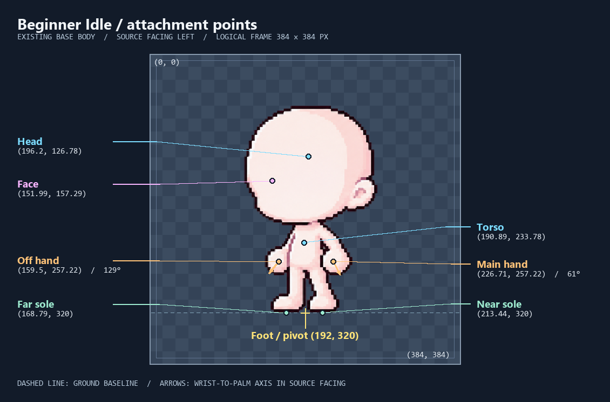

# VF.3.2b Paper Doll Animation Contract

Beginner 採逐幀 RGBA 素體與同姿勢的外觀圖層。使用者已確認此版作為美術交付與 VF.3.3 試作的規格。 [Visual Foundation](VISUAL_FOUNDATION.md) · [VF.3 驗證](evidence/VF3.md)

## 固定畫布與腳底基準

| 欄位                 | Beginner v1                                                                                                                                          |
| -------------------- | ---------------------------------------------------------------------------------------------------------------------------------------------------- |
| `originalSizePx`     | 所有動畫、幀與全畫布圖層共用 384 × 384 px                                                                                                            |
| Frame origin         | 左上角 (0, 0)，X 向右，Y 向下。矩形以左上含、右下不含表示。錨點可使用小數像素                                                                        |
| `pivotPx`            | 固定 (192, 320)，為雙腳的角色根基準。站立接地基線為 y = 320                                                                                          |
| `worldUnitsPerPixel` | 80／256 = 0.3125。各幀、各圖層固定同一倍率，預覽倍率 `height / 256` 也整組套用                                                                       |
| `sourceFacing`       | left。只製作左向原稿                                                                                                                                 |
| 透明外距             | 每格四邊至少 8 px 為 alpha 0，包含武器與前後片。Idle 中性素體的可見邊界約為 x = 116.61–281.53、y = 64–320，預留約左 116.6、右 102.5、上 64、下 64 px |

角色根基準對齊既有 body 底邊中點 `(position.x + width / 2, position.y + height)`。目前權威碰撞盒 24 × 48 world units。跳落的腳可離開作畫基線，Run 以該幀的著地腳校對接觸，Attack、Hurt 和 Death 允許輪廓及重心變化。所有姿勢的根基準固定，依位移與姿勢保留正確的作畫偏移。每幀縮放禁止依可見輪廓、裁切大小、頭高或武器大小重新計算。預設 80 對應中性素體可見高，其他姿勢可用不同的可見高度。

現行單格是 180 × 256 px，腳底為 (90, 256)。將該格原樣放到作畫格的 (102, 64) 即重現已驗收尺寸，重取樣後的非零 alpha 外框為 (114, 64)–(282, 320)。原圖的校準轉換為 `(192 + (x − 740.5) × 256/579, 320 + (y − 783) × 256/579)`。原圖 `α ≥ 16` 的可見外框為 (570, 204)–(943, 783)，頭頸分界約 y = 537，素體約 1.74 頭身。後續原畫以中性姿態的頭、軀幹和腿長維持此比例。 [原圖稽核](evidence/VF3.md#原圖稽核) · [現行衍生圖](../content/assets/images/beginner-base-body.png)

## 中性 Idle 掛載點

`foot` 與全幀共用的 `pivotPx` 相同。`nearSole` 與 `farSole` 記錄個別鞋底接觸點，供製作與驗收使用。掛載點由素體每幀提供，外觀素材引用同一份資料。表內頭、臉、軀幹與掌心為實圖目視定標，鞋底點為最低可見像素列的兩段中點投影至鞋底下緣。近側手暫作主手，遠側手作副手，鏡射時維持該身份。

| ID         | 位置用途                     | 原圖 px      | 384 × 384 畫布 px | `rotationDeg` |
| ---------- | ---------------------------- | ------------ | ----------------- | ------------: |
| `head`     | 顱部，前髮、後髮與頭飾定位   | (750, 346)   | (196.20, 126.78)  |             0 |
| `face`     | 朝左臉部平面，五官與臉飾定位 | (650, 415)   | (151.99, 157.29)  |             0 |
| `torso`    | 胸腹，服裝與軀幹配件定位     | (738, 588)   | (190.89, 233.78)  |             0 |
| `mainHand` | 畫面右側近掌心，主手握柄基準 | (819, 641)   | (226.71, 257.22)  |            61 |
| `offHand`  | 畫面左側遠掌心，副手握點     | (667, 641)   | (159.50, 257.22)  |           129 |
| `foot`     | 雙腳共用的接地基準           | (740.5, 783) | (192, 320)        |             0 |
| `nearSole` | 畫面右側的鞋底接觸點         | (789, 783)   | (213.44, 320)     |             0 |
| `farSole`  | 畫面左側的鞋底接觸點         | (688, 783)   | (168.79, 320)     |             0 |

`rotationDeg` 以原生朝左畫布的 +X 為 0°，順時針增加，序列化為 [0, 360) 內有限數值。手部角度以腕至掌心的方向定標，近側主手與遠側副手分別約為 61° 與 129°。頭、臉、軀幹與鞋底的中性校準軸為水平，其他幀依姿勢明確標記。武器與配件繪製時以該幀位置及角度校對抓握和遮擋，素材自身握柄的方向差在作畫時處理。VF.3.3 先合成已畫好位置與旋轉的圖層，掛載資料用於製作、校驗與除錯。

## Clip 與畫格資料

- `clips` 的 key 為 animation ID，直接使用 `idle`、`run`、`jump`、`fall`、`attack`、`hurt`、`death`。沿用 `SpriteClip` 的 `clips`、`frames`、`loop` 命名與既有呈現狀態。Paper Doll 每幀使用 `index` 和正整數 `durationTicks`（30 ticks/s），因此能分配不等長的姿勢。舊 atlas 保持 `ticksPerFrame`。
- `frames` 依序從 0 連續編號。素體 pose set 為唯一計時來源。每次狀態起始以既有 `visualTick` 記錄相位，經過時間最低取 0，再依累計時長的左閉右開區間取幀。循環對總長取餘數，非循環到末幀後保持。所有外觀一次共用 animation ID 和 frame index，朝向及外觀切換不重啟當前 clip。
- 每幀記錄 `attachments`、由後往前的 `drawOrder` 及必需的 `layers.baseBody` 圖框。每種 slot 在 `drawOrder` 至多出現一次，前後片使用不同 slot。外觀使用 `clips[animationId].frames` 記錄已交付的 `{ index, layers }`。`layers` 以 slot 為 key，值是圖框或代表當幀明確空白的 `null`。外觀不得宣告獨立時長、根基準、縮放或順序，只在素體當幀的 `drawOrder` 啟用的 slot 提供圖框。
- 每個圖框使用 `atlasId`、既有 `AtlasFrame` 形狀的 `rectPx`，及裁切圖左上在 `originalSizePx` 內的 `offsetPx`。圖集只平移裁切，不旋轉或縮放圖塊。矩形須在 atlas 內，且 `offsetPx + rectPx.size` 須在邏輯格內。打包保留至少 2 px 擠邊及 2 px 圖塊間距，兩者在 `rectPx` 之外。未裁切格使用 `offsetPx = (0, 0)`。
- 每片以左上角繪製，未鏡射時相對根節點平移 `(offsetPx − pivotPx) × worldUnitsPerPixel`，尺寸為 `rectPx.size × worldUnitsPerPixel`。整個角色圖層根節點共用水平符號，朝左 +1、朝右 −1。相對座標 (dx, dy) 鏡射為 (−dx, dy)。若需要將掛載軸轉成朝右角度，使用 `(180° − rotationDeg) mod 360°`。鏡射一次即可帶動圖層、掛載軸與已繪製配件，前後順序和主副手身份維持一致。

[最小 JSON 範例](paper-doll/beginner-idle-reference.json) 引用現行單格 atlas，以一幀、1 tick、非循環示範欄位。範例使用獨立的 `beginner-idle-reference` pose set，首批四幀素材使用 `beginner` 的 poseVersion 1，依下方規格製作。 [現有 atlas API](../apps/client/src/rendering/assets/catalog.ts) · [呈現時鐘](../apps/client/src/rendering/player-view.ts)

## 外觀部件與遮擋

VF.3.3b 也支援共用一張紋理的靜態外觀。每個靜態片指定素體掛載點與片內原點（相對裁切圖左上，允許在圖框外），在該幀掛載點的位置套用掛載角度。裁切時從未裁切原點減去裁切左上偏移。這類片沿用素體的畫布倍率、幀索引、遮擋及鏡射。姿勢專屬逐幀片仍使用上節的畫布相對 offset。診斷外觀在開發預覽使用自己的遮擋測試序列，以保留已驗收的 Idle pose metadata。

| 部件           | v1 slot                               | 作畫規則                                       |
| -------------- | ------------------------------------- | ---------------------------------------------- |
| Back hair      | `backHair`                            | 從頭後到肩後。繞到胸前的髮束交給前側片         |
| Base body      | `baseBody`                            | 完整素體，所有姿勢必備，也是無外觀時的呈現     |
| Face           | `face`                                | 與頭部表面同姿勢，前髮與位於前側的手可遮住五官 |
| Front hair     | `frontHair`                           | 瀏海及胸前髮束，依姿勢與前手、武器、配件排序   |
| Upper clothing | `upperClothing`、`upperClothingFront` | 上衣與主要袖片為一層。跨到胸前的袖片依幀拆出   |
| Lower clothing | `lowerClothing`                       | 與腿及軀幹對位。依當幀決定腰線與上衣的覆蓋     |
| Shoes          | `shoes`                               | 一張包含兩鞋的同幀圖層。鞋底依各自接觸點校對   |
| Accessories    | `accessoryBack`、`accessoryFront`     | 一件配件可交前後兩片。v1 每個 slot 允許一片    |
| Weapon         | `weaponBack`、`weaponFront`           | 依每幀握點繪製，跨過角色或握手時可分成前後兩片 |
| 素體遮擋補片   | `bodyForeground`                      | 同幀素體的可選手指或手臂前片，放在武器之前景   |

`drawOrder` 每幀由素體規格明定。Idle 初始由後往前為 `accessoryBack → backHair → weaponBack → baseBody → lowerClothing → shoes → upperClothing → face → frontHair → upperClothingFront → weaponFront → bodyForeground → accessoryFront`。例如 Attack 蓄勢可讓 `weaponBack` 位於身後，跨身揮擊把 `weaponFront` 移到前髮前方，並以手指補片遮住握柄。Run 可讓近側袖片跨身覆蓋衣襟。Death 依倒地姿勢重排武器、髮梢及肢體。畫格素材應預先按遮擋作畫，並以排序與拆片表達前後關係。單一片一旦需要同時位於另一片前後，就拆為已定義的前後片或使用當幀手部補片。素體提供 `bodyForeground`，只有當幀的武器部件到齊且至少一片可見時才使用。補片只覆蓋須遮住武器的手部區域。

## 相容性與回退

- `schemaVersion` 管 metadata 形狀與語意。外觀包宣告精確相同的 `poseSetId` 和 `poseVersion`。版本包含方向、畫布、縮放、根基準、clip 幀序與時長、姿勢、掛載點和 slot／遮擋契約。任一相容性條件改動都提升 `poseVersion`，共同重做受影響外觀。只更換顏色或重新打包且對位契約相同時，可以保留版本，PNG 仍照現有管線更新雜湊。
- 外觀可只交部分 clip 或幀。缺少、不相容、圖集載入失敗或圖框無效時，略過該外觀部件，保留同幀素體。若同一部件在該幀同時啟用前後片，兩片都需要有效圖框或顯式空白值才能呈現。顯式空白無須打包透明圖塊。外觀缺件始終使用該幀，並略過缺件的部件。
- 素體 clip 或所需圖框缺失時，使用現有開發版單格 Base Body。單格也無法取得時使用現有 Beginner Legacy 對應狀態，再沿用向量圖示。回退時隱藏整組 Paper Doll 部件。VF.3.3 可先只支援 Idle，其他狀態走同一條回退路徑。

## 動畫素材製作目標

以下為首輪美術打樣格數與時長。現有 simulation 與網路投影決定狀態以及狀態切換。素材時間只決定當下畫哪格，玩法時間由既有資料和 runtime 維持。 [呈現狀態優先序](../packages/simulation/src/player.ts) · [玩家戰鬥數值](../packages/game-data/src/player-combat.ts) · [受擊時間](../packages/game-data/src/initial-physics.ts)

| 動畫 ID  | 目標幀數 | Loop | 作畫與時長起點                                                                                                                                                     |
| -------- | -------: | ---- | ------------------------------------------------------------------------------------------------------------------------------------------------------------------ |
| `idle`   |        4 | 是   | 中性、吸氣、峰值、回落，每幀 6 ticks，循環 0.8 s                                                                                                                   |
| `run`    |      6–8 | 是   | 雙側各自踏地、承重及跨步。0.4–0.53 s 起測（約每幀 2 ticks），在權威跑速下檢查足滑                                                                                  |
| `jump`   |      1–2 | 否   | 蹬離和上升伸展。2 格可用 3 ticks 起拍後保持第 2 格，由既有上升狀態切換                                                                                             |
| `fall`   |      1–2 | 否   | 過頂後收腿及準備接地。2 格可用 3 ticks 起拍後保持第 2 格，由既有下降狀態切換                                                                                       |
| `attack` |      5–6 | 否   | 基礎攻擊 4 蓄勢／1 生效／9 恢復 ticks。5 格可用 [2, 2, 1, 4, 5]，6 格可用 [2, 2, 1, 3, 3, 3]。第 2 號格畫出揮擊關鍵姿勢。既有命中 tick、18 tick 冷卻與中斷規則照舊 |
| `hurt`   |        2 | 否   | 受力及收回，每格 3 ticks 作為現行 6 tick 受擊窗口的起點                                                                                                            |
| `death`  |      4–6 | 否   | 失衡、倒下、落地並保持末格至既有重生。首輪可每格 4 ticks，重生仍由現行 90 tick 延遲控制                                                                            |

對 Attack，以上配置是對齊既有 windup／active／recovery 的製作用參考。現行 client 的起始相位依本機預測／校正或遠端快照觀察到狀態的時間，與 server 接受的 tick 可能有差距。VF.3.3 可驗證正常播放與截斷，若未來需要逐 tick 對齊遠端生效格，另外提出狀態起始相位的設計及授權。

## Idle sprite sheet 交件

1. 交付一份原生朝左 8-bit RGBA PNG，四格由左至右排列。單格 384 × 384 px，整張 1536 × 384 px，原稿格之間無額外 gutter。格左上為 (0, 0)、(384, 0)、(768, 0)、(1152, 0)。每格先按自己的左上角量座標，對應 sheet 腳點為 (192, 320)、(576, 320)、(960, 320)、(1344, 320)。
2. frame 0 採現在的中性左向實圖作姿勢和比例準線。frame 1 吸氣，胸肩開始抬升。frame 2 為呼吸峰值，頭和胸肩上移約 2–4 畫布 px。frame 3 回落並接回 frame 0。雙腳在同一對 x 接觸點與 y = 320 留地。只讓頭、肩、軀幹、手臂及對應外觀有溫和位移，固定畫格、頭身與整體縮放。四格各 6 ticks。
3. 每格四邊至少留 8 px 全透明安全距，無投影、背景、格線及標註。以本文件的中性實圖邊界作對位起點，保留整個邏輯原尺寸供不同外觀與姿勢使用。每格交附掛載點資料和當幀 `drawOrder`。未來各外觀 sheet 沿用相同尺寸、排列、姿勢與 frame index。使用原始 PNG 做原畫參考時另交新的工作檔或輸出。
4. 驗收時先量 PNG 尺寸、alpha 邊界與腳底接觸。將四格裁切後按 offset 放回畫布與未裁切輸出比對像素。以 80 world units 和 24 × 48 碰撞框在平地預覽兩方向，循環多次逐格核對腳點、頭身、剪影、亮邊以及第 3 格接回第 0 格時的跳動。後續有外觀試件時再驗證戴／卸時的同步取幀、髮束與袖口遮擋、握點、缺件與左右鏡射。

## VF.3.3 renderer 實作順序

1. 在契約確認並取得真實 Idle 交件後，延伸開發資產登錄及現有 validator，保留 atlas ID、rect、雜湊、來源及署名。檢查固定畫布／腳點／倍率、版本、連續索引、時長、矩形及當幀遮擋 slot 對應。範例 metadata 先供驗證規則對照。 [資產規則](ASSETS.md#vf3-開發用角色素材)
2. 沿用共用 Beginner view、atlas scope、資產生命週期及現行 position／facing／visualTick。以一個 Idle 幀解析結果更新其部件及 draw order，角色圖層根節點套用單一縮放與鏡射，碰撞和腳底標記仍用世界座標。VF.3.3b 以幾何測試圖驗證前髮、後髮及臉的 slot。
3. 聚焦測試涵蓋時間邊界、循環、失效版本、圖集裁切還原、部件缺件、排序與鏡射，並驗證狀態變更時所有部件同時切換。瀏覽器驗證使用本機、同房遠端、手機橫向和反覆切圖／卸載，記錄畫格對位及 atlas 釋放。其餘 clip 按實際素材交件逐步接入。
