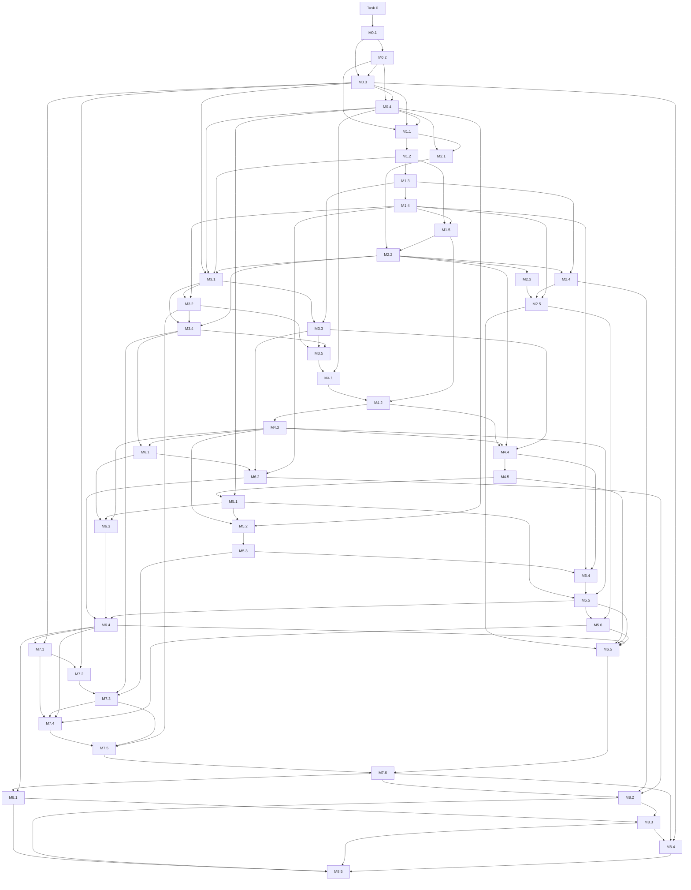

# 開發路線圖

規格基線為 Task 0（2026-11-23）。正式任務由 45 項增為 46 項，新增 M5.6。目前 `DONE` 25 項（25／46，54.35%）、`LOCAL_VERIFIED` 1 項、`NOT_STARTED` 20 項、`IN_PROGRESS`／`BLOCKED` 各 0 項。進度以 `DONE` 除以正式任務總數計算，排除本次文件整理與五項風險檢查。 [協作規則](../AGENTS.md) · [驗證證據索引](evidence/README.md)

## 1. 交付策略與 dependency graph

Task ID 固定。圖中每條箭頭對應正式任務的直接 Dependencies，前置任務須完成並驗證。M3 以 Village／M1 graybox 提早驗證多人連線。每項 Required tests 是該任務的必要檢查。

查看正式任務依賴圖

關鍵鏈：M0 → movement／graybox → M3 → shared combat → progression／personal loot → deterministic party rewards → persistent transactions／sessions → fault、mobile、load 與 operations。每階段保留可操作 build，但不以 dev identity 或 memory save 取代正式登入／持久化。

- **MVP-A = M6.5**：完整 playable gameplay loop，local single-runtime authority＋memory repositories，party 以多角色 harness 驗證。不是 production persistence 或 multiplayer release。
- **MVP-B = M8.5**：MVP-A＋真帳號、PostgreSQL、20人共享房、跨裝置與故障驗證的 multiplayer release candidate。
- 後續任務須經明確授權才開始。提交與推送依 [協作規則](../AGENTS.md) 辦理。

### 任務狀態與 CI

| 狀態             | 判定                                                         |
| ---------------- | ------------------------------------------------------------ |
| `NOT_STARTED`    | 尚未開始。                                                   |
| `IN_PROGRESS`    | 實作或必要本機驗證進行中。                                   |
| `LOCAL_VERIFIED` | 實作與必要本機驗證完成，遠端 CI 或其他必要驗收證據仍待取得。 |
| `DONE`           | 任務全部驗收條件及對應實作提交的遠端 CI 均通過，證據已連結。 |
| `BLOCKED`        | 有明確阻礙，已記錄影響、未驗證範圍與解除條件。               |

1. 獲授權提交實作時，在該提交記錄 `LOCAL_VERIFIED`，附上本機檢查、結果與待補證據。
2. 對應實作提交的 CI 與其餘必要驗收均通過後，以純文件後續提交改為 `DONE`，連結已驗證的實作 SHA、workflow run 與任務證據。純狀態／證據提交沿用實作提交作為驗收對象，無須再開一輪狀態提交來證明該筆文件更新。既有 `DONE` 沿用當時的驗收紀錄，發現實質未解決的 blocker 才重評。 [遠端 CI 與歷史限制](evidence/CI-STABILIZATION.md)

### 修訂執行順序

M5.1（`DONE`）→ 路線圖整理 → 啟動第一輪行動實機 smoke，與 M5.2 並行 → M5.2 → M5.3 → PostgreSQL 契約 spike → M5.4 → M5.5 → 容量 spike → 早期單人 playtest 與第二輪行動實機 smoke → M5.6 NPC 商店 → M6 → M7 → M8。

此順序安排交付與風險檢查，正式任務的技術依賴由圖與各任務定義。以下五項檢查均待執行，將結果附到 [M5 證據](evidence/M5.md)，保留 M6.5、M7、M8 的正式驗收。

### 第一輪行動實機 smoke（M5.1 後）

- 與 M5.2 並行，用一台 iPhone 的 Safari 和一台 Android 手機的 Chrome 驗證橫向版面、safe-area、移動／跳躍／攻擊、移動加跳躍或攻擊的多指操作、portal、AP UI、前後景切換、重連與防卡鍵。
- 記錄裝置、OS／瀏覽器、build、場景、樣本時長、基本 FPS 與可取得的資源趨勢，逐項標示結果。缺機或缺少量測能力記為未驗證。缺少實機本身不阻擋 M5.2。正式裝置矩陣見 [M8.2](#m82--mobilebrowser-與內容品質)。

### PostgreSQL 契約 spike（M5.3 後）

- 限一個專注開發時段。使用可拋棄的真 PostgreSQL 與最小測試表，沿用 InventoryRepository 與角色 mutation 邊界，比對 memory／PG 選定操作的結果。以並行 equip、swap 或其他代表性 inventory mutations 施壓，M5.4 pickup 可稍後交付。
- 以實際 transaction／獨立連線驗證 bag／equipment 原子更新、row lock、version check、unique constraints、同鍵重送／異 payload 拒絕、rollback，以及 COMMIT 結果不明時以 receipt 查回原結果。交付短報告，列出重現步驟、結果、限制與待修正契約。測試 adapter 與 schema 限於隔離環境。正式 schema／migration、runtime PG 接入、帳號／登入與 durable rewards 由 M7 交付。

### 容量 spike（M5.5 後）

- 工具實作限一個專注開發時段。以真 Colyseus headless clients 接上正式 server 的 WorldCoordinator，逐階量測 1 房 20 人、3 房 60 人、7 房 140 人。每個可支援階段以固定條件跑 10 分鐘，包含移動、戰鬥、獎勵生成與代表性 WebSocket 流量。記錄未能啟動或跑完的階段及原因。
- 記錄全域 world tick 執行時間 p50／p95／p99／max、各房 tick 成本、event-loop delay、積欠與補跑、CPU／RSS／heap 趨勢、GC pause、WebSocket 上下行、input／reward queue 深度與拒絕／到期／重試，以及 admission、transfer、reconnect 結果。以 tick p95 <20 ms、p99 <33.33 ms 作早期比較。
- 報告附硬體、build／程序配置、client workload、怪物數與量測限制。使用 memory repository 得到短期單節點觀察，正式容量由 [M8.3 的 60 分鐘驗收](#m83--loadcapacity-與-balance-tuning) 決定。Redis、worker threads、distributed simulation 或 multi-node 的提案須有量測依據及另外授權。

### 單人 playtest（M5.5 後）

- 安排 2–4 人各玩約 20–30 分鐘。觀察移動反應、戰鬥手感與傷害回饋、首殺／首次升級時間、EXP 節奏、首次取得裝備、inventory 與 AP 操作、藥水可得性、地圖探索、重複感與續玩動機。
- 報告分列可觀察事件與主觀回饋，記錄樣本、時間與 build，供 M5.6 藥水定價及後續平衡參考。Classes、skill trees 與新戰鬥系統維持範圍外。完整 MVP-A gate 為 [M6.5](#m65--mvp-a-playable-loop-gate)。

### 第二輪行動實機 smoke（M5.5 後）

- 用同樣的 iPhone／Safari、Android／Chrome 目標檢查物品欄、拾取、裝備與卸裝、消耗品使用，另核對滿包／失敗回饋與操作面板時的誤觸及卡鍵。
- 逐裝置記錄 build、版本、結果與缺項，缺機記為未驗證。完整行動裝置與瀏覽器驗收仍由 [M8.2](#m82--mobilebrowser-與內容品質) 交付。

## 2. M0 — Project Foundation（4 tasks）

### M0.1 — 建立 workspace 與固定相容版本

- **Task ID**：M0.1
- **目標**：建立可重現的 pnpm／TypeScript monorepo 基礎。
- **範圍**：查核 Node LTS、pnpm、React／Vite／PixiJS v8、Colyseus server／SDK／schema、Drizzle／PG 的相容性；建立 workspace、package metadata、lockfile 與空 app entry；設定 strict TS、ESLint、Prettier。先讀取適用的 package manager／formatting skills，保留任何既有設定。
- **Dependencies**：Task 0 文件基線。
- **Deliverables**：workspace manifests、版本紀錄、tsconfig／lint／format scripts、開發環境說明；無 game functionality。
- **Acceptance criteria**：fresh clone 可 frozen install，client／server shell build；版本彼此相容且記錄選型，不新增 Redis／ECS。
- **Required tests**：install reproducibility、typecheck、lint、format check、shell build smoke；確認 production bundle 未引入 server-only packages。
- **Status**：DONE · [Evidence](evidence/M0.md#m01)

### M0.2 — 建立 domain 與 simulation 邊界

- **Task ID**：M0.2
- **目標**：確保 simulation 可在 browser／Node headless 共用。
- **範圍**：依 ARCHITECTURE 建立 domain models／repository ports、physics／simulation／protocol／adapter exports；fixed tick driver、injectable clock／RNG／ID；不建立 generic ECS。
- **Dependencies**：M0.1。
- **Deliverables**：最小 contracts、step shell、import boundary 規則與 pure package build。
- **Acceptance criteria**：simulation 無 DOM／React／Pixi／Colyseus／Drizzle／I/O 依賴；browser 與 Node 可使用同 step contract。
- **Required tests**：import-boundary／cycle check、fake-clock 30Hz tick count、固定 seed repeatability、catch-up 不放大 dt。
- **Status**：DONE · [Evidence](evidence/M0.md#m02)

### M0.3 — 建立測試、CI 與開發環境

- **Task ID**：M0.3
- **目標**：每個後續增量可重現驗證。
- **範圍**：Vitest、headless harness、選定 browser smoke driver、GitHub Actions、Docker 開發／測試 PG service 與環境變數樣板；不建立產品 DB schema。
- **Dependencies**：M0.1、M0.2。
- **Deliverables**：CI jobs、test setup、Docker development definition、secret-free env example、檢查指令說明。
- **Acceptance criteria**：本機與 CI 同樣執行 format／lint／typecheck／test／build，失敗可定位；PG service 可供日後 integration tests。
- **Required tests**：CI dry run、known failing test 正確使 job 失敗、container health smoke、環境 secrets 不被打包或記錄。
- **Status**：DONE · [Evidence](evidence/M0.md#m03)

### M0.4 — 建立 versioned game data 與 validators

- **Task ID**：M0.4
- **目標**：平衡、內容與 protocol 版本具有單一來源。
- **範圍**：balanceVersion、map manifest／content hash、EXP table、monster／item definition contracts 與 runtime validation；填入 GAME_DESIGN 初值，不做 gameplay。
- **Dependencies**：M0.2、M0.3。
- **Deliverables**：typed data、invalid-data diagnostics、version／hash contract、fixture seed。
- **Acceptance criteria**：負值、非整數、未知 item／map references、overflow 與不一致曲線在 startup／CI 被拒。
- **Required tests**：EXP table 與公式／總量260000、max AP120、reference integrity、同內容 hash 穩定、不同 balance 拒絕錯版 join 的 contract fixture。
- **Status**：DONE · [Evidence](evidence/M0.md#m04)

## 3. M1 — Character & Platformer（5 tasks）

### M1.1 — 實作 custom physics 與 collision

- **Task ID**：M1.1
- **目標**：完成 framework-independent 平台移動基礎。
- **範圍**：fixed-step integration、AABB swept axis collision、solid／one-way、grounded、terminal velocity、quantization、bounds／void detection。
- **Dependencies**：M0.2、M0.3、M0.4。
- **Deliverables**：physics package、geometry fixtures、golden traces。
- **Acceptance criteria**：30Hz 下高速落下不穿平台，one-way 可由下穿過、向下可靠站立；不同 render FPS 不改位移。
- **Required tests**：floor／wall／ceiling／corner／thin platform／edge／large velocity／negative coordinate、長時間站立無 drift、重播一致性。
- **Status**：DONE · [Evidence](evidence/M1.md#m11)

### M1.2 — 角色 controller 與狀態機

- **Task ID**：M1.2
- **目標**：以純 simulation 控制 Beginner movement／actions。
- **範圍**：acceleration、air control、jump buffer／coyote、facing、七 presentation states 與 locomotion/action 分離；Attack／Hurt／Death 用事件 fixtures 驅動。
- **Dependencies**：M1.1。
- **Deliverables**：Player model／controller、state transition 規則、input command contract。
- **Acceptance criteria**：一個 jump edge 只跳一次；空中 attack 保留 physics；Death 優先且不再 consume movement。
- **Required tests**：held jump、buffer／coyote 邊界、左右相抵、空中 attack、hurt interruption、Death priority、相同 input trace 重播。
- **Status**：DONE · [Evidence](evidence/M1.md#m12)

### M1.3 — PixiJS rendering 與 camera adapter

- **Task ID**：M1.3
- **目標**：將 simulation state 顯示為可操作場景。
- **範圍**：Pixi v8 application lifecycle、placeholder animation、camera follow／clamp、render interpolation、resize／DPR、React shell 與 HUD store 邊界。
- **Dependencies**：M1.2。
- **Deliverables**：render adapter、camera、debug overlays 與 client playground。
- **Acceptance criteria**：renderer 不修改 simulation；unmount 釋放 resources／listeners；viewport resize 不改碰撞座標。
- **Required tests**：adapter mapping smoke、mount／unmount leak check、camera map bounds、不同 DPR／FPS 的人工 visual check。
- **Status**：DONE · [Evidence](evidence/M1.md#m13)

### M1.4 — Desktop 與 mobile input

- **Task ID**：M1.4
- **目標**：兩種裝置輸出同一 logical input。
- **範圍**：指定 keyboard bindings、touch directions／jump／attack／interact／pickup／potions、multi-pointer、focus／blur／cancel、landscape hint、safe-area 與 UI rem baseline。
- **Dependencies**：M1.3。
- **Deliverables**：input adapters、touch overlay、portrait／background behavior。
- **Acceptance criteria**：移動＋jump／attack 可多指操作；開啟面板不誤觸戰鬥；切出 app 不持續卡鍵。
- **Required tests**：input edge／neutralization unit tests、keyboard focus check、667×375 touch smoke、pointercancel／rotation／resize 人工驗證。
- **Status**：DONE · [Evidence](evidence/M1.md#m14)

### M1.5 — HP／MP、Death 與安全區 respawn fixture

- **Task ID**：M1.5
- **目標**：先完成角色生命週期，再接真 combat。
- **範圍**：HP／MP runtime fields、hurt immunity、Death timer、清 input／action、safe hub fixture 的滿血 respawn；不做 EXP 或 DB。
- **Dependencies**：M1.2、M1.4。
- **Deliverables**：生命週期 controller、HUD、debug damage harness。
- **Acceptance criteria**：HP=0 後3秒回 fixture hub，無重複 body／respawn；MP 不為負；Hurt 期間操作符合規則。
- **Required tests**：simultaneous damage／i-frames、Death 不能 attack、重複 Death event、void fall、respawn timer；M2.2 需替換為真正 Village spawn。
- **Status**：DONE · [Evidence](evidence/M1.md#m15)

## 4. M2 — World & Maps（5 tasks）

### M2.1 — Tiled contract、importer 與 validation

- **Task ID**：M2.1
- **目標**：讓 map authoring 有明確支援範圍與可機器驗證的出口。
- **範圍**：finite orthogonal JSON、tile／object layers、external tilesets、GID flags；collider、portal、spawn、monster spawn、NPC／loot fallback object schemas。
- **Dependencies**：M0.4、M1.1。
- **Deliverables**：map authoring guide、import tool、normalized immutable map data、validator。
- **Acceptance criteria**：unsupported format 明確拒絕；spawn 有支撐／headroom；portal target／reverse reference／collision 有效。
- **Required tests**：missing object／duplicate ID／broken tileset／GID flip／one-way geometry／invalid spawn／out-of-bounds 與 content hash fixtures。
- **Status**：DONE · [Evidence](evidence/M2.md#m21)

### M2.2 — Village／M1 graybox 與 portal 基礎

- **Task ID**：M2.2
- **目標**：提供 early multiplayer slice 所需的最小真實世界。
- **範圍**：Village、M1 Tiled graybox；雙向 portal／safe spawns、local transfer contract、Village safety；替換 M1.5 hub fixture。
- **Dependencies**：M2.1、M1.5。
- **Deliverables**：兩 maps、`spawn_respawn`、portal pair、local transition controller。
- **Acceptance criteria**：兩圖可雙向走訪，spawn 無碰撞／bounce，Village 無怪且無傷害，death 回真正 Village。
- **Required tests**：portal overlap／Up 按下邊緣／持續按住與重新按下／過期或重複輸入／invalid destination／spawn protection／failed transfer。兩圖 keyboard／touch walkthrough。
- **Status**：DONE · [Evidence](evidence/M2.md#m22)

### M2.3 — 七圖 topology 與完整 graybox

- **Task ID**：M2.3
- **目標**：完成全部區域與連線。
- **範圍**：M2–M6、地形、建議等級、12 portals、monster patrol／flight spawn zones、Bat loot fallback；不要求完整美術才往 M3。
- **Dependencies**：M2.2。
- **Deliverables**：七 map exports／source、manifest、portal／spawn matrix。
- **Acceptance criteria**：topology 僅有規格六條雙向邊；各圖有安全出入口，所有 map 可從 Village 到達並返回。
- **Required tests**：graph reachability、12 directed edges、missing reverse／bad spawn validator、七圖 platform／void walkthrough。
- **Status**：DONE · [Evidence](evidence/M2.md#m23)

### M2.4 — 原創／授權 asset pipeline

- **Task ID**：M2.4
- **目標**：替換 placeholder 時不破壞遊戲邊界或授權來源。
- **範圍**：atlas／animation manifest、Beginner 七狀態與三 monsters 視覺、tiles／NPC／loot assets、license／attribution manifest；audio 可延後，不阻擋 MVP。
- **Dependencies**：M2.2、M1.3。
- **Deliverables**：資產與來源／授權紀錄、lazy-loading manifest、sprite/render dimensions。
- **Acceptance criteria**：無受保護 MapleStory 素材；visual size 不決定 collision；首 Village 必要壓縮資產目標≤5MiB。
- **Required tests**：manifest reference／license check、animation coverage、asset load failure／fallback、render visual QA 與 cold-load size measurement。
- **Status**：DONE · [Evidence](evidence/M2.md#m24)

### M2.5 — Guide NPC 與世界 gate

- **Task ID**：M2.5
- **目標**：世界可教學、可走訪且內容驗證完整。
- **範圍**：Village Guide dialogue、互動距離與焦點、七圖最終 world validation；保持無 shops／quests。
- **Dependencies**：M2.3、M2.4、M1.4。
- **Deliverables**：NPC dialogue data／UI、world walkthrough record、map／license validation report。
- **Acceptance criteria**：keyboard／touch 可開關對話，介紹基本循環；七圖與12 portals 皆經實際走訪。
- **Required tests**：距離／未知 NPC 拒絕、focus 不誤觸、reachable graph CI、desktop／mobile world smoke。
- **Status**：DONE · [Evidence](evidence/M2.md#m25)

## 5. M3 — Early Multiplayer Vertical Slice（5 tasks）

### M3.1 — Colyseus room adapter 與 authoritative loop

- **Task ID**：M3.1
- **目標**：同房兩 client 由同一 simulation authority 控制。
- **範圍**：dev-only identity、MapRoom public Schema、WorldCoordinator／CharacterActor registry、30Hz scheduler／10Hz patches、runtime message validation／seat reservations。
- **Dependencies**：M0.3、M0.4、M1.2、M2.2。
- **Deliverables**：server／client network adapters、public state projection、headless room harness。
- **Acceptance criteria**：兩 client 入同 M1、看見彼此；每 tick 只 step 一次；simulation 不引入 Colyseus；21st seat 不進滿 room。
- **Required tests**：join／leave／seat reservation races、invalid payload／protocol mismatch、scheduler double-step／catch-up、兩 browser movement smoke。
- **Status**：DONE · [Evidence](evidence/M3.md#m31)

### M3.2 — Local prediction 與 server reconciliation

- **Task ID**：M3.2
- **目標**：延遲下仍能即時操作且服從 server collision。
- **範圍**：InputFrame seq／epochs、bounded queue、ack、完整 controller checkpoint、未 ack input replay、visual correction／hard reset。
- **Dependencies**：M3.1、M1.4。
- **Deliverables**：prediction controller、input history、correction diagnostics。
- **Acceptance criteria**：client 多送 frame 不加速；stale input 不生效；重連／Death／map switch 清 history；不因 correction 穿牆。
- **Required tests**：duplicate／stale／future burst／overflow、150ms RTT／jitter、edge jump／attack 重播、render FPS 獨立、wall correction trace。
- **Status**：DONE · [Evidence](evidence/M3.md#m32)

### M3.3 — Remote interpolation 與共享怪物 fixture

- **Task ID**：M3.3
- **目標**：提早證明 shared entity 只有一份權威狀態。
- **範圍**：remote snapshot buffer、100ms interpolation／bounded extrapolation；server 驅動一隻簡化巡邏怪物與測試 HP event；不做完整 AI／rewards。
- **Dependencies**：M3.1、M1.3。
- **Deliverables**：remote entity view、same monster ID／HP fixture、snapshot diagnostics。
- **Acceptance criteria**：兩 browser 看見同一隻怪，測試 HP／delete 同步；client 不各自 spawn 或跑 authoritative AI。
- **Required tests**：snapshot gaps／stall／full rejoin、entity add／remove、event de-dup、interpolation bounds、兩 client HP 一致。
- **Status**：DONE · [Evidence](evidence/M3.md#m33)

### M3.4 — Cross-room transfer 與基礎 reconnect

- **Task ID**：M3.4
- **目標**：角色跨圖只有一份 body，失敗能回復。
- **範圍**：source／destination seat、one-time transfer ticket、actor handoff／mapEpoch、dev reconnect grace、global character routing；正式 account lease 留 M7。
- **Dependencies**：M3.1、M3.2、M2.2。
- **Deliverables**：transfer state machine、destination reservation／rollback、private-message routing contract。
- **Acceptance criteria**：Village↔M1 transfer 無雙 body；滿房／ticket timeout 回來源；commit 後掉線從 destination 恢復。
- **Required tests**：transfer ticket replay／wrong owner／timeout、source disconnect／destination failure、20-seat races、input stale mapEpoch、兩端 handoff fault injection。
- **Status**：DONE · [Evidence](evidence/M3.md#m34)

### M3.5 — Early multiplayer slice gate

- **Task ID**：M3.5
- **目標**：在完整 RPG systems 前驗證同步架構。
- **範圍**：整合兩 browser keyboard／touch、movement prediction、共享怪物 fixture、雙圖 transfer／reconnect；記錄 latency、tick 與 bandwidth 初值。
- **Dependencies**：M3.2、M3.3、M3.4。
- **Deliverables**：可展示 vertical slice、測試結果、已知差異與風險紀錄。
- **Acceptance criteria**：兩 client 同圖跑跳、同 monster ID／HP、往返兩圖，150ms RTT 下可操作；清楚標示 dev identity／無正式儲存。
- **Required tests**：端對端固定 scenario、短暫掉線、wrong protocol／map hash、input flood 不加速、owner-channel routing isolation smoke。
- **Status**：DONE · [Evidence](evidence/M3.md#m35)

## 6. M4 — Shared Combat & Monsters（5 tasks）

### M4.1 — Monster archetypes 與完整 AI

- **Task ID**：M4.1
- **目標**：以 server simulation 產生三種共享怪物行為。
- **範圍**：Slime／Mushroom／Bat data、spawn／patrol／aggro／chase／attack／return、leash／edge／flight bounds；先以 M1 與 fixture maps 驗證。
- **實作順序**：先將 MapRuntime 的暫時 `MonsterFixture` 權威狀態遷入 `SimulationState.map.monsters`，再擴充 AI。沿用雙客戶端 ID／HP 一致、跨房隔離與重入的回歸。 [架構契約](ARCHITECTURE.md#7-shared-monster-與-reward-pipeline)
- **Dependencies**：M3.5、M0.4。
- **Deliverables**：monster models／FSM、spawn director、各 archetype traces。
- **Acceptance criteria**：同 room 一份 AI；ground monster 不跌出 patrol segment、Bat 不穿 solid；return 重置 encounter／HP。
- **Required tests**：target ties／dead target／grace-disconnected body仍可被攻擊／expired body移除／aggro distances／unreachable platform／leash reset／spawn count cap／same-seed replay。
- **Status**：DONE · [Evidence](evidence/M4.md#m41)

### M4.2 — Authoritative basic attack 與受傷

- **Task ID**：M4.2
- **目標**：合法 input 才能造成有效 damage。
- **範圍**：player／monster attack timing、hitbox／obstruction、cooldown、critical RNG、physical／magic defense、hurt immunity 與 combat ordering。
- **Dependencies**：M4.1、M1.5。
- **Deliverables**：combat resolver、damage events、server validation errors。
- **Acceptance criteria**：client 不能指定 damage／HP；每 swing 每 target 只一次、最多3 monsters；同 tick player lethal hit 取消 monster hit。
- **Required tests**：range／facing／wall／cooldown boundaries、duplicate attack、critical seeded examples、multi-target ordering、i-frame／protection、malformed damage payload 拒絕。
- **Status**：DONE · [Evidence](evidence/M4.md#m42)

### M4.3 — Contribution ledger 與單次 death claim

- **Task ID**：M4.3
- **目標**：建立 EXP／loot 的可靠共同來源。
- **範圍**：EffectiveDamage、first-hit affiliation contract、encounter IDs、RewardPending transition、immutable death intent／memory idempotency；先不實作 party 分配。
- **Dependencies**：M4.2。
- **Deliverables**：contribution ledger、deathId／attackId 去重、reward port 與 memory receipt skeleton。
- **Acceptance criteria**：overkill 不多算、同 monster 只一 death intent；return 清 ledger；async callback 不再次 claim。
- **Required tests**：兩個 simultaneous lethal hits、40+40 對60HP、duplicate event、stale generation、D=0 removal／return 不發獎勵、event permutation replay。
- **Status**：DONE · [Evidence](evidence/M4.md#m43)

### M4.4 — Combat feedback、monster respawn 與玩家返村

- **Task ID**：M4.4
- **目標**：完成多人共享戰鬥生命週期的可見回饋。
- **範圍**：damage numbers／swing／hurt／death、memory receipt 後 corpse／respawn、Village 玩家 respawn／protection；替換 M3.3 fixture。
- **Dependencies**：M4.2、M4.3、M2.2、M3.3。
- **Deliverables**：combat view adapter、完整 monster lifecycle、death／respawn HUD。
- **Acceptance criteria**：兩 client HP／死亡／新 monster generation 一致；RewardPending 不可再命中；玩家只 respawn 一次。
- **Required tests**：visual event 去重、掉線後 full state、不重播舊 damage、respawn ID／timer、pending reward failure、player death／portal conflict。
- **Status**：DONE · [Evidence](evidence/M4.md#m44)

### M4.5 — Shared combat gate

- **Task ID**：M4.5
- **目標**：共享 monsters／combat 可安全擴展成 RPG reward loop。
- **範圍**：多角色共同攻擊／aggro、三 archetypes、所有 combat invariant 的整合 scenario。
- **Dependencies**：M4.4。
- **Deliverables**：combat integration report、replay seeds 與現存風險。
- **Acceptance criteria**：多名玩家共同削減同一 HP，monster／玩家 death 可重複循環；無 private monster 或 client damage authority。
- **Required tests**：至少4 actors 同時攻擊／死亡／重連、spawn cap、leash／reset、10分鐘 loop smoke、late join 看到正確 HP。
- **Status**：DONE · [Evidence](evidence/M4.md#m45)

## 7. M5 — Progression, Loot & Inventory（6 tasks）

### M5.1 — EXP、level、attributes 與 AP

- **Task ID**：M5.1
- **目標**：角色 combat stats 隨合法成長改變。
- **範圍**：EXP curve、multi-level grant、level cap25、每級5AP、AP atomic allocation、derived stats、AP UI；先以 solo reward policy。
- **Dependencies**：M4.5、M0.4。
- **Deliverables**：progression pure functions、CharacterAggregate、AP command／HUD。
- **Acceptance criteria**：初始四屬性4；AP invariant 永遠成立；client forged／negative allocation 拒絕；升級不補血／復活。
- **Required tests**：curve thresholds、260000 EXP 到25、single grant 多級、cap overflow／discard、AP overspend／fractions／negative／retry、equipment modifier 順序。
- **Status**：DONE · [Evidence](evidence/M5.md#m51)

### M5.2 — Item definitions 與 solo personal rolls

- **Task ID**：M5.2
- **目標**：建立可配置且不可 reroll 的個人 reward 資料。
- **範圍**：四物品種類、六 equipment tiers、loot table／server-secret RNG port、stable lootId、rolled payload／owner／expiry；memory adapter。
- **Dependencies**：M4.3、M5.1、M0.4。
- **Deliverables**：item／equipment definitions、loot roll policy、ground-grant model。
- **Acceptance criteria**：同 death／owner retry 結果相同；currency 亦為 ground drop；equipment 非 stack；不向 client 暴露 seed。
- **Required tests**：seeded rolls／probability boundary／tier reference／unique IDs／expiry clock、物品 metadata validation、level25 tier、D=0 無 roll。
- **Status**：DONE · [Evidence](evidence/M5.md#m52)

### M5.3 — 24-slot inventory 與 equipment mutations

- **Task ID**：M5.3
- **目標**：以單一 authority 管理 bag／equipment／currency。
- **範圍**：memory repositories、CharacterCoordinator、stack packing99、equipment locations、equip swap／unequip、capacity／required level／version／idempotency。
- **Dependencies**：M5.2。
- **Deliverables**：inventory services／ports、atomic memory mutations、inventory／item detail UI。
- **Acceptance criteria**：24-slot 不溢位；滿包 equip 可用來源 slot 交換，滿包 unequip 拒絕；同物品不複製到兩 location。
- **Required tests**：full bag／stack overflow／multi-stack atomicity、wrong owner／slot type、same request 不同 payload、concurrent equip／AP／pickup、rollback 不留半成品。
- **Status**：LOCAL_VERIFIED · [Evidence](evidence/M5.md#m53)

### M5.4 — Ground pickup、consumables 與 owner-only view

- **Task ID**：M5.4
- **目標**：玩家完成看見、拾取、使用個人 rewards 的流程。
- **範圍**：safe-floor loot placement、owner-only snapshot／delta、96-unit pickup、expiry、currency cap、potions／shared cooldown、keyboard／touch controls。
- **Dependencies**：M5.3、M1.4、M4.4。
- **Deliverables**：personal loot renderer、pickup／consume commands、privateRevision recovery 與 UI feedback。
- **Acceptance criteria**：非 owner 收不到 loot payload；滿包保留 drop、expiry 不延長；dead／full HP／cooldown 新使用拒絕。
- **Required tests**：duplicate／foreign／too-far pickup、expiry race、Bat floor fallback、inventory full、currency overflow、consume request retry／death-before-commit effect、private payload inspection。
- **Status**：NOT_STARTED

### M5.5 — Memory reward pipeline 與 solo loop gate

- **Task ID**：M5.5
- **目標**：從一次 death 原子產生 progression 與 ground grants。
- **範圍**：memory transaction／receipt、death→solo eligibility→EXP／loot→UI、失敗重試、versioned after-commit application；不提前連真 PG。
- **Dependencies**：M5.1、M5.4、M4.3。
- **Deliverables**：reward application service、solo gameplay walkthrough、fault fixtures。
- **Acceptance criteria**：同 death 不重複 EXP／loot；失敗無成功通知，retry 用原結果；combat 不 await repository I/O。
- **Required tests**：failure before／after commit、lost acknowledgement、rollback、reward／AP／equip 序列、死亡後 reward 不復活、完整 solo loop replay。
- **Status**：NOT_STARTED

### M5.6 — Village NPC 藥水商店

- **Task ID**：M5.6
- **目標**：提供穩定的 HP／MP 藥水來源與基本貨幣消耗。
- **範圍**：Village 的單一 NPC 商店、由 game-data 配置的固定 HP／MP 藥水價格、權威購買指令、桌面與行動 UI。沿用 CharacterCoordinator 及 inventory mutation 契約。
- **Dependencies**：M5.5、M2.5。
- **Deliverables**：商店資料與 UI、memory 購買交易、購買 receipt 與驗收紀錄。定價由本任務依貨幣收入與早期遊玩回饋提出。 [遊戲規則](GAME_DESIGN.md#101-village-藥水商店) · [指令與交易](ARCHITECTURE.md#82-一致性與各-transaction)
- **Acceptance criteria**：server 決定價格，原子扣款及入包。餘額不足、滿包、無效品項／數量、錯誤 owner／version、倒地或超出互動距離均拒絕，且保留原餘額與背包。重送只生效一次，已提交購買跨圖及同 session 重連後保留。
- **Required tests**：正常購買、stack／整包容量、餘額不足、無效 item／quantity／偽造價格、stale version、wrong owner、dead／transfer／out-of-range、duplicate／同鍵異 payload、購買與其他 inventory mutation 並行、rollback、換圖／重連、desktop keyboard／mobile touch 操作。
- **Status**：NOT_STARTED

## 8. M6 — Party & Reward Distribution（5 tasks）

### M6.1 — Process-wide PartyService

- **Task ID**：M6.1
- **目標**：跨圖共享一份2–4人 party membership。
- **範圍**：invite／accept／reject／expiry、leader transfer、leave／disband、自動 leader／singleton dissolve、membershipToken／revision、30秒 disconnect grace。
- **Dependencies**：M3.4（跨房角色路由與重連）、M4.3（以權威 membership 查詢支援 first-hit 歸屬）。
- **Deliverables**：PartyService queue、membership read snapshots、runtime-only state。
- **Acceptance criteria**：accept 原子驗證；最多4人；離隊再入 token 不同；portal 不清 party；restart 不持久化 party。
- **Required tests**：simultaneous accept 最後名額、stale invite／revision、leader disconnect／leave、two-person dissolve、token reuse 拒絕、transfer 中 membership。
- **Status**：NOT_STARTED

### M6.2 — Party protocol 與 UI

- **Task ID**：M6.2
- **目標**：desktop／mobile 能操作並理解 party 狀態。
- **範圍**：以在線角色名稱解析邀請對象、完整 party actions、member HP／level／map／instance、targeted snapshots、reconnect recovery；無 chat。
- **Dependencies**：M6.1、M3.3、M1.4。
- **Deliverables**：party panel／invite prompt、server lookup／authorization、revisioned routing。
- **Acceptance criteria**：跨圖仍有 roster；非 leader 操作拒絕；掉線重建 UI；不同 party 收不到私有 invite／roster。
- **Required tests**：keyboard／touch invite flow、offline／unknown target、wrong party command、stale revision／snapshot refresh、room disposal 不刪 party。
- **Status**：NOT_STARTED

### M6.3 — Deterministic group EXP 與 eligibility

- **Task ID**：M6.3
- **目標**：實作 GAME_DESIGN 第6節，避免跨 group 重複 BaseEXP。
- **範圍**：first-hit group lock、membership tenure、1%／15秒／640距離／alive／connected 條件、largest remainder baseline pools、eligible bonus／floor residue／forfeiture。
- **Dependencies**：M6.1、M5.1、M4.3。
- **Deliverables**：pure reward policy、immutable eligibility snapshots、example／property tests。
- **Acceptance criteria**：baseline pools 總和=B；bonus 只在組內；idle／遠離／死／斷線者不領；leave/rejoin 不移轉 credit；設定可改。
- **Required tests**：GAME_DESIGN 所有固定 examples、competing parties＋solo、ties／B=1／N=0..4、overkill、cap member、eligibility inclusive boundaries、roster change、permutation／conservation properties。
- **Status**：NOT_STARTED

### M6.4 — Party rewards 與 personal loot 整合

- **Task ID**：M6.4
- **目標**：同一 death snapshot 同時決定 EXP 與個人 loot recipients。
- **範圍**：替換 solo policy、multi-character ordered mutation locks／memory transaction、independent personal rolls、party／solo 混戰與跨圖 snapshot freeze。
- **Dependencies**：M6.2、M6.3、M5.5。
- **Deliverables**：完整 reward service、group receipts、multi-actor fault scenarios。
- **Acceptance criteria**：所有 eligible 共用同一 frozen decision；snapshot 後離隊不撤獎、之後入隊不補領；無 eligible group pool 不轉送。
- **Required tests**：兩 parties＋solo 同殺、idle member／distance／different instance、同 tick party change、death intent retry、跨角色 lock ordering、owner-only loot、independent roll seed。
- **Status**：NOT_STARTED

### M6.5 — MVP-A playable loop gate

- **Task ID**：M6.5
- **目標**：交付可完整遊玩的本機 gameplay MVP。
- **範圍**：七圖探索／NPC、三怪 combat、party、EXP／AP、personal loot、bag／equipment／potions、Village 藥水購買、Death／Village；local authority＋memory persistence。
- **Dependencies**：M2.5、M4.5、M5.5、M5.6、M6.4。
- **Deliverables**：MVP-A build、PRD A1–A4 evidence、完整 MVP-A playtest／balance report、已知限制。
- **Acceptance criteria**：完整 loop 含藥水購買可反覆玩；party／mixed groups 在 harness 可重播；清楚標示資料可重設，無 production auth／save／20人承諾。
- **Required tests**：全 M0–M6 required checks、desktop／mobile landscape walkthrough、scripted4人 party＋competing solo、death／full bag／AP／reward retry／shop regression。
- **Status**：NOT_STARTED

## 9. M7 — Persistence & Character Management（6 tasks）

### M7.1 — PostgreSQL schema、Drizzle 與 migrations

- **Task ID**：M7.1
- **目標**：將已驗證的 repository ports 換成 durable storage。
- **範圍**：ARCHITECTURE logical schema、constraints／indexes、migration lifecycle、test DB isolation、memory／PG contract parity；沒有 party／monster combat persistence。
- **Dependencies**：M6.4（凍結的 death snapshot、多人 grants／receipts 與個人 ground grants 的正式契約）、M0.3。
- **Deliverables**：Drizzle schema／migration files、PG repositories 基礎、constraint／restore fixtures。
- **Acceptance criteria**：新 DB 與升級 DB 均可建 schema；quantity／slot／owner／death／grant uniqueness 有 DB 保護；不存 derived stats 為真值。
- **Required tests**：真 PG migration up／repeat safety、CHECK／FK／UNIQUE、bag／equipment partial index、repository parity、rollback／backup restore smoke。
- **Status**：NOT_STARTED

### M7.2 — Account authentication

- **Task ID**：M7.2
- **目標**：保護帳號、session 與角色入口。
- **範圍**：register／login／logout、Argon2id parameters benchmark、opaque cookie／hashed session、CSRF／Origin、rate limit／secret redaction、24h expiry；無 email／social login。
- **Dependencies**：M7.1、M0.3。
- **Deliverables**：auth endpoints／UI、session repository、security config／tests。
- **Acceptance criteria**：無原密碼／token log；session revoke／expiry 生效；cross-origin mutation／invalid CSRF／credential flood 被拒。
- **Required tests**：normal login、wrong password／unknown handle 同型錯誤、normalization／password bounds、cookie flags、session replay／revoke、CSRF／Origin／rate limits。
- **Status**：NOT_STARTED

### M7.3 — Character creation／selection 與 play lease

- **Task ID**：M7.3
- **目標**：一個帳號只能操作一個本人角色。
- **範圍**：3-character limit、name normalization／uniqueness、starter transaction、select／join ticket、play_sessions unique lease／sessionEpoch、duplicate-session 拒絕；替換 dev identity。
- **Dependencies**：M7.2、M3.4、M5.3。
- **Deliverables**：character endpoints／screens、atomic starter creation、authenticated room join／session registry。
- **Acceptance criteria**：跨 account character access 拒絕；並行建立不超3；另一 tab 顯示 SESSION_IN_USE，舊角色不被踢；new session 從 Village 滿血開始。
- **Required tests**：creation rollback／parallel limits／duplicate names、ticket expiry／one-use／wrong owner、duplicate login／select races、舊 epoch command 拒絕。
- **Status**：NOT_STARTED

### M7.4 — Atomic economy transactions 與 idempotency

- **Task ID**：M7.4
- **目標**：進度、ground grants、pickup、購買與 inventory 在重試下保持一致。
- **範圍**：multi-recipient reward transaction、row locks／ordered coordinator、AP／equip／consume／pickup／purchase receipts、version check、ambiguous commit recovery、bounded retries／circuit breaker。
- **Dependencies**：M7.1、M7.3、M6.4、M5.6。
- **Deliverables**：PG transaction implementations、idempotency ledger、failure injection／recovery tests。
- **Acceptance criteria**：commit 前不回收益成功；同 death／request／loot 一次有效 mutation；rollback 無半套 EXP／loot／bag／purse，購買扣款、入包與 receipt 原子提交；room tick 不 await DB。
- **Required tests**：真 PG simultaneous lethal intents、重複 reward／pickup／purchase、full bag／currency cap、餘額不足／購買 rollback、expire vs pickup、equip／AP concurrent、購買與其他 economy mutation 並行、consume commit前死亡不復活、deadlock／timeout／lost COMMIT acknowledgement（含 purchase receipt lookup）、same key different payload。
- **Status**：NOT_STARTED

### M7.5 — Reconnect、restart 與 ground-loot recovery

- **Task ID**：M7.5
- **目標**：斷線與 process restart 不複製角色或遺失已確認進度。
- **範圍**：30秒 grace、token rotation／auth revalidation、connectionEpoch、full public／private／party resync、startup lease invalidation、未過期 loot rebind／expiry；reward backpressure。
- **Dependencies**：M7.4、M7.3、M3.2。
- **Deliverables**：session lifecycle、startup recovery、reconnect UI 與 fault scenarios。
- **Acceptance criteria**：grace body 可受傷且不取得新 rewards；重連只有一 body；restart 保留經濟狀態、重設 party／monsters；loot expiry 不延長。
- **Required tests**：before／after grace、stale token／epoch、transfer 中掉線、斷線後死亡與respawn-ready重連、commit 後 kill process／notification前kill、old room missing rebind／still live不搬移、DB outage／recovery、privateRevision gap。
- **Status**：NOT_STARTED

### M7.6 — Persistent multiplayer integration gate

- **Task ID**：M7.6
- **目標**：證明正式 storage 與完整 gameplay loop 接合。
- **範圍**：真實 account 多角色、party mixed rewards、三次 logout／login、process restart、跨圖與 inventory 全流程；開發 identity 不可進 release build。
- **Dependencies**：M7.5、M6.5。
- **Deliverables**：staging build、persistence／network regression report、資料一致性核對。
- **Acceptance criteria**：PRD B1／B4 的核心情境通過，已確認 AP／EXP／currency／bag／equipment 無回退或增加；已提交購買可在換圖、重連及重啟後讀回；無 anonymous prod bypass。
- **Required tests**：真 PG E2E loop、3次重登入／一次重啟、correlation receipt 核對、wrong owner／duplicate session、reward retry＋map transition regression、購買後重連／重啟。
- **Status**：NOT_STARTED

## 10. M8 — Stabilization & MVP Release（5 tasks）

### M8.1 — Multiplayer correctness 與 adversarial matrix

- **Task ID**：M8.1
- **目標**：確認多人與未受信任 client 不破壞 authority／economy。
- **範圍**：20 clients 同 room、21st admission、party／solo competition、packet／request abuse、same tick races、network／DB fault matrix。
- **Dependencies**：M7.6、M6.4。
- **Deliverables**：整合／安全／fault test report、blocker 修正與 regression cases。
- **Acceptance criteria**：共享 HP／death／rewards 一致，無非 owner payload／mutation；input flood 不加速；150ms RTT 可完成 loop。
- **Required tests**：20-player combat、mixed parties／idle／disconnect、1% loss／jitter、malformed／oversized／replayed payload、CSRF／ticket／epoch abuse、simultaneous grant／pickup＋process fault。
- **Status**：NOT_STARTED

### M8.2 — Mobile、browser 與內容品質

- **Task ID**：M8.2
- **目標**：讓 desktop 與 mobile landscape 的完整體驗達標。
- **範圍**：current／previous stable browser matrix、實際 iOS Safari／Android Chrome、touch／safe-area／orientation／visibility、render memory／FPS、UI labels／focus、license 完整性。
- **Dependencies**：M7.6、M2.4、M6.2。
- **Deliverables**：裝置與版本紀錄、visual／interaction QA、asset manifest、效能修正。
- **Acceptance criteria**：667×375 可完成全部 actions；desktop≥55 FPS／mobile≥30 FPS 參考目標；無卡鍵、overflow 面板或未授權素材。
- **Required tests**：10分鐘20-player scene、multi-pointer、portrait／app switch／resize、full bag／party／AP panels、cold load、resource cleanup／memory trend、license audit。
- **Status**：NOT_STARTED

### M8.3 — Load、capacity 與 balance tuning

- **Task ID**：M8.3
- **目標**：用量測決定單節點首發容量及初始平衡。
- **範圍**：PRD N01–N04 benchmark、7×20 players／12 monsters、140 unique seats／14-room admission、tick／DB／bandwidth、EXP pacing／loot supply／party bonus playtest。
- **Dependencies**：M8.1、M8.2。
- **Deliverables**：60分鐘負載報告、hardware／build／seed／network config、正式 node caps、balanceVersion 變更與回歸結果。
- **Acceptance criteria**：tick p95<20ms／p99<33.33ms，bandwidth／frame／load 目標有證據；不達標就修正或降低容量並同步 PRD，不無據宣稱140人。
- **Required tests**：7 rooms負載、滿房transfer／reconnect reservation、reward spikes／DB slow、memory backlog、單人／2–4人升級速度與材料／裝備供給、調整後重跑相關 invariants。
- **Status**：NOT_STARTED

### M8.4 — Deployment、observability 與 recovery runbook

- **Task ID**：M8.4
- **目標**：單節點 release 可部署、監測、排空與復原。
- **範圍**：Docker release images／same-origin TLS／WSS proxy、migration job、secrets、health／readiness、metrics／logs、30秒 drain、backup retention7天／restore、rollback 與 admission config。
- **Dependencies**：M8.3、M7.6、M0.3。
- **Deliverables**：deployment artifacts、staging 演練紀錄、runbook／dashboard／alert config；未授權不發布外部正式服務。
- **Acceptance criteria**：fresh deploy／upgrade／rollback／restart 可重現；RPO≤24h、RTO≤2h 目標經 restore drill；pending receipts 正確恢復，no Redis／multi-node requirement。
- **Required tests**：TLS／WSS smoke、migration lock／failure、secret redaction、DB outage readiness、active-combat graceful shutdown、kill-after-commit、backup restore／integrity、容量設定 smoke。
- **Status**：NOT_STARTED

### M8.5 — MVP-B multiplayer release candidate gate

- **Task ID**：M8.5
- **目標**：確認完整 multiplayer MVP 可以進入受控首發。
- **範圍**：核對 PRD A1–A4／B1–B5 與 N01–N10、完整 regression、已知限制、assets／runbook、release checklist；不擴充 post-MVP features。
- **Dependencies**：M8.1、M8.2、M8.3、M8.4。
- **Deliverables**：versioned release candidate、acceptance evidence index、release notes、remaining risks／capacity／操作說明。
- **Acceptance criteria**：沒有未解決 blocker；所有必要測試有結果，production persistence／20人共享世界／party／mobile 成立；發布動作另依使用者指示。
- **Required tests**：fresh install／migrate／full gameplay E2E、20人／4人party＋mixed solo、desktop＋兩mobile實機、restart／reconnect／rollback／owner isolation 最終抽驗；前述已通過且無新變更的高成本測試可引用其紀錄。
- **Status**：NOT_STARTED

## 11. 決策追蹤與執行紀錄規範

| 未決項                          | 目前 default                                                                                              | 負責 task      | 完成決策的證據                                                  |
| ------------------------------- | --------------------------------------------------------------------------------------------------------- | -------------- | --------------------------------------------------------------- |
| 固定工具鏈                      | Node.js 24.22.3、pnpm 11.19.0；Compose PostgreSQL 18.7。Colyseus、Drizzle、PG driver 與驗證工具見版本矩陣 | M0.1（已完成） | [目前 pins](../README.md#版本矩陣) · [歷史驗證](evidence/M0.md) |
| Browser automation／load driver | Vitest＋headless TS harness，瀏覽器使用 Playwright Chromium                                               | M0.3、M3.5     | 可重播雙瀏覽器情境、WebSocket 延遲與斷線控制                    |
| Portal 實際座標與 map 節奏      | GAME_DESIGN dimensions／IDs／safe spawn contract                                                          | M2.1–M2.3      | Tiled files、validator、walkthrough                             |
| 最終資產／命名／授權            | 原創 placeholders、license manifest                                                                       | M2.4、M8.2     | 原始資產與授權來源                                              |
| EXP／party／loot tuning         | GAME_DESIGN 明確初值，不做熱更新                                                                          | M6.5、M8.3     | playtest 量測、balanceVersion／tests                            |
| HP／MP 藥水價格                 | 單一 NPC、固定整數價格。M5.6 依掉落收入與單人 playtest 提出兩項數值                                       | M5.6           | game-data／balanceVersion、兩種藥水扣款與入包驗證               |
| Hosting／備份實作               | 單 region單 Node＋PG；日備份7天                                                                           | M0.1、M8.4     | 成本與容量選擇、deploy／restore drill                           |
| 實機清單與真正 node cap         | 667×375、DPR2、140 unique characters／14 rooms 暫定                                                       | M8.2、M8.3     | 裝置版本、hardware／load report                                 |

任務開始時記錄 scope／assumptions，驗證結果與限制依 [證據索引](evidence/README.md) 歸檔。規則變更同步 PRD／GAME_DESIGN／ARCHITECTURE／相關 ADR，並更新受影響的 dependencies 與 gate。
