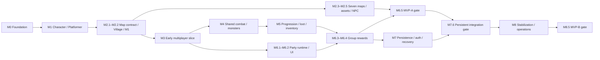

# 開發路線圖

規格基線為 Task 0（2026-11-23）。45 項 implementation tasks 的進度見各項 Status，須有驗證證據才能改為 `DONE`。協作規則見 [AGENTS.md](../AGENTS.md)。

## 1. 交付策略與 dependency graph

Task ID 是 stable identifier。Dependencies 列出的 tasks 必須完成並驗證；同一 milestone 不代表所有工作必須等前一 milestone 全部完成。M3 只需要 Village／M1 graybox，不必等七張地圖美術完成，讓多人風險提早曝光。每項 Required tests 為實作的必要檢查。

關鍵鏈：M0 → movement／graybox → M3 → shared combat → progression／personal loot → deterministic party rewards → persistent transactions／sessions → fault、mobile、load 與 operations。每階段保留可操作 build，但不以 dev identity 或 memory save 取代正式登入／持久化。

- **MVP-A = M6.5**：完整 playable gameplay loop，local single-runtime authority＋memory repositories，party 以多角色 harness 驗證。不是 production persistence 或 multiplayer release。
- **MVP-B = M8.5**：MVP-A＋真帳號、PostgreSQL、20人共享房、跨裝置與故障驗證的 multiplayer release candidate。
- 後續任務須經明確授權才開始。依 [協作規則](../AGENTS.md) 管理 commit 與 push。

## 2. M0 — Project Foundation（4 tasks）

### M0.1 — 建立 workspace 與固定相容版本

- **Task ID**：M0.1
- **目標**：建立可重現的 pnpm／TypeScript monorepo 基礎。
- **範圍**：查核 Node LTS、pnpm、React／Vite／PixiJS v8、Colyseus server／SDK／schema、Drizzle／PG 的相容性；建立 workspace、package metadata、lockfile 與空 app entry；設定 strict TS、ESLint、Prettier。先讀取適用的 package manager／formatting skills，保留任何既有設定。
- **Dependencies**：Task 0 文件基線。
- **Deliverables**：workspace manifests、版本紀錄、tsconfig／lint／format scripts、開發環境說明；無 game functionality。
- **Acceptance criteria**：fresh clone 可 frozen install，client／server shell build；版本彼此相容且記錄選型，不新增 Redis／ECS。
- **Required tests**：install reproducibility、typecheck、lint、format check、shell build smoke；確認 production bundle 未引入 server-only packages。
- **Status**：DONE
- **驗證紀錄（2026-11-23）**：Windows 使用 Node.js 24.22.3 與 pnpm 11.19.0。在乾淨目錄執行 `pnpm install --frozen-lockfile` 成功，lockfile 雜湊一致。`pnpm run typecheck`、`pnpm run lint`、`pnpm run format:check` 及 `pnpm run build` 均通過。Chrome Headless 渲染 production client，Colyseus shell 的 `/__healthcheck` 回傳 HTTP 200。在獨立驗證中，Colyseus SDK 透過 WebSocket 接收到 Schema 5 狀態，PixiJS 與 SDK 可一同建置，注入的 server-only import 被 build 拒絕。套件選型、宣告相容性設定與啟動方式見 [README](../README.md)。
- **驗證限制**：Drizzle Kit 與 Drizzle／`pg` adapter 在獨立環境完成載入驗證。Vitest 及 PostgreSQL 開發 service 由 M0.3 建立，實際 PostgreSQL 連線與 transaction 由 M7 驗證。

### M0.2 — 建立 domain 與 simulation 邊界

- **Task ID**：M0.2
- **目標**：確保 simulation 可在 browser／Node headless 共用。
- **範圍**：依 ARCHITECTURE 建立 domain models／repository ports、physics／simulation／protocol／adapter exports；fixed tick driver、injectable clock／RNG／ID；不建立 generic ECS。
- **Dependencies**：M0.1。
- **Deliverables**：最小 contracts、step shell、import boundary 規則與 pure package build。
- **Acceptance criteria**：simulation 無 DOM／React／Pixi／Colyseus／Drizzle／I/O 依賴；browser 與 Node 可使用同 step contract。
- **Required tests**：import-boundary／cycle check、fake-clock 30Hz tick count、固定 seed repeatability、catch-up 不放大 dt。
- **Status**：DONE
- **驗證紀錄（2026-11-23）**：Windows 使用 Node.js 24.22.3／pnpm 11.19.0。乾淨副本的 frozen install 與 build 前 typecheck 通過。Workspace 的 lint、format check、typecheck 與 build 通過。Node 內建 runner 的 5 項測試通過，涵蓋 fake-clock 30Hz、到期時間精度、每次最多 5 步且保留 backlog、固定 `dt` 與 seed 重播。ESLint 負向驗證攔截跨套件私有路徑、framework、Node I/O 與直接取用時間或亂數等 12 個案例，dependency graph 檢查拒絕注入的套件循環。臨時 Vite consumer 經公開入口匯入五個套件，Node 與 Chrome Headless 的 30 ticks、RNG 與注入 ID trace 完全相同。執行指令見 [README](../README.md#domain-與-simulation-驗證)。

### M0.3 — 建立測試、CI 與開發環境

- **Task ID**：M0.3
- **目標**：每個後續增量可重現驗證。
- **範圍**：Vitest、headless harness、選定 browser smoke driver、GitHub Actions、Docker 開發／測試 PG service 與環境變數樣板；不建立產品 DB schema。
- **Dependencies**：M0.1、M0.2。
- **Deliverables**：CI jobs、test setup、Docker development definition、secret-free env example、檢查指令說明。
- **Acceptance criteria**：本機與 CI 同樣執行 format／lint／typecheck／test／build，失敗可定位；PG service 可供日後 integration tests。
- **Required tests**：CI dry run、known failing test 正確使 job 失敗、container health smoke、環境 secrets 不被打包或記錄。
- **Status**：DONE
- **驗證紀錄（2026-11-23）**：以 Node.js 24.22.3／pnpm 11.19.0 在 Windows 乾淨副本依 CI 順序執行 frozen install、typecheck、lint、format check、dependency boundary check、Vitest 與 production build，鎖檔雜湊一致。Build 前的 7 項單元測試與 build 後的 2 項 Playwright Chromium smoke 都通過。README 的檢查順序與 CI 相符。
- **CI 負向驗證**：`actionlint` 與 `act --dryrun` 通過。使用 Ubuntu 容器執行同一 workflow，在隔離副本插入一個已知失敗的 assertion。前置檢查與原 7 項測試通過，`verify` 在 Unit tests 步驟以 exit code 1 失敗，Build 未啟動。GitHub 託管 runner 與遠端 cache 尚無實跑紀錄。
- **PG 與環境變數驗證**：Compose 設定驗證通過並拒絕空白密碼。PostgreSQL 18.7 完成 TCP 登入及 `SELECT 1` healthcheck，測試容器與 volume 已清理。合成憑證字串未出現在 client／server 產物與 build、app smoke 或 PostgreSQL 日誌。啟動與檢查指令見 [README](../README.md#驗證)。

### M0.4 — 建立 versioned game data 與 validators

- **Task ID**：M0.4
- **目標**：平衡、內容與 protocol 版本具有單一來源。
- **範圍**：balanceVersion、map manifest／content hash、EXP table、monster／item definition contracts 與 runtime validation；填入 GAME_DESIGN 初值，不做 gameplay。
- **Dependencies**：M0.2、M0.3。
- **Deliverables**：typed data、invalid-data diagnostics、version／hash contract、fixture seed。
- **Acceptance criteria**：負值、非整數、未知 item／map references、overflow 與不一致曲線在 startup／CI 被拒。
- **Required tests**：EXP table 與公式／總量260000、max AP120、reference integrity、同內容 hash 穩定、不同 balance 拒絕錯版 join 的 contract fixture。
- **Status**：DONE
- **驗證紀錄（2026-11-23）**：Windows 乾淨副本使用 Node.js 24.22.3／pnpm 11.19.0，frozen install 的鎖檔雜湊一致。Typecheck、lint、format check、dependency boundaries、55 項 Vitest、production build 與 2 項 Chromium smoke 均通過。Fixture 驗證 25 級累計 260000 EXP／120 AP、七圖／12 個 directed portals、引用完整性、hash 正規化及錯版 join。
- **啟動驗證**：在隔離副本注入不相容 schema 後，production server 以 exit code 1 回報 `UNSUPPORTED_SCHEMA`，在監聽前退出。Vitest 也確認未知 map 會在建立 transport 前拒絕。合法 fixture 透過 dev 入口驗證並回傳 HTTP 200。版本、hash 與編輯方式見 [Game data 載入與版本](GAME_DATA.md)。

## 3. M1 — Character & Platformer（5 tasks）

### M1.1 — 實作 custom physics 與 collision

- **Task ID**：M1.1
- **目標**：完成 framework-independent 平台移動基礎。
- **範圍**：fixed-step integration、AABB swept axis collision、solid／one-way、grounded、terminal velocity、quantization、bounds／void detection。
- **Dependencies**：M0.2、M0.3、M0.4。
- **Deliverables**：physics package、geometry fixtures、golden traces。
- **Acceptance criteria**：30Hz 下高速落下不穿平台，one-way 可由下穿過、向下可靠站立；不同 render FPS 不改位移。
- **Required tests**：floor／wall／ceiling／corner／thin platform／edge／large velocity／negative coordinate、長時間站立無 drift、重播一致性。
- **Status**：DONE
- **驗證紀錄（2026-11-23）**：Windows 使用 Node.js 24.22.3／pnpm 11.19.0。`typecheck`、`lint`、`format:check`、`check:boundaries`、82 項 Vitest、production build 與 2 項 Chromium smoke 均通過。新增 27 項物理測試，驗證支援上限速度撞上 1/1024 unit 薄平台、單向平台上下穿越規則、站立 10,000 ticks 無漂移，以及 24／60／144 FPS 模擬與兩秒停頓補跑的完整 60-tick 軌跡一致。座標、速度及 void 契約見 [ARCHITECTURE §4.1](ARCHITECTURE.md#41-m11-平台碰撞契約)。

### M1.2 — 角色 controller 與狀態機

- **Task ID**：M1.2
- **目標**：以純 simulation 控制 Beginner movement／actions。
- **範圍**：acceleration、air control、jump buffer／coyote、facing、七 presentation states 與 locomotion/action 分離；Attack／Hurt／Death 用事件 fixtures 驅動。
- **Dependencies**：M1.1。
- **Deliverables**：Player model／controller、state transition 規則、input command contract。
- **Acceptance criteria**：一個 jump edge 只跳一次；空中 attack 保留 physics；Death 優先且不再 consume movement。
- **Required tests**：held jump、buffer／coyote 邊界、左右相抵、空中 attack、hurt interruption、Death priority、相同 input trace 重播。
- **Status**：DONE
- **驗證紀錄（2026-11-23）**：Windows 使用 Node.js 24.22.3／pnpm 11.19.0。`typecheck`、`lint`、`format:check`、`check:boundaries`、106 項 Vitest、production build 與 2 項 Chromium shell smoke 均通過。新增 18 項 controller 測試及 6 項平衡資料測試，涵蓋七種 presentation states、跳躍視窗第 3／4 tick 邊界、空中 Attack、Hurt 中斷、Death 優先、指令去重與多人順序。相同輸入在 24／60／144 FPS 取樣與一次補跑 60 ticks 時得到相同 trace，既有 M1.1 golden traces 全數通過。Node 亦透過 production 公開入口驗證一次移動 tick。
- **驗證範圍**：角色行為以 headless geometry 與 action fixtures 驗證，Chromium smoke 驗證 client shell 與 server health。裝置輸入與互動畫面由 M1.3／M1.4 驗證。指令及步進契約見 [ARCHITECTURE §4.2](ARCHITECTURE.md#42-m12-角色與指令契約)，移動與狀態規則見 [GAME_DESIGN §2](GAME_DESIGN.md#2-角色移動與狀態)。

### M1.3 — PixiJS rendering 與 camera adapter

- **Task ID**：M1.3
- **目標**：將 simulation state 顯示為可操作場景。
- **範圍**：Pixi v8 application lifecycle、placeholder animation、camera follow／clamp、render interpolation、resize／DPR、React shell 與 HUD store 邊界。
- **Dependencies**：M1.2。
- **Deliverables**：render adapter、camera、debug overlays 與 client playground。
- **Acceptance criteria**：renderer 不修改 simulation；unmount 釋放 resources／listeners；viewport resize 不改碰撞座標。
- **Required tests**：adapter mapping smoke、mount／unmount leak check、camera map bounds、不同 DPR／FPS 的人工 visual check。
- **Status**：DONE
- **驗證紀錄（2026-11-23）**。Windows 使用 Node.js 24.22.3／pnpm 11.19.0。Frozen offline install、`typecheck`、`lint`、`format:check`、`check:boundaries`、122 項 Vitest、production build 和 5 項 Chromium smoke 均通過。測試驗證七種狀態、實體與單向平台著陸、24／60／144 FPS 取樣重播一致性，以及三輪場景卸載釋放 canvas、resize observer 和 WebGL context。Vite 開發版的 React StrictMode 初次載入只建立一個場景 canvas。
- **目視驗證**。Windows Chromium Headless 159.0.8154.6 取樣 1280 × 720／DPR 1／25.6 FPS（162 幀）與 667 × 375／DPR 3／35.1 FPS（207 幀）。兩種視窗皆完整顯示場景和 HUD，確認水平跟隨、邊緣限制、小世界置中留邊及 DPR 3 限制為 2。樣本來自單角色測試場的短時段瀏覽器檢查。行動實機與正式場景效能依後續 gate 驗證。生命週期與資料流見 [ARCHITECTURE §10.1](ARCHITECTURE.md#101-m13-平台測試場)。

### M1.4 — Desktop 與 mobile input

- **Task ID**：M1.4
- **目標**：兩種裝置輸出同一 logical input。
- **範圍**：指定 keyboard bindings、touch directions／jump／attack／interact／pickup／potions、multi-pointer、focus／blur／cancel、landscape hint、safe-area 與 UI rem baseline。
- **Dependencies**：M1.3。
- **Deliverables**：input adapters、touch overlay、portrait／background behavior。
- **Acceptance criteria**：移動＋jump／attack 可多指操作；開啟面板不誤觸戰鬥；切出 app 不持續卡鍵。
- **Required tests**：input edge／neutralization unit tests、keyboard focus check、667×375 touch smoke、pointercancel／rotation／resize 人工驗證。
- **Status**：DONE
- **驗證紀錄（2026-11-23）**。Windows 使用 Node.js 24.22.3／pnpm 11.19.0。`typecheck`、`lint`、`format:check`、`check:boundaries`、135 項 Vitest、production build 和 7 項 Chromium smoke 均通過。測試包含 30 Hz 取樣與序號、鍵盤焦點與輸入欄、多指移動加跳躍或攻擊，以及中斷後回到中立。原有腳本重播與 simulation golden traces 通過。
- **人工驗證**。使用有視窗的 Chromium 159.0.8154.6 和 Chromium 觸控模擬，在 667 × 375 橫向確認操作區與 `pointercancel`，在 375 × 667 直向確認旋轉提示與輸入清理，並回到 640 × 360 橫向確認版面、按鈕恢復及擷取中斷後停止移動。行動實機矩陣由 M8.2 驗證。操作與模式見 [README](../README.md#平台測試場操作)。
- **CI 迴歸（2026-11-25）**。觸控 smoke 在直橫向切換後等待原生動畫幀，讓瀏覽器先送出清除舊輸入的媒體查詢事件，再推進測試中的固定步進或開始新的觸控。Windows 對 Chromium 159.0.8154.6 執行完整 smoke，21 項均通過。GitHub Actions 的 Ubuntu 驗證待執行。
- **觸控取消迴歸（2026-11-25）**。固定步進前先確認向右與跳躍的兩個 `pointercancel` 均已送達。受控延遲重現 HUD 停留於跑步，取消送達後再推進遊戲便回到待機。150 ms RTT 多人 smoke 也在鍵盤與觸控跳躍輸入前開始記錄本機 HUD 與遠端高度。Ubuntu 24.04／Chromium 159.0.8154.6 完整 smoke 共 21 項通過，第二批使用兩個 worker。旋轉與雙指取消案例另重跑 20 次，均通過。GitHub Actions 待驗證。

### M1.5 — HP／MP、Death 與安全區 respawn fixture

- **Task ID**：M1.5
- **目標**：先完成角色生命週期，再接真 combat。
- **範圍**：HP／MP runtime fields、hurt immunity、Death timer、清 input／action、safe hub fixture 的滿血 respawn；不做 EXP 或 DB。
- **Dependencies**：M1.2、M1.4。
- **Deliverables**：生命週期 controller、HUD、debug damage harness。
- **Acceptance criteria**：HP=0 後3秒回 fixture hub，無重複 body／respawn；MP 不為負；Hurt 期間操作符合規則。
- **Required tests**：simultaneous damage／i-frames、Death 不能 attack、重複 Death event、void fall、respawn timer；M2.2 需替換為真正 Village spawn。
- **Status**：DONE
- **驗證紀錄（2026-11-24）**。Windows 使用 Node.js 24.22.3／pnpm 11.19.0。`typecheck`、`lint`、`format:check`、`check:boundaries`、152 項 Vitest 與 production build 均通過。測試涵蓋 6 tick Hurt、30 tick 傷害免疫、HP／MP 邊界、void 與重複死亡、D + 90 恢復同一 body、舊生命指令失效、固定步進重播與 M1.1 golden traces。生命週期與資料契約見 [ARCHITECTURE §4.3](ARCHITECTURE.md#43-m15-hpmp-與重生契約)。
- **瀏覽器驗證**。Chromium 159.0.8154.6 的 7 項 smoke 通過。2567 已由開發伺服器占用，smoke 使用正式版 client preview 並重用既有 health endpoint，正式版 server 另在隔離的本機埠驗證 HTTP 200。另在 Chromium 開發版操作傷害按鈕，確認 HP 50 → 40 → 0、倒地、清除按住的控制，及回安全區時補滿 HP／MP。觸控使用 667 × 375 橫向模擬。正式建置有 Vite 的 chunk 大小提示。

## 4. M2 — World & Maps（5 tasks）

### M2.1 — Tiled contract、importer 與 validation

- **Task ID**：M2.1
- **目標**：讓 map authoring 有明確支援範圍與可機器驗證的出口。
- **範圍**：finite orthogonal JSON、tile／object layers、external tilesets、GID flags；collider、portal、spawn、monster spawn、NPC／loot fallback object schemas。
- **Dependencies**：M0.4、M1.1。
- **Deliverables**：map authoring guide、import tool、normalized immutable map data、validator。
- **Acceptance criteria**：unsupported format 明確拒絕；spawn 有支撐／headroom；portal target／reverse reference／collision 有效。
- **Required tests**：missing object／duplicate ID／broken tileset／GID flip／one-way geometry／invalid spawn／out-of-bounds 與 content hash fixtures。
- **Status**：DONE
- **驗證紀錄（2026-11-24）**。Windows 使用 Node.js 24.22.3／pnpm 11.19.0。`typecheck`、`lint`、`format:check`、`check:boundaries`、199 項 Vitest 與 production build 均通過。47 項 Tiled 測試涵蓋格式拒絕、ID、外部 atlas、GID、出生支撐和淨空、portal 引用與碰撞、M1.1 落地行為及 hash 相容性。CLI 以七圖 manifest 驗證暫存地圖，錯誤 atlas 在載入階段以欄位路徑拒絕。製作與匯出方式見 [Tiled 地圖製作指南](TILED_MAPS.md)。
- **瀏覽器驗證**。預設 2567 已由開發伺服器占用，改用暫存 Playwright 設定，在 25821 啟動本次正式建置。並行 smoke 的觸控案例曾逾時，改用單一 worker 後 7 項 Chromium smoke 全數通過。Vite 建置仍有 chunk 大小提示。完整地圖與通行驗證由 M2.2／M2.3 接續。

### M2.2 — Village／M1 graybox 與 portal 基礎

- **Task ID**：M2.2
- **目標**：提供 early multiplayer slice 所需的最小真實世界。
- **範圍**：Village、M1 Tiled graybox；雙向 portal／safe spawns、local transfer contract、Village safety；替換 M1.5 hub fixture。
- **Dependencies**：M2.1、M1.5。
- **Deliverables**：兩 maps、`spawn_respawn`、portal pair、local transition controller。
- **Acceptance criteria**：兩圖可雙向走訪，spawn 無碰撞／bounce，Village 無怪且無傷害，death 回真正 Village。
- **Required tests**：portal overlap／Up 按下邊緣／持續按住與重新按下／過期或重複輸入／invalid destination／spawn protection／failed transfer。兩圖 keyboard／touch walkthrough。
- **Status**：DONE
- **驗證紀錄（2026-11-24）**。Windows、Node.js 24.22.3、pnpm 11.19.0。`validate:maps` 驗證兩圖的 11 個 collider、3 個 spawn 與雙向 portal。預設載入和以反向順序指定 JSON 都得到 SHA-256 `08b5c271bb8f013bf09aaff90e933ac83660209bf0e1e0cfea4994422db798ef`。`typecheck`、`lint`、`format:check`、`check:boundaries`、`test`（214 項）及 `build` 通過。Vite 仍有 chunk 大小提示。
- **瀏覽器驗證**。Chromium 159.0.8154.6 的 9 項 smoke 通過。桌面鍵盤與 667 × 375 橫向觸控模擬都完成雙向走訪，通過 Up 邊緣、畫布重用、鏡頭跟隨及死亡返村檢查。2567 已由開發伺服器占用，使用 `VIESMA_SERVER_PORT=25822` 與單 worker 驗證正式建置。
- **製作限制**。兩圖以原創矩形物件圖層作為 graybox。專案匯入器已驗證來源 JSON。驗證環境封鎖 Tiled 安裝套件解包，編輯器重新匯出未實跑。 [地圖與匯出流程](TILED_MAPS.md#七圖-graybox)

### M2.3 — 七圖 topology 與完整 graybox

- **Task ID**：M2.3
- **目標**：完成全部區域與連線。
- **範圍**：M2–M6、地形、建議等級、12 portals、monster patrol／flight spawn zones、Bat loot fallback；不要求完整美術才往 M3。
- **Dependencies**：M2.2。
- **Deliverables**：七 map exports／source、manifest、portal／spawn matrix。
- **Acceptance criteria**：topology 僅有規格六條雙向邊；各圖有安全出入口，所有 map 可從 Village 到達並返回。
- **Required tests**：graph reachability、12 directed edges、missing reverse／bad spawn validator、七圖 platform／void walkthrough。
- **Status**：DONE
- **資料驗收（2026-11-24）**。七張 Tiled JSON 通過 `validate:maps`，共 51 個 collider、13 個玩家生成點、12 個傳送門、68 個怪物生成標記與 5 個 Bat 掉落備援點。驗證六條雙向連線、反向引用、生成點支撐和淨空。內建載入、明確指定檔案及反轉檔案順序均得到 SHA-256 `6aa7e4a56492d94fac28301d3b3c62a4fefeaea2283fb9b97ee29974b7a1b974`。 [地圖來源與地形](TILED_MAPS.md#七圖-graybox) · [Portal 與 spawn 矩陣](GAME_DESIGN.md#11-portal-與-spawn-契約)
- **移動與生命週期驗收**。以 30 Hz Beginner 輸入驗證 32 條出生點至出口路線、M2–M6 的踏面落地、M1 單向橋及 M6 裂隙雙向通行。七圖 12 次換圖可決定性重播。六張戰鬥圖死亡後都於第 90 tick 返回 `village/spawn_respawn` 並補滿 HP／MP，舊 mapEpoch 的指令無效。另驗證 M1、M6 墜落返村和 Village 安全區。
- **實際檢查**。Windows、Node.js 24.22.3、pnpm 11.19.0。 `typecheck`、`lint`、`format:check`、`check:boundaries`、`test`（266 項）和 `build` 通過。Chromium 159.0.8154.6 的 10 項 production smoke 通過，使用 client preview 4173、隔離 server 25823 和單一 worker。桌面鍵盤走完全部 12 個傳送方向，確認抵達鏡頭、角色位置與畫布重用。667 × 375 橫向觸控模擬完成 Village 與 M1、M2 的往返。
- **驗證限制**。Tiled 編輯器未安裝，執行環境政策封鎖官方 MSI 的管理式解包，因此編輯器開啟及重新匯出未驗證。正式版通過建置，Vite 仍提示主 chunk 超過 500 kB。

### M2.4 — 原創／授權 asset pipeline

- **Task ID**：M2.4
- **目標**：替換 placeholder 時不破壞遊戲邊界或授權來源。
- **範圍**：atlas／animation manifest、Beginner 七狀態與三 monsters 視覺、tiles／NPC／loot assets、license／attribution manifest；audio 可延後，不阻擋 MVP。
- **Dependencies**：M2.2、M1.3。
- **Deliverables**：資產與來源／授權紀錄、lazy-loading manifest、sprite/render dimensions。
- **Acceptance criteria**：無受保護 MapleStory 素材；visual size 不決定 collision；首 Village 必要壓縮資產目標≤5MiB。
- **Required tests**：manifest reference／license check、animation coverage、asset load failure／fallback、render visual QA 與 cold-load size measurement。
- **Status**：DONE
- **交付（2026-11-24）**。三張可重生的原創 PNG 圖集和七個視覺 ID，涵蓋 Beginner 七狀態、三種怪物、圖塊、Guide 與掉落袋。Vite 驗證來源、摘要、授權、圖框與 Tiled 引用，再發布帶摘要的圖集及署名。Pixi 依 ID 延遲載入，碰撞與腳底定位沿用 simulation 的 24 × 48 world-unit body。 [資產工作流程](ASSETS.md) · [原創來源紀錄](../content/assets/provenance/graybox.md)
- **建置及資料驗收**。Windows、Node.js 24.22.3、pnpm 11.19.0。 `validate:assets`、`validate:maps`、`typecheck`、`lint`、`format:check`、`check:boundaries`、`test`（296 項）及 `build` 通過。兩次正式 client 建置的 15 份檔案 SHA-256 完全相同。七圖 hash 為 `6aa7e4a56492d94fac28301d3b3c62a4fefeaea2283fb9b97ee29974b7a1b974`。
- **瀏覽器驗收**。Chromium 159.0.8154.6、WebGL SwiftShader、client preview 4173、server 25824、單一 worker。最終 `test:smoke` 12 項通過，包含桌面鍵盤、667 × 375 觸控模擬及全部 12 次換圖。每次抵達後只追蹤到 Beginner 與當前地圖的 ImageBitmap／WebGL texture，卸載後皆為 0。檢視 Village、Forest Entrance 及缺圖畫面截圖。開發伺服器實際省略選用的 Village PNG 時回傳 404，Beginner 圖集仍可載入，鍵盤可操作。正式版故障注入也覆蓋解碼失敗和圖形 fallback。
- **冷載入驗收**。停用瀏覽器快取後，首個 Village 載入 12 份資源。以 HTTP 回應的 HTML／JS／CSS 內容重新計算 gzip，加上 PNG 實際檔案大小，共 252,891 bytes（約 247 KiB），其中圖集 1,537 bytes。戰鬥圖集延後至換圖下載。
- **驗證限制**。交付為原創 graybox 視覺樣本。第三方授權路徑用合成資料驗證，未引入第三方美術。實機與長時間記憶體量測仍由 M8.2 處理。Vite 仍提示主 chunk 超過 500 kB。

### M2.5 — Guide NPC 與世界 gate

- **Task ID**：M2.5
- **目標**：世界可教學、可走訪且內容驗證完整。
- **範圍**：Village Guide dialogue、互動距離與焦點、七圖最終 world validation；保持無 shops／quests。
- **Dependencies**：M2.3、M2.4、M1.4。
- **Deliverables**：NPC dialogue data／UI、world walkthrough record、map／license validation report。
- **Acceptance criteria**：keyboard／touch 可開關對話，介紹基本循環；七圖與12 portals 皆經實際走訪。
- **Required tests**：距離／未知 NPC 拒絕、focus 不誤觸、reachable graph CI、desktop／mobile world smoke。
- **Status**：DONE
- **驗證紀錄（2026-11-24）**。Windows、Node.js 24.22.3、pnpm 11.19.0。`validate:maps`、`validate:assets`、`typecheck`、`lint`、`format:check`、`check:boundaries`、`test`（312 項）及 `build` 通過。Vitest 涵蓋 96 units 含邊界、角色狀態、NPC／地圖 ID、舊生命與舊 epoch、重複與衝突序號、舊對話關閉請求、死亡及換圖中斷、確定性重播、傳送失敗與七圖可達性。
- **七圖與資產驗證**。CLI 驗證 7 張地圖、12 個方向傳送門、13 個角色出生點與 Village `npc_guide`。`mapContentHash` 為 `ee0a09e481b4d09daa529cf85a08cb7764685edf809f348a6c2dc62dbe94d5aa`。資產驗證通過 3 張 `project-owned` 原創圖集與 7 個 sprite 的來源、圖框、授權紀錄及發行署名。 [地圖契約](TILED_MAPS.md) · [資產管線](ASSETS.md)
- **瀏覽器走訪**。Chromium 159.0.8154.6／WebGL SwiftShader，client preview 4173，server 25825。桌面以鍵盤走完 Village → M1 → M5 → M1 → Village → M2 → M6 → M2 → Village → M3 → Village → M4 → Village，每次抵達驗證地圖、鏡頭及畫布重用，卸載後追蹤的圖集 ImageBitmap 與 WebGL texture 均為 0。桌面確認 Guide sprite、E 開關、面板焦點隔離及 W 傳送。667 × 375 觸控模擬確認完整對話可讀、觸控開關與關閉按鈕，並走訪 Village、M1、M2。預設時限的一輪有腳本播放與世界走訪逾時，最終以 `pnpm run test:smoke --workers=1 --timeout=180000` 完成 14 項。 [Guide 驗收](../tests/smoke/guide.spec.mjs) · [七圖走訪](../tests/smoke/world.spec.mjs)
- **限制**。HP 藥水與組隊屬 Guide 教學內容，對應玩法由後續任務接入。行動實機與長時間資源量測留待 M8.2。Vite 仍對約 594 kB 的主 chunk 提示大小警告。

## 5. M3 — Early Multiplayer Vertical Slice（5 tasks）

### M3.1 — Colyseus room adapter 與 authoritative loop

- **Task ID**：M3.1
- **目標**：同房兩 client 由同一 simulation authority 控制。
- **範圍**：dev-only identity、MapRoom public Schema、WorldCoordinator／CharacterActor registry、30Hz scheduler／10Hz patches、runtime message validation／seat reservations。
- **Dependencies**：M0.3、M0.4、M1.2、M2.2。
- **Deliverables**：server／client network adapters、public state projection、headless room harness。
- **Acceptance criteria**：兩 client 入同 M1、看見彼此；每 tick 只 step 一次；simulation 不引入 Colyseus；21st seat 不進滿 room。
- **Required tests**：join／leave／seat reservation races、invalid payload／protocol mismatch、scheduler double-step／catch-up、兩 browser movement smoke。
- **Status**：DONE
- **驗證紀錄（2026-11-24）**。Windows、Node.js 24.22.3、pnpm 11.19.0。暫用 server port 25825，避開已占用的 2567。`validate:assets`、`validate:maps`、`typecheck`、`lint`、`format:check`、`check:boundaries`、`test`（319 項）與 `build` 均通過。開發用 TypeScript 入口的健康檢查回傳 HTTP 200。
- **房間與排程**。實際 WebSocket 測試覆蓋同房公開狀態、第二房隔離、版本不符、身份與欄位驗證、斷線清理、21st seat 拒絕、一次性預留消費與逾時回收。Headless harness 驗證單一 30 Hz driver、同 tick 不重跑、每次最多補 5 ticks、規律與延遲喚醒的重播一致。 [房間整合](../apps/server/test/map-room.test.mjs) · [Headless harness](../apps/server/test/map-runtime.test.mjs) · [實作契約](ARCHITECTURE.md#46-m31-m1-開發房)
- **瀏覽器驗收**。Chromium 159.0.8154.6／SwiftShader。兩個獨立工作階段在 M1 以桌面鍵盤與 667 × 375 橫向觸控移動，驗證同房角色與對方離房後的畫面更新。預設六工人並行執行時，14 項通過，多人案例觸發 `WORLD_TICK_BACKLOG` 入房保護。`pnpm run test:smoke --workers=1 --timeout=180000` 完整通過 15 項。 [兩瀏覽器驗收](../tests/smoke/multiplayer.spec.mjs)
- **限制**。開發角色限單次連線及 M1，畫面依 10 Hz patch 更新。實機、高延遲及持續負載的表現留待後續驗證。Vite 主 chunk 約 595 kB，仍有大小提示。

### M3.2 — Local prediction 與 server reconciliation

- **Task ID**：M3.2
- **目標**：延遲下仍能即時操作且服從 server collision。
- **範圍**：InputFrame seq／epochs、bounded queue、ack、完整 controller checkpoint、未 ack input replay、visual correction／hard reset。
- **Dependencies**：M3.1、M1.4。
- **Deliverables**：prediction controller、input history、correction diagnostics。
- **Acceptance criteria**：client 多送 frame 不加速；stale input 不生效；重連／Death／map switch 清 history；不因 correction 穿牆。
- **Required tests**：duplicate／stale／future burst／overflow、150ms RTT／jitter、edge jump／attack 重播、render FPS 獨立、wall correction trace。
- **Status**：DONE
- **驗證紀錄（2026-11-24）**。Windows、Node.js 24.18.0、pnpm 11.19.0。預設連接埠 2567 已占用，smoke 使用 25825。`validate:assets`、`validate:maps`、`typecheck`、`lint`、`format:check`、`check:boundaries`、`test`（332 項）及 `build` 均通過。pnpm 回報 Node 低於專案指定的 24.22.3，Vite 發出約 595 kB 主 chunk 的大小提示。
- **輸入與校正**。有界佇列、過遠序號、stale／duplicate／衝突幀、Death／epoch／連線清理及 owner-only checkpoint 都有測試。75 ms 單向延遲與最多 ±24 ms 單向 jitter 以注入時鐘重現。兩種渲染頻率的輸入與最終狀態一致，涵蓋 coyote／buffered jump、Attack edge 保留及 solid 阻隔的校正路徑。 [本機預測測試](../apps/client/test/local-prediction.test.mjs) · [伺服器步進測試](../apps/server/test/map-runtime.test.mjs) · [WebSocket 房間測試](../apps/server/test/map-room.test.mjs) · [同步契約](ARCHITECTURE.md#53-predictionreconciliation-與-interpolation)
- **瀏覽器驗收**。Chromium 159.0.8154.6／SwiftShader。雙瀏覽器在 M1 同房，用桌面鍵盤及 667 × 375 橫向觸控驗證封包送達前的移動、恢復傳輸後超過 64 world units 的權威校正、同伴離房、連線及畫布清理，兩頁皆無未捕捉的執行期例外。首次預設六工人執行時有 14 項通過，多人案例入場逾時且期間記錄到 tick 積欠。增加多人案例的就緒等待時間後，`pnpm run test:smoke --workers=1 --timeout=180000` 及預設六工人的 `pnpm run test:smoke` 重跑均通過 15 項。 [多人 smoke](../tests/smoke/multiplayer.spec.mjs)
- **限制**。Wire protocol v2 需搭配同版本的 client 與 server。線上測試限 M1 的單次連線開發角色，其他角色使用最新的公開 patch。實體裝置與長時間負載留給後續驗證。

### M3.3 — Remote interpolation 與共享怪物 fixture

- **Task ID**：M3.3
- **目標**：提早證明 shared entity 只有一份權威狀態。
- **範圍**：remote snapshot buffer、100ms interpolation／bounded extrapolation；server 驅動一隻簡化巡邏怪物與測試 HP event；不做完整 AI／rewards。
- **Dependencies**：M3.1、M1.3。
- **Deliverables**：remote entity view、same monster ID／HP fixture、snapshot diagnostics。
- **Acceptance criteria**：兩 browser 看見同一隻怪，測試 HP／delete 同步；client 不各自 spawn 或跑 authoritative AI。
- **Required tests**：snapshot gaps／stall／full rejoin、entity add／remove、event de-dup、interpolation bounds、兩 client HP 一致。
- **Status**：DONE
- **驗證紀錄（2026-11-24）**。Windows、Node.js 24.18.0、pnpm 11.19.0。`validate:assets`（7 個 sprite）、`validate:maps`（7 張圖）、`typecheck`、`lint`、`format:check`、`check:boundaries`、`test`（348 項）及 `build` 均通過。pnpm 提示 Node 低於專案指定的 24.22.3，Vite 提示主 chunk 約 596 kB。
- **同步與隔離**。遠端畫面用 10 Hz patch、100 ms 延遲與每 entity 8 筆歷史。缺一筆時可插值，活角色最多外推 100 ms。測試覆蓋 jitter、stall、舊 tick、瞬移／世代切換、離房與緩衝清理。既有本人 150 ms RTT 回歸通過。M1 房間各有從驗證資料建立的巡邏 Slime；測試覆蓋固定 tick 重播、HP／移除去重、伺服器投影、偽造 client 訊息拒絕及跨房隔離。 [同步契約](ARCHITECTURE.md#53-predictionreconciliation-與-interpolation) · [房間測試](../apps/server/test/map-room.test.mjs)
- **Chromium 驗收**。Chromium 159.0.8154.6（啟用 SwiftShader），預設 2567 已占用，`pnpm run test:smoke` 使用 25825。預設 6 workers 完整重跑通過 16 項。雙頁以各自收到的相同 server tick 比對怪物 ID／位置，注入 45 ms 有序下行延遲並在多個 patch 之間驗證遠端中間位置。離房移除同伴 sprite，Slime 留在房內，重入取得相同 ID。伺服器測試事件令兩頁觀察到相同的 HP 71 → 35 與後續 sprite 移除。既有桌面鍵盤與 667 × 375 橫向觸控回歸通過，兩頁各維持一個 canvas，無未捕捉的執行期例外。前兩輪修正了固定畫面取樣頻率與兩頁同步讀取的測試假設。 [多人 smoke](../tests/smoke/multiplayer.spec.mjs)
- **限制**。公開 Schema 升到 protocol v3，client 與 server 需配對更新。遠端外推僅呈現座標，斷訊或地形邊緣可有短暫視覺偏差。多人驗證限 M1 開發房與單隻地面巡邏 fixture。平行 smoke 曾觀察到短暫 tick backlog；實機與長時間負載另由後續任務驗證。

**Pre-M3.4 維護（2026-11-25）**。六幀佇列保留有效輸入邊緣，加入 200 ms 伺服器排隊期限與累積 ACK 回歸。多人地圖名稱取自已載入資料，畫面診斷改為明確啟用，根 dev 入口集中建置共享套件，CI 由 lint 執行套件邊界檢查。Node.js 24.22.3／pnpm 11.19.0 通過 356 項 Vitest，三個 dev 入口皆從乾淨輸出啟動。 [輸入與同步契約](ARCHITECTURE.md#5-input-protocol-與同步) · [開發與驗證](../README.md#開發環境)

六 worker 重疊測試重現 `WORLD_TICK_BACKLOG`。拒絕前喚醒間隔達 3.36 秒，Node 主執行緒約用 16 ms CPU，入房時仍積欠 92 ticks，支持測試主機資源競爭是主因。`test:smoke` 先用單 worker 跑多人測試，完成清理後再以預設 worker 跑其餘測試。保留入房保護、30 Hz 步進、5 ticks 補跑上限、10 Hz 公開 patch、輸入佇列與 TTL、ACK 與校正契約。需要調查全套平行負載時，直接執行 `pnpm exec playwright test --workers=6`。 [Smoke 指令](../README.md#app-smoke)

Windows 以 Node.js 24.22.3／pnpm 11.19.0 通過資產與地圖驗證、typecheck、lint、格式與套件邊界檢查、356 項 Vitest 及正式建置。`--list` 確認兩批完整涵蓋原有 17 項且無重複。兩輪 smoke 都通過多人 3/3 與其餘 14/14。已驗證兩批的退出碼、啟動失敗與 Windows Ctrl+C 清理。Ubuntu CI 待執行。多人 smoke 的量測範圍為單房雙瀏覽器，多房、滿房與長時間負載仍由 M8.3 驗證。

### M3.4 — Cross-room transfer 與基礎 reconnect

- **Task ID**：M3.4
- **目標**：角色跨圖只有一份 body，失敗能回復。
- **範圍**：source／destination seat、one-time transfer ticket、actor handoff／mapEpoch、dev reconnect grace、global character routing；正式 account lease 留 M7。
- **Dependencies**：M3.1、M3.2、M2.2。
- **Deliverables**：transfer state machine、destination reservation／rollback、private-message routing contract。
- **Acceptance criteria**：Village↔M1 transfer 無雙 body；滿房／ticket timeout 回來源；commit 後掉線從 destination 恢復。
- **Required tests**：transfer ticket replay／wrong owner／timeout、source disconnect／destination failure、20-seat races、input stale mapEpoch、兩端 handoff fault injection。
- **Status**：DONE
- **驗證紀錄（2026-11-25）**。Windows 使用 Node.js 24.22.3／pnpm 11.19.0。資產、七圖與 12 個 directed portals、typecheck、lint、格式、套件邊界、365 項 Vitest 及正式建置全部通過。決定性測試驗證雙向交接在兩房步進前完成、單一 body 與本人 checkpoint、20 席競爭、錯誤 owner／舊 ticket、逾時、建房與接線失敗、提交前後掉線、30 秒保留期與舊 epoch fencing。
- **瀏覽器驗收**。Chromium 159.0.8154.6／SwiftShader，以兩個工作階段驗證同房、鍵盤與 667 × 375 橫向觸控往返 Village／M1、保持同一角色及 canvas、提交後掉線從 Village 恢復、prediction 與 interpolation 重設、M1 共享 Slime，以及沒有 uncaught runtime errors。Smoke runner 多人階段 4／4、其餘 14／14。清單與直接 discovery 比對確認 18 項各執行一次。Vite 仍提示主 bundle 超過 500 kB。 [架構契約](ARCHITECTURE.md#6-map-authoringroom-與-transfer) · [決定性測試](../apps/server/test/world-travel.test.mjs) · [瀏覽器測試](../tests/smoke/multiplayer.spec.mjs)

### M3.5 — Early multiplayer slice gate

- **Task ID**：M3.5
- **目標**：在完整 RPG systems 前驗證同步架構。
- **範圍**：整合兩 browser keyboard／touch、movement prediction、共享怪物 fixture、雙圖 transfer／reconnect；記錄 latency、tick 與 bandwidth 初值。
- **Dependencies**：M3.2、M3.3、M3.4。
- **Deliverables**：可展示 vertical slice、測試結果、已知差異與風險紀錄。
- **Acceptance criteria**：兩 client 同圖跑跳、同 monster ID／HP、往返兩圖，150ms RTT 下可操作；清楚標示 dev identity／無正式儲存。
- **Required tests**：端對端固定 scenario、短暫掉線、wrong protocol／map hash、input flood 不加速、owner-channel routing isolation smoke。
- **Status**：DONE
- **驗收紀錄（2026-11-25）**。Windows 使用 Node.js 24.22.3／pnpm 11.19.0。資產（7 個 sprite）、七圖與 12 個方向傳送門、typecheck、lint、格式、套件邊界、368 項 Vitest 與正式建置通過。Chromium smoke 先跑多人 5／5，再跑其餘 14／14。與直接 discovery 比對，19 項各出現一次。列出的結果來自本機工作樹，本次變更尚待 Ubuntu CI。
- **雙瀏覽器**。Chromium 159.0.8154.6／SwiftShader，桌面鍵盤與 667 × 375 橫向觸控在雙向各 75 ms 的 WebSocket 延遲設定下同房跑跳、看到同一 Slime ID／HP，完成 M1 ↔ Village 往返與短暫斷線重連。虛空死亡後以同一角色與 canvas 回 Village，故意延後目的地入房確認也可從目的地恢復。UI 標示開發用匿名身分與記憶體暫存。 [瀏覽器驗收](../tests/smoke/multiplayer.spec.mjs)
- **權威與生命週期**。交接先準備兩房狀態，再於同一 world tick 步進前提交。準備拋錯保留來源，提交後通知失敗保留目的席位。回歸覆蓋單一 body／綁定、20 席限制、房間銷毀、舊 ticket／epoch、本人 checkpoint、版本與地圖 hash 拒絕，以及大量輸入與正常送幀位移相同。 [決定性測試](../apps/server/test/world-travel.test.mjs) · [WebSocket 測試](../apps/server/test/map-room.test.mjs)
- **量測初值與限制**。Windows 11／Core i7-1355U 在 17.66 秒內推進 531 ticks，含 157 個額外補跑 ticks。218 次單 tick 喚醒的耗時 p95／p99 為 1.12／8.29 ms。代理實測單向延遲中位數為 84.32–86.52 ms，差額包含本機排程。桌面上／下行為 4.08／4.74 KiB/s，觸控為 3.07／4.63 KiB/s，僅計 WebSocket payload。Vite 主 bundle 為 596.43 kB 並有大小提示。實機與多房持續負載留待 M8.2／M8.3。

## 6. M4 — Shared Combat & Monsters（5 tasks）

### M4.1 — Monster archetypes 與完整 AI

- **Task ID**：M4.1
- **目標**：以 server simulation 產生三種共享怪物行為。
- **範圍**：Slime／Mushroom／Bat data、spawn／patrol／aggro／chase／attack／return、leash／edge／flight bounds；先以 M1 與 fixture maps 驗證。
- **實作順序**：先將 MapRuntime 的暫時 `MonsterFixture` 權威狀態遷入 `SimulationState.map.monsters`，再擴充 AI。沿用雙客戶端 ID／HP 一致、跨房隔離與重入的回歸。 [架構契約](ARCHITECTURE.md#7-shared-monster-與-reward-pipeline)
- **Dependencies**：M3.5、M0.4。
- **Deliverables**：monster models／FSM、spawn director、各 archetype traces。
- **Acceptance criteria**：同 room 一份 AI；ground monster 不跌出 patrol segment、Bat 不穿 solid；return 重置 encounter／HP。
- **Required tests**：target ties／dead target／grace-disconnected body仍可被攻擊／expired body移除／aggro distances／unreachable platform／leash reset／spawn count cap／same-seed replay。
- **Status**：DONE
- **權威與決定性驗收（2026-11-25）**。共用 30 Hz simulation 步進角色與怪物，M1 每房從資料建立六隻 Slime、四隻 Mushroom。測試覆蓋空房步進、房間隔離、出生上限、固定快照順序、重連與銷毀、Slime 原始巡邏及半血／移除回歸。AI 測試涵蓋等距、死亡與保護排除、寬限期及到期移除、目標與 leash 邊界、不可達平台、Bat 飛行區及 solid、攻擊時序、Return 回滿 HP／換 encounter 與同 seed 重播。 [AI 測試](../packages/simulation/test/monster-ai.test.mjs) · [房間測試](../apps/server/test/map-runtime.test.mjs) · [重連測試](../apps/server/test/world-travel.test.mjs)
- **Chromium 驗收**。雙客戶端在相同 server tick 核對整批怪物 ID、座標與 HP，重入及重連後沿用相同 ID。移除測試 Slime 時只清理其 sprite，150 ms RTT 的桌面鍵盤、橫向觸控、傳送、死亡回村與單 canvas 回歸通過。 [瀏覽器測試](../tests/smoke/multiplayer.spec.mjs)
- **本機檢查**。Windows、Node.js 24.22.3／pnpm 11.19.0。資產、七圖、typecheck、lint、格式、套件邊界、383 項 Vitest 和正式建置通過。循既有 smoke runner 完成多人 5／5、其餘 14／14，19 項與直接 discovery 一致且各出現一次。Ubuntu CI 尚未驗證本次工作樹。

### M4.2 — Authoritative basic attack 與受傷

- **Task ID**：M4.2
- **目標**：合法 input 才能造成有效 damage。
- **範圍**：player／monster attack timing、hitbox／obstruction、cooldown、critical RNG、physical／magic defense、hurt immunity 與 combat ordering。
- **Dependencies**：M4.1、M1.5。
- **Deliverables**：combat resolver、damage events、server validation errors。
- **Acceptance criteria**：client 不能指定 damage／HP；每 swing 每 target 只一次、最多3 monsters；同 tick player lethal hit 取消 monster hit。
- **Required tests**：range／facing／wall／cooldown boundaries、duplicate attack、critical seeded examples、multi-target ordering、i-frame／protection、malformed damage payload 拒絕。
- **Status**：DONE
- **權威戰鬥驗收（2026-11-25）**。固定 tick 依序步進角色與怪物，結算合法普攻及怪物傷害。決定性測試通過 48 × 40 矩形與 reach 邊界、朝向鎖定、solid 遮擋、時序與 cooldown、重複輸入／swing ID、三目標排序、seeded 暴擊、物防／魔防、最低傷害與 overkill、Hurt／保護／Village、同 tick 致死、Return encounter 重置與精確重播。房間測試確認偽造欄位整幀拒絕、grace body 可受傷、到期移除及致死後 90 ticks 開始返村交接。 [戰鬥測試](../packages/simulation/test/combat.test.mjs) · [輸入測試](../apps/server/test/map-runtime.test.mjs) · [交接測試](../apps/server/test/world-travel.test.mjs)
- **Chromium 驗收**。兩個獨立瀏覽器收到同一 Slime HP 71 → 51；送達伺服器的偽造傷害封包維持兩端 HP 71。隔離 fixture 在 tick 邊界只調整角色位置，正常的 Slime AI 使該角色 HP 50 → 43，旁觀者保持 50 HP。單 canvas、sprite 數量、執行期錯誤、預測校正、150 ms RTT 設定下的傳送／重連及原有 M4.1 回歸通過。 [瀏覽器測試](../tests/smoke/multiplayer.spec.mjs)
- **本機檢查**。Windows、Node.js 24.22.3／pnpm 11.19.0。資產、七圖、typecheck、lint、格式、套件邊界、419 項 Vitest、正式建置及 Chromium 159.0.8154.6 smoke 通過。隔離多人 6／6、其餘 14／14，合併 discovery 與直接 discovery 相符，20 項各出現一次。本次工作樹的 Ubuntu CI 尚未執行。

### M4.3 — Contribution ledger 與單次 death claim

- **Task ID**：M4.3
- **目標**：建立 EXP／loot 的可靠共同來源。
- **範圍**：EffectiveDamage、first-hit affiliation contract、encounter IDs、RewardPending transition、immutable death intent／memory idempotency；先不實作 party 分配。
- **Dependencies**：M4.2。
- **Deliverables**：contribution ledger、deathId／attackId 去重、reward port 與 memory receipt skeleton。
- **Acceptance criteria**：overkill 不多算、同 monster 只一 death intent；return 清 ledger；async callback 不再次 claim。
- **Required tests**：兩個 simultaneous lethal hits、40+40 對60HP、duplicate event、stale generation、D=0 removal／return 不發獎勵、event permutation replay。
- **Status**：DONE
- **決定性驗收（2026-11-25）**。40＋40 對 60 HP 記為 40＋20，尾刀先入帳，同 tick 只建立一份 death intent 並取消已死亡怪物的攻擊。測試涵蓋重複與過期事件、指令排列重播、Return 清帳與新 encounter ID、無傷害移除、群組歸屬與資格邊界、掉線／重連／交接，以及提交失敗、確認遺失與房間銷毀後完成結算。 [戰鬥測試](../packages/simulation/test/combat.test.mjs) · [帳本測試](../packages/simulation/test/encounter-rewards.test.mjs) · [receipt 測試](../apps/server/test/encounter-reward-worker.test.mjs) · [交接測試](../apps/server/test/world-travel.test.mjs)
- **本機驗收**。Windows、Node.js 24.22.3、pnpm 11.19.0。資產、七張地圖、typecheck、lint、格式、套件邊界、435 項 Vitest、正式建置與 Chromium 159.0.8154.6 smoke 全數通過。兩位瀏覽器玩家共同削減 71 HP，兩端移除同一 sprite，伺服器 fixture 確認唯一 claim 與 receipt。多人 7／7、其餘 14／14，分階段和直接 discovery 的 21 項各出現一次。 [瀏覽器測試](../tests/smoke/multiplayer.spec.mjs)
- **Ubuntu CI**。遠端基線 `2f737ae` 的 Ubuntu verify 已通過。M4.3 留在本機工作樹，尚未執行 Ubuntu CI。 [基線 CI](https://github.com/Jacky-stc/Viesma/actions/runs/45460525502/job/138681525944)

### M4.4 — Combat feedback、monster respawn 與玩家返村

- **Task ID**：M4.4
- **目標**：完成多人共享戰鬥生命週期的可見回饋。
- **範圍**：damage numbers／swing／hurt／death、memory receipt 後 corpse／respawn、Village 玩家 respawn／protection；替換 M3.3 fixture。
- **Dependencies**：M4.2、M4.3、M2.2、M3.3。
- **Deliverables**：combat view adapter、完整 monster lifecycle、death／respawn HUD。
- **Acceptance criteria**：兩 client HP／死亡／新 monster generation 一致；RewardPending 不可再命中；玩家只 respawn 一次。
- **Required tests**：visual event 去重、掉線後 full state、不重播舊 damage、respawn ID／timer、pending reward failure、player death／portal conflict。
- **Status**：DONE
- **決定性驗收（2026-11-25）**。舊死亡 ID、舊世代、重複 receipt、提交失敗與確認遺失的重試都維持單一死亡認領。測試覆蓋 receipt 邊界、屍體 30 ticks、重生等待 300 ticks、新世代身分、出生上限、同 seed 重播、斷線快照與傷害去重。玩家測試覆蓋 portal 票券撤銷、單次返村、HP／MP 補滿、90 tick 保護與 Village 安全。 [權威戰鬥](../packages/simulation/test/combat.test.mjs) · [返村與故障注入](../apps/server/test/world-travel.test.mjs) · [傷害呈現](../apps/client/test/combat-presentation.test.mjs)
- **本機驗收**。Windows、Node.js 24.22.3、pnpm 11.19.0、Chromium 159.0.8154.6。資產、七張地圖、typecheck、lint、格式、套件邊界、443 項 Vitest、正式建置與 21 項 smoke 皆通過。隔離多人階段 7／7，其餘 14／14。分階段與直接 discovery 的 21 項各出現一次。雙瀏覽器驗證共享 HP、RewardPending、receipt 後屍體、新世代、重連全量狀態、重複封包去重及單次返村。測試時鐘透過固定 tick driver 推進等待段。 [瀏覽器測試](../tests/smoke/multiplayer.spec.mjs) · [生命週期與同步契約](ARCHITECTURE.md#7-shared-monster-與-reward-pipeline)
- **Ubuntu CI**。遠端基線 `2f737ae` 的 Ubuntu verify 通過。M4.4 變更留在本機工作樹，尚無 Ubuntu CI 執行紀錄。 [基線 CI](https://github.com/Jacky-stc/Viesma/actions/runs/45460525502/job/138681525944)

### M4.5 — Shared combat gate

- **Task ID**：M4.5
- **目標**：共享 monsters／combat 可安全擴展成 RPG reward loop。
- **範圍**：多角色共同攻擊／aggro、三 archetypes、所有 combat invariant 的整合 scenario。
- **Dependencies**：M4.4。
- **Deliverables**：combat integration report、replay seeds 與現存風險。
- **Acceptance criteria**：多名玩家共同削減同一 HP，monster／玩家 death 可重複循環；無 private monster 或 client damage authority。
- **Required tests**：至少4 actors 同時攻擊／死亡／重連、spawn cap、leash／reset、10分鐘 loop smoke、late join 看到正確 HP。
- **Status**：DONE

#### M4.5 驗收矩陣

| 驗收項目 | 驗證 |
| --- | --- |
| 至少四名並行角色 | 四個獨立角色與連線共用房間。在相同 tick 送出普攻。實時循環逐次 wake 檢查兩房合計四具唯一角色 body。 [權威整合](../apps/server/test/shared-combat.test.mjs) · [循環斷言](../apps/server/test/shared-combat-loop.mjs) |
| 同一份權威怪物 HP | 第一擊 71 → 51，同 tick 合法傷害 20、20、11，HP 歸零。兩個 Chromium 接收同一代 HP 並呈現對應傷害數字。 [權威整合](../apps/server/test/shared-combat.test.mjs) · [瀏覽器](../tests/smoke/multiplayer.spec.mjs) |
| 同時攻擊與致死 | 反序送四份合法輸入，依角色 ID 結算，末擊封頂。每代唯一 claim、intent 與 memory receipt，另注入提交失敗與確認遺失。 [權威整合](../apps/server/test/shared-combat.test.mjs) · [故障與重試](../apps/server/test/world-travel.test.mjs) |
| 角色死亡／重連／重生 | grace body 可受傷、30 秒邊界移除、舊連線及 epoch 拒絕。死亡滿 90 ticks 開始單次 Village 交接，HP／MP 補滿與 90 ticks 保護。 [故障與交接](../apps/server/test/world-travel.test.mjs) · [權威整合](../apps/server/test/shared-combat.test.mjs) |
| Slime、Mushroom、Bat | 原始 M1 驗證 Slime 與 Mushroom。經驗證 M2 地圖直接作為 runtime fixture，三種怪維持界內移動與穩定 snapshot。純 AI fixture 驗證 Bat 飛行、薄牆、滑行與不可達目標。 [M1 runtime](../apps/server/test/map-runtime.test.mjs) · [M2 fixture](../apps/server/test/shared-combat.test.mjs) · [AI](../packages/simulation/test/monster-ai.test.mjs) |
| 出生數量上限 | 將 runtime cap 設為 3 驗證穩定裁切；M1 實時循環檢查 10 個出生點維持在地圖 cap 12 內。 [runtime](../apps/server/test/map-runtime.test.mjs) · [循環斷言](../apps/server/test/shared-combat-loop.mjs) |
| Leash、Return 與 encounter reset | 驗證 leash、失去目標、Return 免傷、重返出生點補血並更換 encounter，舊 hit 不得帶入。實時循環中受傷 Slime 在角色死亡後補滿 HP。 [AI](../packages/simulation/test/monster-ai.test.mjs) · [帳本](../packages/simulation/test/encounter-rewards.test.mjs) · [循環斷言](../apps/server/test/shared-combat-loop.mjs) |
| 怪物反覆死亡與重生 | RewardPending 拒絕戰鬥。接受 receipt 後屍體 30 ticks、重生等待 300 ticks；新 monster ID、generation、encounter ID，拒絕舊世代事件。 [權威整合](../apps/server/test/shared-combat.test.mjs) · [戰鬥模擬](../packages/simulation/test/combat.test.mjs) |
| 十分鐘實時循環 | `pnpm run build` 後執行 `pnpm run test:acceptance:m4.5`。以 monotonic clock 執行連續 600 秒，週期內包含正常普攻、目標追擊與 Return、兩側死亡與重生、入房／離房／重連與 receipt。 [實時命令](../apps/server/test/run-shared-combat-endurance.mjs) |
| Late join 取得當下 HP | 先造成 20 點合法傷害，再加入新瀏覽器，取得同房同 ID 的 HP 51 且無舊傷害。重連取得 RewardPending 全量狀態，接續新 generation。 [瀏覽器](../tests/smoke/multiplayer.spec.mjs) |
| 無私有怪物模擬 | 同房兩瀏覽器顯示共用 projection；不同 instance 的怪物 ID、HP 彼此獨立。重連、傳送與 late join 不增加出生數。 [房間傳輸](../apps/server/test/map-room.test.mjs) · [循環斷言](../apps/server/test/shared-combat-loop.mjs) |
| 無 client damage／HP authority | 送達伺服器的偽造封包不改 HP。runtime 拒絕偽造傷害、HP、reward 欄位與過期 epoch，checkpoint 依連線所有權送達本人。 [瀏覽器](../tests/smoke/multiplayer.spec.mjs) · [輸入驗證](../apps/server/test/map-runtime.test.mjs) · [房間傳輸](../apps/server/test/map-room.test.mjs) |

- **重播條件**。房間沿用 production seed `1`。四人重播使用固定 tick 與遞增 `scenario-0001…` ID，實時命令與兩輪演練使用相同場景及 `loop-000001…` ID。M2 以同 seed 反序載入 spawn definitions，比對 180 個權威快照。純 AI fixture 另外使用 seed `1000` 驗證 Bat 初始朝向受注入 RNG 控制。
- **測試場景**。四人 fixture 將 M1 入口移到第一隻 Slime 附近、縮小該怪的巡邏範圍，並將 Village 的回程門移到重生點。攻擊、移動、入房與傳送都走正式 runtime API。 [場景配置](../apps/server/test/shared-combat-fixture.mjs)
- **已修正缺陷**。Village 住滿 20 位時，死亡回復會因沒有可用房間而反覆失敗。現在同批死亡回復共用新 Village 建立作業，每個角色各保留一個目的席位與一次交接。一般 portal 維持滿房拒絕。 [回歸測試](../apps/server/test/world-travel.test.mjs)
- **十分鐘實測（2026-11-25）**。Windows 11 26200、i7-1355U（12 logical CPUs）、16 GiB、Node.js 24.22.3／pnpm 11.19.0。實際 600.043 秒、18,000 ticks，兩房共四具角色 body。M1 10／12 怪物，Village 0。570 秒後停止開始新輪次，固定時鐘繼續到 600 秒。26 次循環各有角色死亡／返村、怪物死亡／重生、Return reset、receipt 提交與釋放。共 30 次 fresh join、26 次主動離房、26 次重連、208 次角色受傷、129 次怪物受傷。巡邏投影有 797 次位置變動，觀察到 11 ticks 的追擊位移。待處理意圖和保留 receipt 峰值各 1，結束各 0。最近傷害事件峰值 4／128，待 ACK 輸入峰值 1／6，單次 wake 最多步進 3／5。共補跑 4,789 ticks，積欠 episode 及殘留 backlog 均為 0。排程器在房間清理後停止，程序錯誤 0。
- **本機驗收**。資產、七張地圖、typecheck、lint、格式、套件邊界、447 項 Vitest、正式建置及 Chromium 159.0.8154.6 smoke 通過。隔離多人 7／7，其餘 14／14。分階段與直接 discovery 各列出相同 21 項，每項一次。雙瀏覽器驗證中途入房 HP、兩端有效傷害數字、RewardPending 重連、舊事件清理、新怪物世代及單一 canvas。預設伺服器埠已有服務，瀏覽器測試以 `VIESMA_SERVER_PORT=25767` 執行。
- **Ubuntu CI**。現有紀錄為遠端基線 `2f737ae` 的 Ubuntu verify 通過。M4.5 留在本機工作樹，尚無 Ubuntu CI 執行紀錄。 [基線 CI](https://github.com/Jacky-stc/Viesma/actions/runs/45460525502/job/138681525944)
- **延後驗證**。M5.1／M5.5 負責實際成長與 memory reward mutation，M6.4 驗證私人獎勵 payload，M7 驗證 PostgreSQL durability。M8.2 驗證實機與冷載入預算，Vite 主 chunk 的 500 kB 門檻警告保留至該階段。M8.3 驗證多房容量與高負載時的 tick／queue 表現。M4.5 的實時命令使用 M1 與 Village runtime peer，瀏覽器測試另行驗證實際傳輸及渲染。

## 7. M5 — Progression, Loot & Inventory（5 tasks）

### M5.1 — EXP、level、attributes 與 AP

- **Task ID**：M5.1
- **目標**：角色 combat stats 隨合法成長改變。
- **範圍**：EXP curve、multi-level grant、level cap25、每級5AP、AP atomic allocation、derived stats、AP UI；先以 solo reward policy。
- **Dependencies**：M4.5、M0.4。
- **Deliverables**：progression pure functions、CharacterAggregate、AP command／HUD。
- **Acceptance criteria**：初始四屬性4；AP invariant 永遠成立；client forged／negative allocation 拒絕；升級不補血／復活。
- **Required tests**：curve thresholds、260000 EXP 到25、single grant 多級、cap overflow／discard、AP overspend／fractions／negative／retry、equipment modifier 順序。
- **Status**：NOT_STARTED

### M5.2 — Item definitions 與 solo personal rolls

- **Task ID**：M5.2
- **目標**：建立可配置且不可 reroll 的個人 reward 資料。
- **範圍**：四物品種類、六 equipment tiers、loot table／server-secret RNG port、stable lootId、rolled payload／owner／expiry；memory adapter。
- **Dependencies**：M4.3、M5.1、M0.4。
- **Deliverables**：item／equipment definitions、loot roll policy、ground-grant model。
- **Acceptance criteria**：同 death／owner retry 結果相同；currency 亦為 ground drop；equipment 非 stack；不向 client 暴露 seed。
- **Required tests**：seeded rolls／probability boundary／tier reference／unique IDs／expiry clock、物品 metadata validation、level25 tier、D=0 無 roll。
- **Status**：NOT_STARTED

### M5.3 — 24-slot inventory 與 equipment mutations

- **Task ID**：M5.3
- **目標**：以單一 authority 管理 bag／equipment／currency。
- **範圍**：memory repositories、CharacterCoordinator、stack packing99、equipment locations、equip swap／unequip、capacity／required level／version／idempotency。
- **Dependencies**：M5.2。
- **Deliverables**：inventory services／ports、atomic memory mutations、inventory／item detail UI。
- **Acceptance criteria**：24-slot 不溢位；滿包 equip 可用來源 slot 交換，滿包 unequip 拒絕；同物品不複製到兩 location。
- **Required tests**：full bag／stack overflow／multi-stack atomicity、wrong owner／slot type、same request 不同 payload、concurrent equip／AP／pickup、rollback 不留半成品。
- **Status**：NOT_STARTED

### M5.4 — Ground pickup、consumables 與 owner-only view

- **Task ID**：M5.4
- **目標**：玩家完成看見、拾取、使用個人 rewards 的流程。
- **範圍**：safe-floor loot placement、owner-only snapshot／delta、96-unit pickup、expiry、currency cap、potions／shared cooldown、keyboard／touch controls。
- **Dependencies**：M5.3、M1.4、M4.4。
- **Deliverables**：personal loot renderer、pickup／consume commands、privateRevision recovery 與 UI feedback。
- **Acceptance criteria**：非 owner 收不到 loot payload；滿包保留 drop、expiry 不延長；dead／full HP／cooldown 新使用拒絕。
- **Required tests**：duplicate／foreign／too-far pickup、expiry race、Bat floor fallback、inventory full、currency overflow、consume request retry／death-before-commit effect、private payload inspection。
- **Status**：NOT_STARTED

### M5.5 — Memory reward pipeline 與 solo loop gate

- **Task ID**：M5.5
- **目標**：從一次 death 原子產生 progression 與 ground grants。
- **範圍**：memory transaction／receipt、death→solo eligibility→EXP／loot→UI、失敗重試、versioned after-commit application；不提前連真 PG。
- **Dependencies**：M5.1、M5.4、M4.3。
- **Deliverables**：reward application service、solo gameplay walkthrough、fault fixtures。
- **Acceptance criteria**：同 death 不重複 EXP／loot；失敗無成功通知，retry 用原結果；combat 不 await repository I/O。
- **Required tests**：failure before／after commit、lost acknowledgement、rollback、reward／AP／equip 序列、死亡後 reward 不復活、完整 solo loop replay。
- **Status**：NOT_STARTED

## 8. M6 — Party & Reward Distribution（5 tasks）

### M6.1 — Process-wide PartyService

- **Task ID**：M6.1
- **目標**：跨圖共享一份2–4人 party membership。
- **範圍**：invite／accept／reject／expiry、leader transfer、leave／disband、自動 leader／singleton dissolve、membershipToken／revision、30秒 disconnect grace。
- **Dependencies**：M3.4、M4.3。
- **Deliverables**：PartyService queue、membership read snapshots、runtime-only state。
- **Acceptance criteria**：accept 原子驗證；最多4人；離隊再入 token 不同；portal 不清 party；restart 不持久化 party。
- **Required tests**：simultaneous accept 最後名額、stale invite／revision、leader disconnect／leave、two-person dissolve、token reuse 拒絕、transfer 中 membership。
- **Status**：NOT_STARTED

### M6.2 — Party protocol 與 UI

- **Task ID**：M6.2
- **目標**：desktop／mobile 能操作並理解 party 狀態。
- **範圍**：以在線角色名稱解析邀請對象、完整 party actions、member HP／level／map／instance、targeted snapshots、reconnect recovery；無 chat。
- **Dependencies**：M6.1、M3.3、M1.4。
- **Deliverables**：party panel／invite prompt、server lookup／authorization、revisioned routing。
- **Acceptance criteria**：跨圖仍有 roster；非 leader 操作拒絕；掉線重建 UI；不同 party 收不到私有 invite／roster。
- **Required tests**：keyboard／touch invite flow、offline／unknown target、wrong party command、stale revision／snapshot refresh、room disposal 不刪 party。
- **Status**：NOT_STARTED

### M6.3 — Deterministic group EXP 與 eligibility

- **Task ID**：M6.3
- **目標**：實作 GAME_DESIGN 第6節，避免跨 group 重複 BaseEXP。
- **範圍**：first-hit group lock、membership tenure、1%／15秒／640距離／alive／connected 條件、largest remainder baseline pools、eligible bonus／floor residue／forfeiture。
- **Dependencies**：M6.1、M5.1、M4.3。
- **Deliverables**：pure reward policy、immutable eligibility snapshots、example／property tests。
- **Acceptance criteria**：baseline pools 總和=B；bonus 只在組內；idle／遠離／死／斷線者不領；leave/rejoin 不移轉 credit；設定可改。
- **Required tests**：GAME_DESIGN 所有固定 examples、competing parties＋solo、ties／B=1／N=0..4、overkill、cap member、eligibility inclusive boundaries、roster change、permutation／conservation properties。
- **Status**：NOT_STARTED

### M6.4 — Party rewards 與 personal loot 整合

- **Task ID**：M6.4
- **目標**：同一 death snapshot 同時決定 EXP 與個人 loot recipients。
- **範圍**：替換 solo policy、multi-character ordered mutation locks／memory transaction、independent personal rolls、party／solo 混戰與跨圖 snapshot freeze。
- **Dependencies**：M6.2、M6.3、M5.5。
- **Deliverables**：完整 reward service、group receipts、multi-actor fault scenarios。
- **Acceptance criteria**：所有 eligible 共用同一 frozen decision；snapshot 後離隊不撤獎、之後入隊不補領；無 eligible group pool 不轉送。
- **Required tests**：兩 parties＋solo 同殺、idle member／distance／different instance、同 tick party change、death intent retry、跨角色 lock ordering、owner-only loot、independent roll seed。
- **Status**：NOT_STARTED

### M6.5 — MVP-A playable loop gate

- **Task ID**：M6.5
- **目標**：交付可完整遊玩的本機 gameplay MVP。
- **範圍**：七圖探索／NPC、三怪 combat、party、EXP／AP、personal loot、bag／equipment／potions、Death／Village；local authority＋memory persistence。
- **Dependencies**：M2.5、M4.5、M5.5、M6.4。
- **Deliverables**：MVP-A build、PRD A1–A4 evidence、初次 playtest／balance report、已知限制。
- **Acceptance criteria**：完整 loop 可反覆玩；party／mixed groups 在 harness 可重播；清楚標示資料可重設，無 production auth／save／20人承諾。
- **Required tests**：全 M0–M6 required checks、desktop／mobile landscape walkthrough、scripted4人 party＋competing solo、death／full bag／AP／reward retry regression。
- **Status**：NOT_STARTED

## 9. M7 — Persistence & Character Management（6 tasks）

### M7.1 — PostgreSQL schema、Drizzle 與 migrations

- **Task ID**：M7.1
- **目標**：將已驗證的 repository ports 換成 durable storage。
- **範圍**：ARCHITECTURE logical schema、constraints／indexes、migration lifecycle、test DB isolation、memory／PG contract parity；沒有 party／monster combat persistence。
- **Dependencies**：M6.4、M0.3。
- **Deliverables**：Drizzle schema／migration files、PG repositories 基礎、constraint／restore fixtures。
- **Acceptance criteria**：新 DB 與升級 DB 均可建 schema；quantity／slot／owner／death／grant uniqueness 有 DB 保護；不存 derived stats 為真值。
- **Required tests**：真 PG migration up／repeat safety、CHECK／FK／UNIQUE、bag／equipment partial index、repository parity、rollback／backup restore smoke。
- **Status**：NOT_STARTED

### M7.2 — Account authentication

- **Task ID**：M7.2
- **目標**：保護帳號、session 與角色入口。
- **範圍**：register／login／logout、Argon2id parameters benchmark、opaque cookie／hashed session、CSRF／Origin、rate limit／secret redaction、24h expiry；無 email／social login。
- **Dependencies**：M7.1、M0.3。
- **Deliverables**：auth endpoints／UI、session repository、security config／tests。
- **Acceptance criteria**：無原密碼／token log；session revoke／expiry 生效；cross-origin mutation／invalid CSRF／credential flood 被拒。
- **Required tests**：normal login、wrong password／unknown handle 同型錯誤、normalization／password bounds、cookie flags、session replay／revoke、CSRF／Origin／rate limits。
- **Status**：NOT_STARTED

### M7.3 — Character creation／selection 與 play lease

- **Task ID**：M7.3
- **目標**：一個帳號只能操作一個本人角色。
- **範圍**：3-character limit、name normalization／uniqueness、starter transaction、select／join ticket、play_sessions unique lease／sessionEpoch、duplicate-session 拒絕；替換 dev identity。
- **Dependencies**：M7.2、M3.4、M5.3。
- **Deliverables**：character endpoints／screens、atomic starter creation、authenticated room join／session registry。
- **Acceptance criteria**：跨 account character access 拒絕；並行建立不超3；另一 tab 顯示 SESSION_IN_USE，舊角色不被踢；new session 從 Village 滿血開始。
- **Required tests**：creation rollback／parallel limits／duplicate names、ticket expiry／one-use／wrong owner、duplicate login／select races、舊 epoch command 拒絕。
- **Status**：NOT_STARTED

### M7.4 — Atomic economy transactions 與 idempotency

- **Task ID**：M7.4
- **目標**：進度、ground grants、pickup 與 inventory 在重試下保持一致。
- **範圍**：multi-recipient reward transaction、row locks／ordered coordinator、AP／equip／consume／pickup receipts、version check、ambiguous commit recovery、bounded retries／circuit breaker。
- **Dependencies**：M7.1、M7.3、M6.4。
- **Deliverables**：PG transaction implementations、idempotency ledger、failure injection／recovery tests。
- **Acceptance criteria**：commit 前不回收益成功；同 death／request／loot 一次有效 mutation；rollback 無半套 EXP／loot／bag；room tick 不 await DB。
- **Required tests**：真 PG simultaneous lethal intents、重複 reward／pickup、full bag／currency cap、expire vs pickup、equip／AP concurrent、consume commit前死亡不復活、deadlock／timeout／lost COMMIT acknowledgement、same key different payload。
- **Status**：NOT_STARTED

### M7.5 — Reconnect、restart 與 ground-loot recovery

- **Task ID**：M7.5
- **目標**：斷線與 process restart 不複製角色或遺失已確認進度。
- **範圍**：30秒 grace、token rotation／auth revalidation、connectionEpoch、full public／private／party resync、startup lease invalidation、未過期 loot rebind／expiry；reward backpressure。
- **Dependencies**：M7.4、M7.3、M3.2。
- **Deliverables**：session lifecycle、startup recovery、reconnect UI 與 fault scenarios。
- **Acceptance criteria**：grace body 可受傷且不取得新 rewards；重連只有一 body；restart 保留經濟狀態、重設 party／monsters；loot expiry 不延長。
- **Required tests**：before／after grace、stale token／epoch、transfer 中掉線、斷線後死亡與respawn-ready重連、commit 後 kill process／notification前kill、old room missing rebind／still live不搬移、DB outage／recovery、privateRevision gap。
- **Status**：NOT_STARTED

### M7.6 — Persistent multiplayer integration gate

- **Task ID**：M7.6
- **目標**：證明正式 storage 與完整 gameplay loop 接合。
- **範圍**：真實 account 多角色、party mixed rewards、三次 logout／login、process restart、跨圖與 inventory 全流程；開發 identity 不可進 release build。
- **Dependencies**：M7.5、M6.5。
- **Deliverables**：staging build、persistence／network regression report、資料一致性核對。
- **Acceptance criteria**：PRD B1／B4 的核心情境通過，已確認 AP／EXP／currency／bag／equipment 無回退或增加；無 anonymous prod bypass。
- **Required tests**：真 PG E2E loop、3次重登入／一次重啟、correlation receipt 核對、wrong owner／duplicate session、reward retry＋map transition regression。
- **Status**：NOT_STARTED

## 10. M8 — Stabilization & MVP Release（5 tasks）

### M8.1 — Multiplayer correctness 與 adversarial matrix

- **Task ID**：M8.1
- **目標**：確認多人與未受信任 client 不破壞 authority／economy。
- **範圍**：20 clients 同 room、21st admission、party／solo competition、packet／request abuse、same tick races、network／DB fault matrix。
- **Dependencies**：M7.6、M6.4。
- **Deliverables**：整合／安全／fault test report、blocker 修正與 regression cases。
- **Acceptance criteria**：共享 HP／death／rewards 一致，無非 owner payload／mutation；input flood 不加速；150ms RTT 可完成 loop。
- **Required tests**：20-player combat、mixed parties／idle／disconnect、1% loss／jitter、malformed／oversized／replayed payload、CSRF／ticket／epoch abuse、simultaneous grant／pickup＋process fault。
- **Status**：NOT_STARTED

### M8.2 — Mobile、browser 與內容品質

- **Task ID**：M8.2
- **目標**：讓 desktop 與 mobile landscape 的完整體驗達標。
- **範圍**：current／previous stable browser matrix、實際 iOS Safari／Android Chrome、touch／safe-area／orientation／visibility、render memory／FPS、UI labels／focus、license 完整性。
- **Dependencies**：M7.6、M2.4、M6.2。
- **Deliverables**：裝置與版本紀錄、visual／interaction QA、asset manifest、效能修正。
- **Acceptance criteria**：667×375 可完成全部 actions；desktop≥55 FPS／mobile≥30 FPS 參考目標；無卡鍵、overflow 面板或未授權素材。
- **Required tests**：10分鐘20-player scene、multi-pointer、portrait／app switch／resize、full bag／party／AP panels、cold load、resource cleanup／memory trend、license audit。
- **Status**：NOT_STARTED

### M8.3 — Load、capacity 與 balance tuning

- **Task ID**：M8.3
- **目標**：用量測決定單節點首發容量及初始平衡。
- **範圍**：PRD N01–N04 benchmark、7×20 players／12 monsters、140 unique seats／14-room admission、tick／DB／bandwidth、EXP pacing／loot supply／party bonus playtest。
- **Dependencies**：M8.1、M8.2。
- **Deliverables**：60分鐘負載報告、hardware／build／seed／network config、正式 node caps、balanceVersion 變更與回歸結果。
- **Acceptance criteria**：tick p95<20ms／p99<33.33ms，bandwidth／frame／load 目標有證據；不達標就修正或降低容量並同步 PRD，不無據宣稱140人。
- **Required tests**：7 rooms負載、滿房transfer／reconnect reservation、reward spikes／DB slow、memory backlog、單人／2–4人升級速度與材料／裝備供給、調整後重跑相關 invariants。
- **Status**：NOT_STARTED

### M8.4 — Deployment、observability 與 recovery runbook

- **Task ID**：M8.4
- **目標**：單節點 release 可部署、監測、排空與復原。
- **範圍**：Docker release images／same-origin TLS／WSS proxy、migration job、secrets、health／readiness、metrics／logs、30秒 drain、backup retention7天／restore、rollback 與 admission config。
- **Dependencies**：M8.3、M7.6、M0.3。
- **Deliverables**：deployment artifacts、staging 演練紀錄、runbook／dashboard／alert config；未授權不發布外部正式服務。
- **Acceptance criteria**：fresh deploy／upgrade／rollback／restart 可重現；RPO≤24h、RTO≤2h 目標經 restore drill；pending receipts 正確恢復，no Redis／multi-node requirement。
- **Required tests**：TLS／WSS smoke、migration lock／failure、secret redaction、DB outage readiness、active-combat graceful shutdown、kill-after-commit、backup restore／integrity、容量設定 smoke。
- **Status**：NOT_STARTED

### M8.5 — MVP-B multiplayer release candidate gate

- **Task ID**：M8.5
- **目標**：確認完整 multiplayer MVP 可以進入受控首發。
- **範圍**：核對 PRD A1–A4／B1–B5 與 N01–N10、完整 regression、已知限制、assets／runbook、release checklist；不擴充 post-MVP features。
- **Dependencies**：M8.1、M8.2、M8.3、M8.4。
- **Deliverables**：versioned release candidate、acceptance evidence index、release notes、remaining risks／capacity／操作說明。
- **Acceptance criteria**：沒有未解決 blocker；所有必要測試有結果，production persistence／20人共享世界／party／mobile 成立；發布動作另依使用者指示。
- **Required tests**：fresh install／migrate／full gameplay E2E、20人／4人party＋mixed solo、desktop＋兩mobile實機、restart／reconnect／rollback／owner isolation 最終抽驗；前述已通過且無新變更的高成本測試可引用其紀錄。
- **Status**：NOT_STARTED

## 11. 決策追蹤與執行紀錄規範

| 未決項 | 目前 default | 負責 task | 完成決策的證據 |
| --- | --- | --- | --- |
| Stack 精確版本／Node LTS／PG driver | 指定 stack，不要求 latest major；選相容且受支援組合 | M0.1 | 版本矩陣、lockfile、build／adapter smoke |
| Browser automation／load driver | Vitest＋headless TS harness，瀏覽器使用 Playwright Chromium | M0.3、M3.5 | 可重播雙瀏覽器情境、WebSocket 延遲與斷線控制 |
| Portal 實際座標與 map 節奏 | GAME_DESIGN dimensions／IDs／safe spawn contract | M2.1–M2.3 | Tiled files、validator、walkthrough |
| 最終資產／命名／授權 | 原創 placeholders、license manifest | M2.4、M8.2 | 原始資產與授權來源 |
| EXP／party／loot tuning | GAME_DESIGN 明確初值，不做熱更新 | M6.5、M8.3 | playtest 量測、balanceVersion／tests |
| Hosting／備份實作 | 單 region單 Node＋PG；日備份7天 | M0.1、M8.4 | 成本與容量選擇、deploy／restore drill |
| 實機清單與真正 node cap | 667×375、DPR2、140 unique characters／14 rooms 暫定 | M8.2、M8.3 | 裝置版本、hardware／load report |

Implementation task 開始時記錄 scope／assumptions，結束時附 checks／結果／限制與檔案位置。發現新 blocker 可標 BLOCKED 並記錄依賴；缺少實機、PG 或壓測環境不得直接標 DONE。變更規則須同步 PRD／GAME_DESIGN／ARCHITECTURE／相關 ADR，保持本文件的 dependency graph 與 gate 定義一致。
